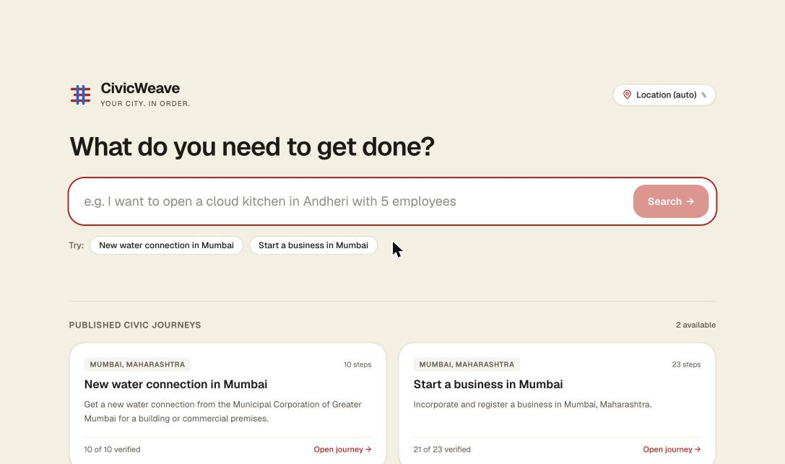
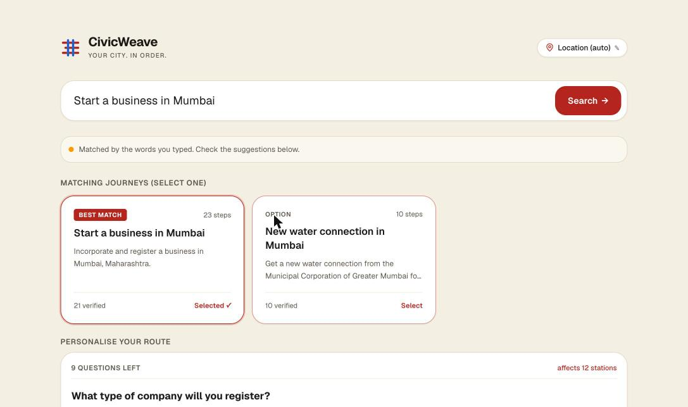

# CivicWeave

**Your city. In order.** Describe a civic task in plain language and get the whole procedure as a roadmap: every step, office, form, fee and timeline, the order they happen in (including which steps can run in parallel), and a link to the official government source for each one.

Built for **PSWB 02, Municipal Bureaucracy Path Visualizer** (Internal Hackathon 2026-27, Computer Engineering Department, Web category). The repository is named `DamnSon`; the product is CivicWeave.

[Live site](https://damn-son.vercel.app) · [Product requirements](docs/prd/CivicWeave-PRD.md) · [Problem statement](docs/ps.md)



## The problem

Getting something done in a city, such as registering a business or getting a water connection, means working across a dozen disconnected government websites. Nothing tells you what you need first, which steps can happen at the same time, or whether the page you found is the official one.

## What it does

- **Natural-language search.** Type "start a business in Mumbai" and the search matches it to a published journey. Journeys also carry Hindi and Marathi keywords. If the AI service is slow or unavailable, a keyword fallback answers instead, and the page says so.
- **Personalised route.** A few questions ("What type of company will you register?") add or remove steps. Excluded steps are removed with their prerequisites bridged to their dependents, so the order stays correct.
- **Order and parallelism computed, not drawn by hand.** The journey is a dependency graph. `analyzeGraph()` checks it for cycles and broken references, then derives the order and the layers of steps that can run in parallel.
- **Official sources only.** Every step cites its source, checked by `isOfficialUrl()` (gov.in, nic.in and a short vetted list). Missing or unofficial sources are shown as such. Unverified steps are labelled **unverified**, and fees that vary are listed separately and never guessed.
- **Progress tracking.** Mark steps done and the remaining steps, fees and time update. State persists in the browser, and a journey can be shared by link or printed as a checklist.
- **3D and 2D views.** A "Civic Metro" scene built with React Three Fiber, with an accessible React Flow flowchart as the 2D view and the no-WebGL fallback.



## Published journeys

| Journey | Steps | Verified against an official page |
|---|---|---|
| Start a business in Mumbai | 23 | 21 |
| New water connection in Mumbai | 10 | 10 |

They are composed from 14 reusable approval modules (MCA SPICe+, GST, Udyam, FSSAI, EPFO, ESIC, Maharashtra Shops & Establishments, professional tax, DSC, founder KYC, trademark, DPIIT recognition, bank account, and the MCGM new water connection). Real data lives in `data/seed/`; synthetic data for tests lives in `data/fixtures/` and is never served in production. The new water connection journey uses a dataset of MCGM ward offices ([ADR 0002](docs/adr/0002-mcgm-ward-office-dataset.md)).

## How it is built

```text
Browser ── Next.js 16 app (App Router, React 19, Tailwind 4)
             ├─ 3D scene (React Three Fiber) / 2D flowchart (React Flow)
             ├─ lib/graph: schema, analyzeGraph, resolvePath, progress, share state
             └─ /api/v1 route handlers (search, copilot, templates, feedback, admin, health)
                  ├─ Prisma 7 + Postgres (Supabase)        persistence, drafts, audit log
                  ├─ data/seed                              verified journey modules and templates
                  └─ services/intelligence (Python)         intent matching, retrieval, cited copilot
```

- **One contract.** The graph contract (`schemaVersion: 3`) is a JSON Schema with a zod mirror. A test checks that Ajv and zod accept and reject exactly the same documents. Steps are a union on `kind`, sources live on the module, and any concrete fee or numeric threshold must cite a source.
- **Whole-graph saves.** Editing one step can create a cycle, so the admin API saves a whole module as a draft and re-validates it. Publishing is a separate human-approved step, so nothing reaches a citizen unreviewed.
- **Frontend rules.** Per-frame values (camera position, animation time) live in refs and `useFrame`, never in React or Zustand state. The 3D canvas and React Flow load with `next/dynamic` and `ssr: false`.
- **Evaluation sets.** `data/eval/` holds labelled sets for intent matching, jurisdiction and the copilot.

### Tech stack

| Layer | Tools |
|---|---|
| Web | Next.js 16 (App Router, Turbopack), React 19, TypeScript 5.9, Tailwind CSS 4, shadcn/ui, Geist |
| 3D and 2D | three, React Three Fiber, drei, postprocessing; React Flow (`@xyflow/react`) |
| State and validation | Zustand (persisted progress), zod 4, Ajv (dev, conformance tests) |
| Motion | motion; GSAP for the intro and landing timelines only |
| Data | Prisma 7, PostgreSQL on Supabase (pgvector for retrieval) |
| AI service | Python service in `services/intelligence` (intent, retrieval, validation, guards, evals), Gemini embeddings |
| Quality | ESLint 9, Vitest, Playwright (end-to-end and accessibility), GitHub Actions CI |

## Run it locally

Requires Node.js 24 LTS (minimum 22.12) and npm 11.20 or later.

```bash
git clone https://github.com/Gurpreet-pixel-hue/DamnSon.git
cd DamnSon
npm install
cp .env.example .env.local   # fill in the values you need
npm run dev                  # http://localhost:3000
```

With `DATA_SOURCE=files` the app reads journeys from `data/seed/` and needs no database. Add Supabase and `DATABASE_URL` / `DIRECT_URL` to use the database-backed routes.

| Command | What it does |
|---|---|
| `npm run verify` | Lint, type-check, unit tests and a production build, the same gate CI runs |
| `npm test` | Vitest unit and contract tests |
| `npm run e2e` | Playwright end-to-end and accessibility tests |
| `npm run validate:seed` | Validate every seed file against the graph contract |
| `npm run db:migrate` / `npm run seed` | Apply migrations and load seed data |
| `npm run grant-admin` | Grant a user the admin role |

## Project layout

```text
app/            routes: landing, /journey/[taskId] (+ print), /admin, /api/v1/*
components/     canvas (3D), graph-2d, hud, shell, landing, intro, ui (shadcn)
lib/            graph logic, contract, server code, stores
services/       intelligence (Python AI service)
data/           seed (verified), fixtures (synthetic), eval, gazetteer, offices, sources
prisma/         schema and migrations
e2e/            Playwright specs
docs/           PRD, problem statement, tech stack, frontend spec, ADRs, graph schema
```

## Status

- **Built:** landing and natural-language search, journey resolution and personalisation, the 3D and 2D views, progress tracking, share and print, the `/api/v1` routes, two verified journeys, CI and end-to-end tests.
- **In progress:** the admin authoring UI (the admin API exists; the page is a placeholder pending FE-7) and further journeys.
- **Out of scope for the hackathon:** citizen accounts and sync, Hindi and Marathi UI strings, and copilot streaming. See [PRD §2.2](docs/prd/CivicWeave-PRD.md).

## Team

| | |
|---|---|
| **Gurpreet** | All frontend: the app shell, 3D and 2D views, landing and intro, HUD |
| **Divvye** | Platform and API |
| **Jai** | AI service |
| **Pruthviraj** | Data, verification and evaluation |

## Contributing

`main` holds reviewed, working code only and changes arrive by pull request. Read the [PRD](docs/prd/CivicWeave-PRD.md) engineering rules (§13) first. Civic data must come from an official page, and fees, form numbers, timelines and URLs are never invented. AI-agent rules are in [AGENTS.md](AGENTS.md).

## Documentation

[Product requirements](docs/prd/CivicWeave-PRD.md) · [Problem statement](docs/ps.md) · [Tech stack and rules](docs/techstack.md) · [Repository structure](docs/structure.md) · [Frontend spec](docs/frontend-spec.md) · [Visual direction](docs/visual-direction.md) · [Graph data contract](docs/graph-data-schema.json) · [Example graph](docs/examples/example-graph.json) · [Architecture decisions](docs/adr)
