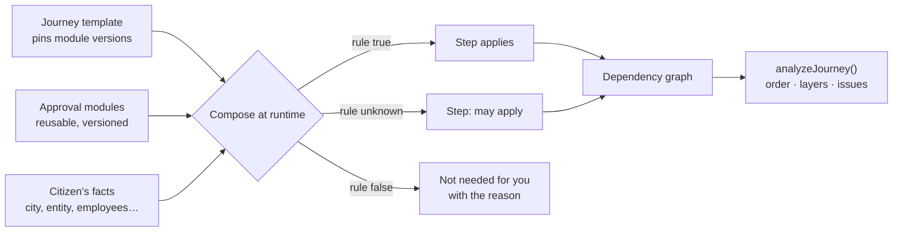
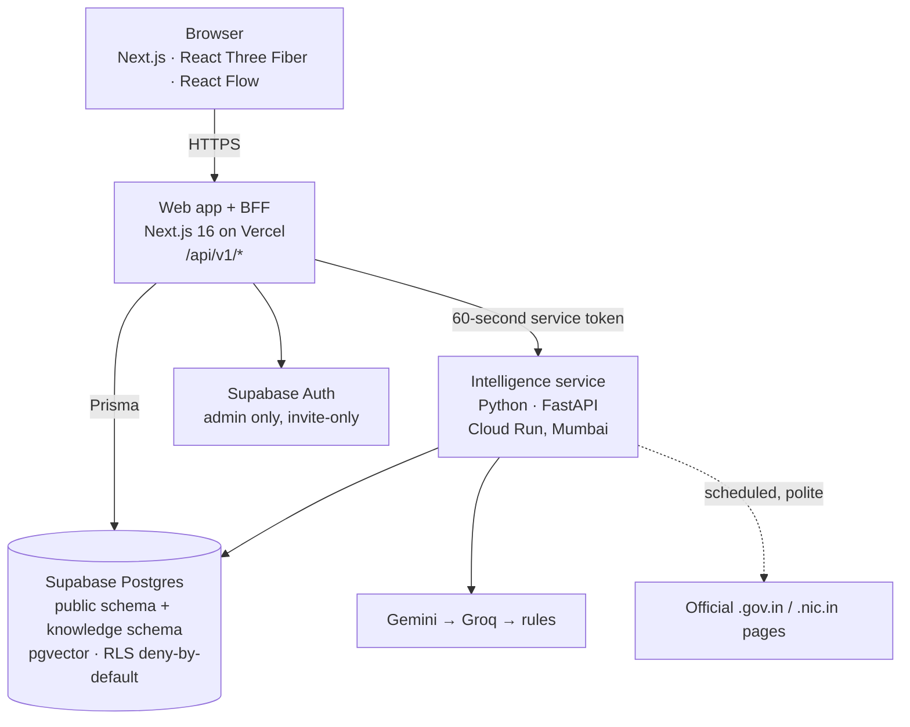
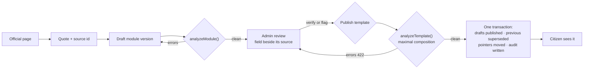
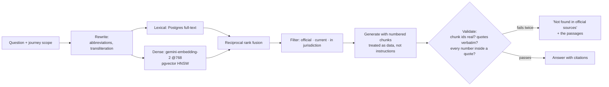
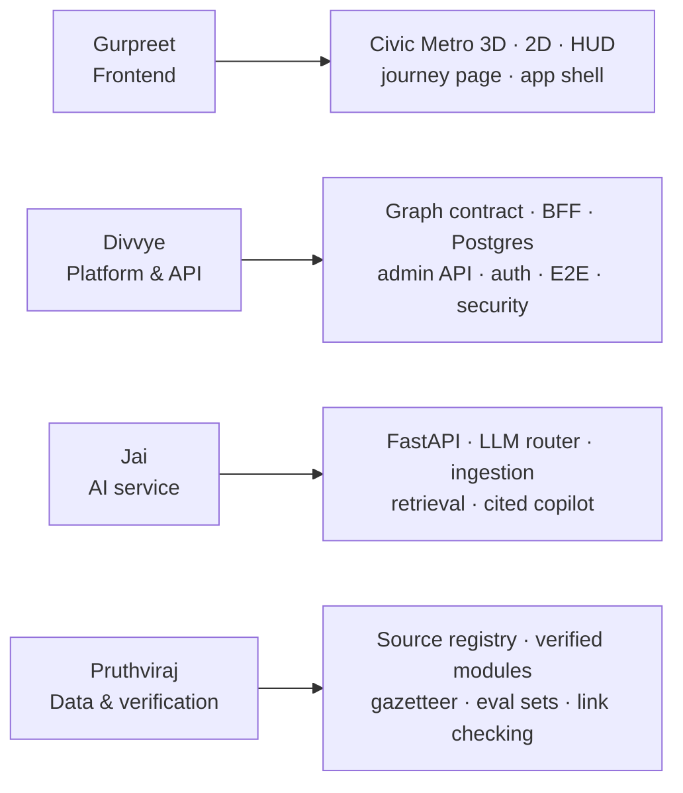

# Prompt 2 — Slide deck

Build a presentation deck for **CivicWeave**, a project for the **internal hackathon of the Computer
Engineering Department**. Audience: faculty judges and peers. Target 10 minutes of speaking, about
24 slides. Use the briefing document from the NotebookLM prompt as the content source, and the images
in `docs/ppt-assets/screenshots/` as the visuals.

## Hard requirements

**Slide 1 must contain, exactly:**

- Team name: **damnson control**
- Project: **CivicWeave — Municipal Bureaucracy Path Visualizer (PSWB 02)**
- For the **internal hackathon of the Computer Engineering Department**
- Members, with division and roll number:
  - Divvye Kansara — C2 — 2403080
  - Pruthviraj Kachate — C2 — 2403075
  - Jai Kukreja — C2 — 2403090
  - Gurpreet Sandhu — C2 — 2403143

**Every slide after the first carries a small speaker tag in the corner** — the person who built that
part presents it. The tags are in the outline below. Nobody presents someone else's work.

**Never put an invented civic fact on a slide.** Every fee, timeline, form number and URL must come
from the sources. Where the real data says "not verified", show that — it is a deliberate design
decision and a selling point, not a gap to paper over.

**Do not claim anything as working that is not.** Mark in-progress work plainly.

## Deck outline

| # | Slide | Speaker | Content and visuals |
|---|---|---|---|
| 1 | Title | all | As specified above |
| 2 | One citizen, one goal, twelve doors | Pruthviraj | The SaaS-company-in-Mumbai scenario. List the authorities actually involved (MCA, GSTN, MH Labour, MAHAGST, EPFO, ESIC, MSME, DPIIT, IP India, FSSAI). One line each on what the citizen does not know: what comes first, what blocks what, which documents repeat |
| 3 | The real pain points | Pruthviraj | Hidden prerequisites · unknown ordering · the same document demanded repeatedly · repeat office visits · three tiers of government with different vocabulary and update cycles · no single authoritative view. Keep it concrete |
| 4 | Why today's answers fail | Pruthviraj | Search engines rank blogs above portals; agents charge for what is public; generic chatbots invent fees, form numbers and URLs. State the consequence: a citizen cannot tell a correct answer from a confident one |
| 5 | What CivicWeave is | Gurpreet | One sentence, then the product line: "Every citizen can see the complete, official path to a government service before taking the first step." Screenshot `01-landing.png` |
| 6 | What makes it different (1) — traceable, not chatty | Divvye | Every fact carries its source URL, authority, retrieval date and verification state. "Official" is a code-level predicate: https on `.gov.in`/`.nic.in` only, never a `.gov` string check. Unknown values render "not verified" rather than a guess. Screenshot `07-not-verified.png` |
| 7 | What makes it different (2) — the graph is computed | Divvye | Journeys are composed at runtime from reusable approval modules plus the citizen's facts. Three-valued logic: an unknown fact yields "may apply", never a silent exclusion. Status, order, layers, positions and totals are derived, never stored. Diagram: **Mermaid A** |
| 8 | What makes it different (3) — a human gate | Divvye | AI understands, algorithms decide, humans verify. Nothing reaches a citizen without an admin publishing it; publishing validates the whole graph first. Screenshot `08-admin-review.png` |
| 9 | Solution walkthrough — say it in one sentence | Gurpreet | Plain-language query to structured facts, with only the questions that change the graph |
| 10 | Solution walkthrough — the Civic Metro | Gurpreet | Left-to-right is dependency order; each column is one layer, so parallel steps sit side by side. Station shape comes from the office type; online steps are kiosks. Screenshot `02-journey-3d.png` (full bleed) |
| 11 | Solution walkthrough — one step, fully sourced | Gurpreet | Authority, documents, fee, three-part timeline, "Apply here", verification badge, official link. Screenshot `04-step-drawer.png` |
| 12 | Solution walkthrough — change a fact, the map rebuilds | Gurpreet + Pruthviraj | Switching business type to food service adds the FSSAI branch live. Note the three FSSAI paths render as "may apply" with their turnover bands, because no turnover fact exists to decide between them. Screenshot `06-fssai-flip.png` |
| 13 | Beyond business — the municipal tier | Pruthviraj | MCGM new water connection, 11 steps, in-person and online mixed, timings quoted from ward RTI manuals. Screenshot `13-municipal-journey.png` |
| 14 | Architecture | Divvye | Three deployables and what each owns. Diagram: **Mermaid B** |
| 15 | The graph contract | Divvye | Approval modules and journey templates; composition with bridging when a step is excluded; the analyzer's error codes; publish-time validation of the maximal composition. Diagram: **Mermaid C** |
| 16 | Data: how a fact becomes a step | Pruthviraj | Official page → quote → field → source id → analyzer → human verification. Every fee and threshold carries a `sourceRef` and a verbatim quote or it is stored as unknown. Screenshot `12-link-check.png` |
| 17 | AI: answers that can be checked | Jai | Hybrid retrieval over official pages, then generation, then a validator that rejects any claim whose quote is not verbatim in a retrieved chunk. Two repair attempts, then "not found in official sources". Diagram: **Mermaid D** |
| 18 | AI: what happens when things break | Jai | Gemini → Groq → rule matcher; service down → lexical fallback for search and an honest refusal for the copilot; database down → read-only from files. The product degrades, it does not lie |
| 19 | Frontend: drawing a city that stays honest | Gurpreet | Layout from the graph's layers; instanced geometry per office archetype; batched tracks; a performance budget; the 2D view uses the same layout so switching never feels like a different app. Screenshot `03-journey-2d.png` |
| 20 | Tech stack | Divvye | Table, grouped by layer, exact pinned versions. Diagram optional: **Mermaid E** |
| 21 | Feasibility — what actually runs | Divvye | Only verified numbers: 14 approval modules and 2 journey templates of real verified data; 23 action steps on the business journey, 21 verified; 11 versioned API endpoints; 45 test files; row-level security proven to deny the browser key; 49 of 52 official links reachable, the other 3 bot-blocked and confirmed live by hand. Mark the AI service and production deploy as in progress |
| 22 | Challenges and what we did (1) | Gurpreet + Divvye | Gurpreet: keeping a 3D scene inside a draw-call budget while every interaction still works in 2D and by keyboard. Divvye: publishing safely — immutable published content, one draft per module, compare-and-swap on save so two admins cannot overwrite each other, and a seed loader that must never undo a publish |
| 23 | Challenges and what we did (2) | Jai + Pruthviraj | Jai: stopping a model inventing a fee — structured output plus a citation validator, and answering in the question's language while citing English sources. Pruthviraj: official portals that block scripts, and pages that publish no fee at all — captured text for the first, "unknown" for the second, never a guess |
| 24 | Impact and benefits | Pruthviraj + Gurpreet | Citizens: fewer wasted visits, no missed prerequisite, a path they can verify themselves. Staff: a correction reaches every citizen at once. Cities: a new city is new data, not new code. Name the honest limits too |
| 25 | What's next | Divvye | Deployment, the remaining AI integration, more procedures, a second city by data alone, officer proposals |
| 26 | References | — | **Last slide only.** Every official source used, grouped by authority, plus standards and tools. Say that every civic claim in the deck traces to one of these |

## Diagrams

Render each as a clean image and place it on its slide. Export to `docs/ppt-assets/diagrams/`.

**Mermaid A — composition**

**Mermaid B — architecture**

**Mermaid C — publishing and the human gate**

**Mermaid D — a cited answer**

**Mermaid E — who built what** (optional, good on the tech-stack slide)

## Style

- Light, civic, serious. Not a startup pitch deck.
- One idea per slide. Short lines, no paragraphs. The speaker carries the detail.
- Screenshots large — the product is the argument. Full bleed on slides 10 and 13.
- Indian number formatting for currency (₹1,00,000).
- Where a number appears, it must be traceable to a source in the briefing.
- If a screenshot listed in `docs/ppt-assets/README.md` does not exist yet, leave the slot empty and
  note what is missing. Do not substitute a mock-up.
