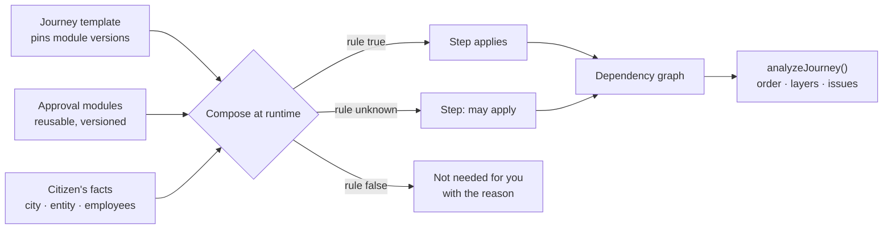
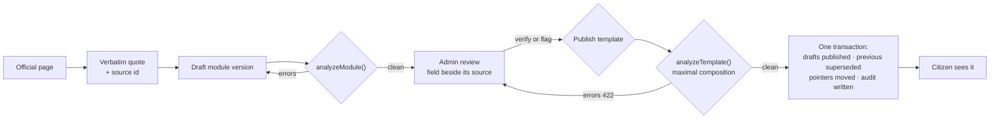
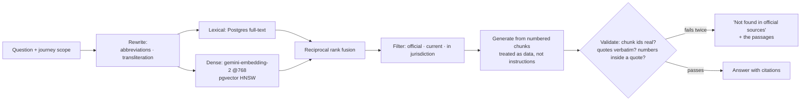

# Prompt 2 — Slide deck

Build a presentation deck for **CivicWeave**, a project for the **internal hackathon of the Computer
Engineering Department**. Audience: faculty judges and peers. **Exactly 18 slides**, about 10 minutes of
speaking. Use the briefing from the NotebookLM prompt as the content source and the images in
`docs/ppt-assets/screenshots/` as the visuals.

## Hard requirements

**Slide 1 — title — must contain, exactly:**

- Team name: **damnson control**
- Project: **CivicWeave — Municipal Bureaucracy Path Visualizer (PSWB 02)**
- For the **internal hackathon of the Computer Engineering Department**
- Members, with division and roll number:
  - Divvye Kansara — C2 — 2403080
  - Pruthviraj Kachate — C2 — 2403075
  - Jai Kukreja — C2 — 2403090
  - Gurpreet Sandhu — C2 — 2403143

**Slide 18 — references — is the last slide and the only place references appear.**

**Every slide from 2 to 17 carries a small speaker tag in the corner.** The person who built that part
presents it. Tags are fixed in the outline below; nobody presents someone else's work.

**Never put an invented civic fact on a slide.** Every fee, timeline, form number and URL comes from the
sources. Where the real data says "not verified", show that — it is a deliberate design decision and a
selling point, not a gap to paper over.

**Do not present anything as working that is not.** In-progress work is marked plainly.

## The 18 slides

| # | Slide | Speaker | Content and visuals |
|---|---|---|---|
| 1 | Title | — | Exactly as specified above |
| 2 | One citizen, one goal, twelve doors | Pruthviraj | "I want to start a SaaS company in Mumbai." Name the authorities actually involved — MCA, GSTN, MH Labour, MAHAGST, EPFO, ESIC, MSME, DPIIT, IP India, FSSAI — then the four things the citizen cannot find out: what comes first, what blocks what, which documents repeat, and how long it really takes. Keep it concrete, no adjectives |
| 3 | Why today's answers fail | Pruthviraj | Search ranks blogs above portals; agents charge for what is public; generic chatbots invent fees, form numbers and URLs. Land the consequence: **a citizen cannot tell a correct answer from a confident one** |
| 4 | What CivicWeave is | Gurpreet | One line — "Every citizen can see the complete, official path to a government service before taking the first step" — then what it is not: not a chatbot, not a list of links. Screenshot `01-landing.png` |
| 5 | Three ideas that make it different | Divvye | (a) **Traceable** — every fact carries its source, authority, date and verification state; "official" is a code-level predicate over https `.gov.in`/`.nic.in`, never a `.gov` string check; unknown renders "not verified". (b) **Computed** — the journey is composed at runtime from reusable modules plus the citizen's facts, with three-valued logic so an unknown fact shows "may apply" rather than vanishing. (c) **Human-gated** — AI understands, algorithms decide, humans verify. Diagram: **Mermaid A** |
| 6 | Say it in one sentence | Gurpreet | Plain language in, structured facts out, and only the questions that actually change the graph get asked. Show the fact card |
| 7 | See the whole route | Gurpreet | The Civic Metro: left to right is dependency order, each column is one layer so parallel steps sit side by side, station shape comes from the office type, online steps are kiosks. Screenshot `02-journey-3d.png`, **full bleed** |
| 8 | Open one step | Gurpreet | Authority, documents, fee, the three-part timeline, "Apply here", verification badge and the official link. Then the honesty: a field with no published figure shows "not verified". Screenshots `04-step-drawer.png` and `07-not-verified.png` |
| 9 | Change a fact, the map rebuilds | Pruthviraj | Switch business type to food and the FSSAI branch appears live. Note that its three paths render as "may apply" with their turnover bands, because no turnover fact exists to choose between them — the product says what it does not know. Then: the same engine, a different tier — MCGM new water connection, 11 steps, timings quoted from ward RTI manuals. Screenshots `06-fssai-flip.png`, `13-municipal-journey.png` |
| 10 | How it is built | Divvye | Three deployables and what each owns; the browser never calls an LLM or a government site. Diagram: **Mermaid B** |
| 11 | The contract, and the gate before a citizen | Divvye | Approval modules and journey templates; composition bridges around an excluded step so order survives; the analyzer rejects cycles, unsourced fees and verified-without-official-source; publishing validates the maximal composition inside one transaction and writes an audit row. Diagram: **Mermaid C**. Screenshot `08-admin-review.png` |
| 12 | How a fact becomes a step | Pruthviraj | Official page → verbatim quote → field → source id → analyzer → human verification on the live page. Every fee and threshold carries a `sourceRef` and a quote, or it is stored as unknown. Mention what this cost: portals that block scripts, and pages that publish no fee at all. Screenshot `12-link-check.png` |
| 13 | Answers that can be checked | Jai | Hybrid retrieval over official pages, generation with numbered chunks treated as data, then a validator that rejects any claim whose quote is not verbatim in a retrieved chunk — two repairs, then "not found in official sources". Add the degradation ladder in one line: Gemini → Groq → rules; service down → lexical search and an honest refusal; database down → read-only from files. Diagram: **Mermaid D** |
| 14 | The stack, and why each piece | Gurpreet | Table grouped by layer with exact pinned versions. One line each on the three choices worth defending: React Three Fiber with instanced geometry inside a draw-call budget; the 2D view reusing the same layout so switching never feels like a different app; one Postgres with pgvector instead of a separate vector database. Screenshot `03-journey-2d.png` |
| 15 | What actually runs today | Divvye | Only verified numbers: **14 approval modules and 2 journey templates** of real verified data; **23 action steps** on the business journey, **21 verified**; **11 versioned API endpoints**; **45 test files**; row-level security proven to deny the browser key while the database holds rows; **49 of 52 official links reachable**, the other 3 bot-blocked and confirmed live by hand. Mark the AI service and the production deploy as in progress. Screenshots `09-api-health.png`, `10-rls-denied.png` |
| 16 | What was hard, and what we did | all four | Four quadrants, each person speaks their own. **Gurpreet:** holding a 3D city inside a draw-call budget while every interaction still works in 2D and by keyboard. **Divvye:** publishing safely — published content immutable, one draft per module, compare-and-swap on save so two admins cannot overwrite each other, and a seed loader that must never undo a publish. **Jai:** stopping a model inventing a fee — structured output plus a citation validator, and answering in the question's language while citing English sources. **Pruthviraj:** official portals that block scripts, and pages that publish no fee at all — captured text for the first, "unknown" for the second, never a guess |
| 17 | Who it helps | Pruthviraj + Gurpreet | Citizens: fewer wasted visits, no missed prerequisite, a path they can verify themselves. Staff: one correction reaches every citizen at once. Cities: a new city is new data, not new code. End with the honest limits — coverage is two procedures today, and CivicWeave never submits or pays on anyone's behalf. Screenshot `05-summary-bar.png` |
| 18 | Research and references | — | **Last slide, and the only references slide.** Every official source grouped by authority (MCA, GSTN, MH Labour, MAHAGST, EPFO, ESIC, MSME/Udyam, DPIIT, IP India, FSSAI, MCGM), then standards and tools. Close with one line: every civic claim in this deck traces to one of these |

**Speaking order.** Slides are grouped into speaker blocks so the deck runs with five handoffs rather
than eight. Run them in this sequence: Pruthviraj sets up the problem (2 to 3), Gurpreet shows the
product (4, 6, 7, 8 and 14 on the stack), Divvye explains how it is computed and served (5, 10, 11, 15),
Jai covers what AI adds (13), Pruthviraj proves the data is real (9, 12), all four take a quadrant on 16,
and 17 closes. If you renumber the slides to match that sequence, keep the speaker tags with their
content, not with the numbers.

## Diagrams

Render each cleanly and place it on its slide. Export to `docs/ppt-assets/diagrams/`.

**Mermaid A — composition (slide 5)**

**Mermaid B — architecture (slide 10)**

**Mermaid C — publishing and the human gate (slide 11)**

**Mermaid D — a cited answer (slide 13)**

## Style

- Light, civic, serious. Not a startup pitch deck.
- One idea per slide. Short lines, no paragraphs — the speaker carries the detail.
- Screenshots large; the product is the argument. Slide 7 is full bleed.
- Indian number formatting for currency (₹1,00,000).
- Every number on a slide must be traceable to a source in the briefing.
- If a screenshot listed in `docs/ppt-assets/README.md` does not exist yet, leave the slot empty and note
  what is missing. **Do not substitute a mock-up** — the deck must not show something the demo cannot do.
