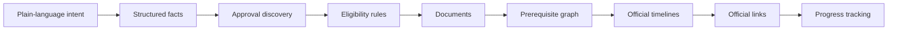
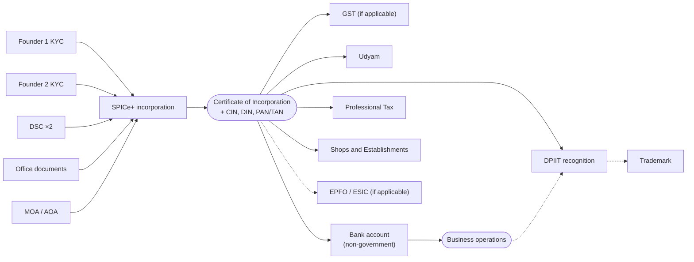
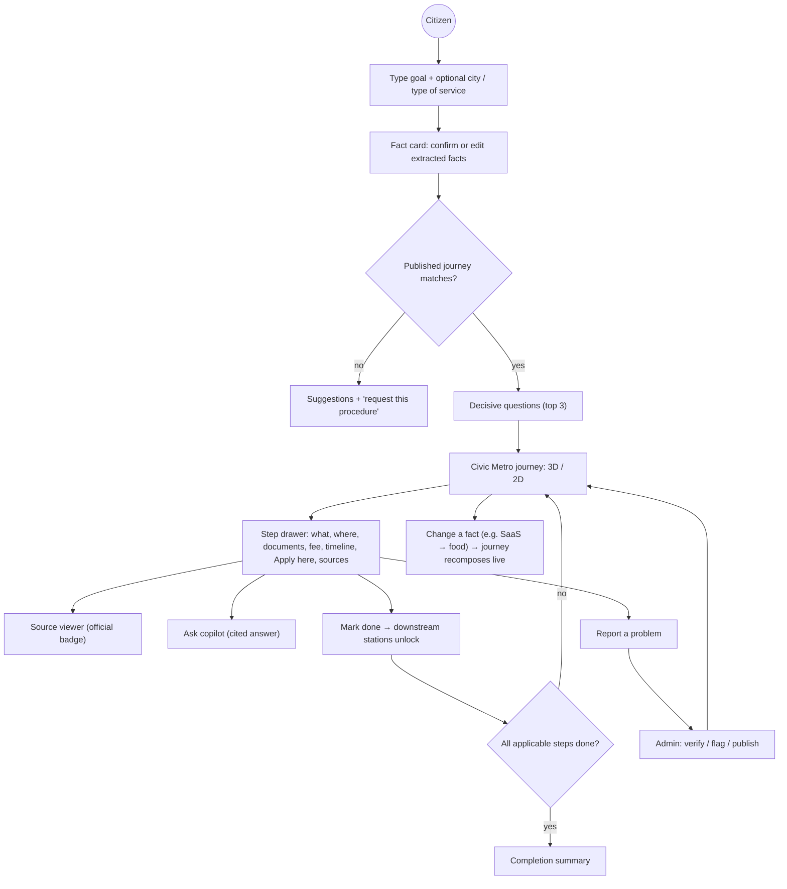
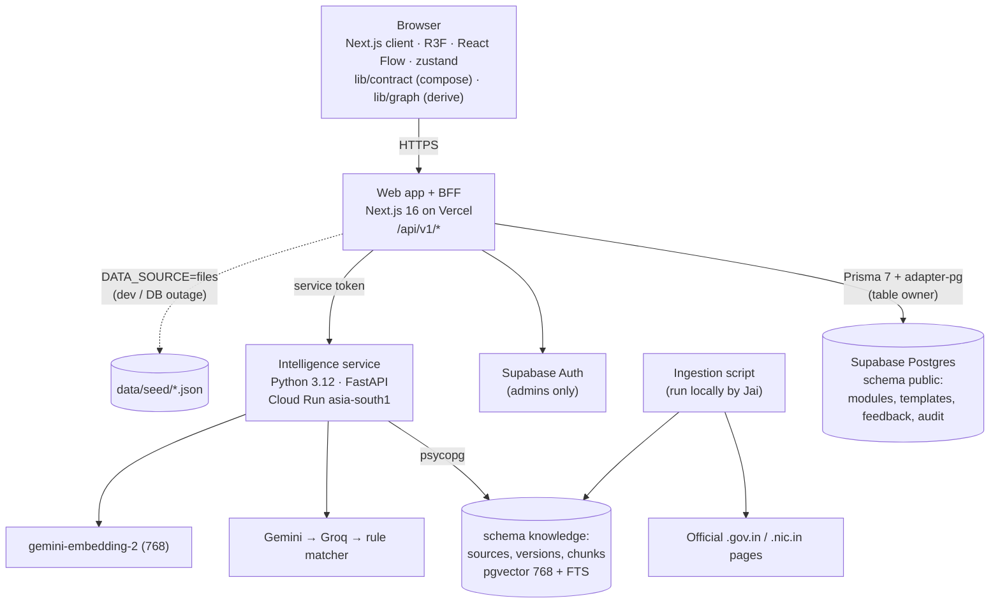
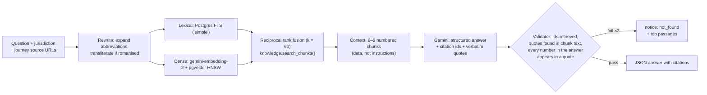
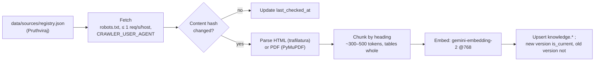

# CivicWeave: Product Requirements Document

**Weaving fragmented government services into one clear civic journey**

| | |
|---|---|
| Problem statement | **PSWB 02 · Municipal Bureaucracy Path Visualizer** · Internal Hackathon 2026-27, Computer Engineering Department, Web category |
| Product / repo | CivicWeave / `DamnSon` (`github.com/Gurpreet-pixel-hue/DamnSon`, one repository) |
| Version, date | **1.3.0** · 2026-09-28 (supersedes 1.2.0; changes in "What changed in 1.3") |
| Team | **Gurpreet**: all frontend · **Divvye**: platform and API · **Jai**: AI service · **Pruthviraj**: data, verification and evaluation |
| Status | **Single source of truth.** The graph contract (§8, Appendix D), API contracts (§10, Appendix F) and database (Appendix A) are normative. Change control is in §13.3 |

## What changed in 1.3

The latency budgets between the web BFF and the intelligence service, and one milestone-status rule (Class C, §13.3; approved by Gurpreet 2026-09-28). Found in Divvye's review of PL-4/PL-6: §6.6 gave the BFF 6 s for every call, while §7.2 gave the copilot's LLM calls 15 s plus up to 2 repairs. Every real copilot answer would have returned 503.

| # | Area | 1.2 said | 1.3 says | Why |
|---|---|---|---|---|
| 1 | **Search budget** | BFF waits 6 s; the service's per-call timeout is 8 s | BFF still waits **6 s**, then serves `lexical_fallback`. The service finishes the whole search flow within **5 s**: an intent call of at most **4 s**, then the rule matcher on timeout | The service's own timeout has to fit inside the BFF's, or the fallback fires on working answers |
| 2 | **Copilot budget** | BFF waits 6 s (§6.6); 15 s per call and ≤ 2 repairs (§7.2, §7.4) | Copilot gets its own budget. **BFF waits 25 s** (route `maxDuration = 30`). The service has a **22 s hard deadline**: retrieval ≤ 3 s, generation ≤ 12 s, **at most 1 repair** of ≤ 8 s. At the deadline it returns the safe fallback (`not_found` plus the top 3 passages); it never hangs | A cited answer needs retrieval plus generation and sometimes a repair, which can't fit in 6 s. Vercel functions on every plan run up to 300 s, so 30 s is safe |
| 3 | **Copilot panel** | "The panel says so" on 503 | The panel shows progress ("Searching official sources…", then "Writing a cited answer…"), aborts the request when closed, and shows the 503 message only after 25 s | A 10–20 s answer must not look broken |
| 4 | **Milestone status (§8.8)** | `done` when every prerequisite that isn't `may_apply` is done | ...**and at least one prerequisite is done** | With no answers, every prerequisite of "Company incorporated" is `may_apply`, so the old rule marked it done before the citizen had done anything (found on the real start-business-mumbai data) |

## What changed in 1.2

Frontend experience only. Contracts, APIs, database and data rules are unchanged.

| # | Area | 1.1 said | 1.2 says | Why |
|---|---|---|---|---|
| 1 | **Journey page layout** | Full-screen canvas with floating HUD panels (`frontend-spec.md` "HUD") | An **app shell**: the 3D scene sits in a framed window, with the top bar and summary tiles above it, a left rail, and a docked right drawer. The 2D panel and trip plan sit below the window. Parameters are in `docs/visual-direction.md` §9.1 | Matches the reference composition the team agreed on; every later milestone has a fixed slot |
| 2 | **Intro sequence** | Not specified | A skippable kinetic-typography intro on `/` (first visit per session, ≤ 4.5 s, DOM/SVG only). It doubles as the preloader for the 3D chunk and models. **P1**, in FE-5. Spec in `visual-direction.md` §9.2 | A memorable first impression that also hides load time |
| 3 | **Landing → journey transition** | Not specified | Search, fact card and questions on the landing, then a ≤ 2.4 s transition: the query moves into the top bar, the city rises and the camera lands on the route. **P1**, in FE-5. Reduced motion skips it. Spec in §9.3–9.4 | Connects typing a sentence to seeing the route |
| 4 | Design system | Dark civic theme (§11.6) | Light civic theme per `visual-direction.md` (already built in FE-1V) | §11.6 was out of date |
| 5 | Stack | `motion` for animation | `motion` for UI micro-interactions. **`gsap` 3.15.0** (Standard no-charge licence: SplitText, ScrambleText, DrawSVG, Flip) only for the intro and landing timelines, loaded with `next/dynamic` on `/` | Timeline sequencing and text splitting for the intro |

## What changed in 1.1 (read this first)

Version 1.0 was a strong product design. Version 1.1 keeps that design and fixes what would have broken the build or the team. Every code block in Appendices A, D, E and F was executed before publishing: zod 4.6.5 + Ajv 8.20 conformance, Prisma 7.10.0's schema validator, and the SQL on Postgres with pgvector (PGlite).

| # | Area | 1.0 said | 1.1 says | Why |
|---|---|---|---|---|
| 1 | **Graph contract** | Modules and templates, labelled `schemaVersion: 2` | Same design, labelled **`schemaVersion: 3`**. Adds a composed-journey type for rendering and a migration path from the repo's v2 | The repo already has a different `schemaVersion: 2` (flat graph + yes/no questions) with M1 logic and tests built on it. Two incompatible "v2"s would silently break seed files, fixtures and stores |
| 2 | Contract details | Step fields shared by every kind. `conditional` could have neither rule nor question. Sources per step | Steps are a union on `kind` (milestones carry no fee, timeline or office). Sources live on the module and steps reference them by id. Concrete fees must cite a source. Numeric thresholds must cite a source. A fact registry types every rule | Makes invalid data unrepresentable and enforces "never invent civic data" in code, not only in review |
| 3 | Composition | "Drop links to excluded modules" | Excluded steps are removed **with bridging** (prerequisites connect to dependents), skipping redundant tracks | Dropping links loses order. Bridging is what the repo's M1 `resolvePath` already does and tests |
| 4 | **Prisma schema** | v6 syntax, one-line blocks and enums | Prisma **7.10.0** syntax (URLs in `prisma.config.ts`, `@prisma/adapter-pg`, `prisma-client` generator) | The 1.0 schema fails validation (8 errors). Prisma 7 also rejects `url` / `directUrl` in schema files. npm's `latest` tag for `prisma` currently points to an 8.0 release candidate while `@prisma/client` is 7.10.0, so unpinned installs mismatch |
| 5 | Vectors and search | Chunks in Prisma, `vector(1024)`, trigram on chunk text | Knowledge tables in a separate `knowledge` schema that Prisma doesn't manage. `vector(768)`. Hybrid search fixed | Prisma can't express HNSW indexes or generated tsvector columns, so its migration diffs would treat them as drift. The 1.0 `lex` query had `LIMIT` without `ORDER BY` (top-k not guaranteed), and `%` trigram similarity against long chunks practically never matches |
| 6 | **Embeddings** | BGE-M3 self-hosted in the Cloud Run service | **`gemini-embedding-2` at 768 dimensions** in the hackathon, BGE-M3 later | Removes PyTorch and a ~2 GB model from the container. Gemini Embedding 2 is multilingual (100+ languages); the eval set checks Hindi and Marathi retrieval |
| 7 | Supabase keys | `anon` and `service_role` keys | **Publishable** and **secret** keys. The secret key never goes to Vercel | Supabase is deprecating the legacy keys by the end of 2026. The web app doesn't need the secret key at runtime |
| 8 | Database access in the hackathon | RLS policies per role, `SET LOCAL role` per transaction | RLS **on, with no policies** (deny-all for the Data API). The BFF reads and writes as the table owner through Prisma | The browser never queries tables. Per-role policies are for citizen sync, which is post-hackathon |
| 9 | Team | 5 roles | **4 people**: Gurpreet does 100% of frontend. Backend is split across Divvye, Jai and Pruthviraj | Actual team |
| 10 | Scope | Everything ✅ in 48 h | Priorities **P0 / P1 / P2** and an explicit cut order. List mode, Hindi/Marathi UI strings, admin MFA, copilot streaming, Redis and Turnstile move to P2 or later | One frontend developer can't build 1.0's full ✅ list in 48 h. Multilingual **input and answers** stay (backend-driven) |
| 11 | Copilot transport | SSE streaming | JSON response in the hackathon, streaming later | Citations are validated after generation, so streaming unvalidated tokens contradicts the design. JSON is simpler on both sides |
| 12 | Orchestration | LangGraph required | Plain async functions allowed in the hackathon. LangGraph when the extraction pipeline needs interrupts | Same node boundaries, less to learn in 48 h |
| 13 | Git | Contract changes flow `backend` → `frontend` | Contract changes go through a PR **to `main`**, reviewed by one frontend and one backend person. Both branches then merge `main` | Merging `backend` into `frontend` would drag unfinished backend work into the UI branch |
| 14 | Repository | "No repository is needed; Appendix B replaces every file" | The repo exists (M0 scaffold + M1 journey logic on `frontend`). Appendix B documents how it was built. **Don't re-run it** | Re-bootstrapping would overwrite tested work |
| 15 | Frontend spec | PRD §11 and `docs/frontend-spec.md` disagreed (phones → list mode vs laptop-first, 50 vs 30 draw calls) | `frontend-spec.md` stays normative for Civic Metro parameters. §11 lists the v3 deltas | Decided earlier: laptop-only demo |
| 16 | Civic data notes | Shops & Establishments "1 day" as one step | Flag for the data lane: Maharashtra's 2017 Act separates **intimation (under 10 workers)** from **registration (10 or more)**. EPF/ESI thresholds now sit under the **Code on Social Security, 2020** (in force since 21 Nov 2025) | Both change what the SaaS demo shows. Both must still be verified on official pages |
| 17 | Event name | "Smart India Hackathon 2026 (internal round)" | "Internal Hackathon 2026-27" | The problem-statement PDF doesn't mention SIH. Put it back if the event is the SIH internal round |

## Instructions for AI agents (read first)

To any AI agent (Antigravity, Claude Code, Gemini CLI, Copilot, Cursor, Codex) working on CivicWeave:

1. **This PRD is the source of truth.** Read §13 (engineering rules), §15 (who owns what) and the sections for your task before planning.
2. **Check every request against the PRD.** A request **conflicts** if it breaks an invariant (§13.1), changes a fixed area (graph contract, API contracts, database, folder ownership, branch rules), adds or upgrades a dependency outside §13.4, uses an excluded technology (§7.7), skips a human approval gate (§6.4), or builds a P2/Later item (§2.2) before the P0 path works.
3. **On a conflict, stop and ask the user.** State what was asked, the PRD section it conflicts with, and the options: (a) follow the PRD, (b) change the PRD first, (c) a compliant alternative. Wait for an explicit choice. Never deviate silently.
4. **Never invent civic data.** No fees, form numbers, timelines, thresholds, addresses or URLs that aren't on an official page. Show "not verified" instead.
5. **Stay in your lane's folders** (§13.2). Shared contract files change only through a PR to `main` (§14).
6. Reference PRD section numbers in plans, commits and PR descriptions.

## Repository state on 2026-09-26

| Branch | Contains |
|---|---|
| `main` | Docs and agent rules only (M0 phase 1) |
| `frontend` | M0 scaffold (Next.js 16.3.6, R3F, React Flow, shadcn, strict TS, Vitest) + M1 journey logic on the **v2** flat graph (`resolvePath`, states, totals, critical path, trips, layout, share state, repository, search) + M1.1 fixes in progress |
| `backend` | Not created yet |

**Before H0:** merge `frontend` → `main` by PR (baseline), then create `backend` from `main` (§15.1).

## Contents

1. [Problem and vision](#1-problem-and-vision)
2. [Scope, priorities and the cut line](#2-scope-priorities-and-the-cut-line)
3. [Reference case study: SaaS company in Mumbai](#3-reference-case-study-saas-company-in-mumbai)
4. [Users and journeys](#4-users-and-journeys)
5. [Features and requirements](#5-features-and-requirements)
6. [Architecture](#6-architecture)
7. [AI and ML](#7-ai-and-ml)
8. [Data model and graph engine (contract v3)](#8-data-model-and-graph-engine-contract-v3)
9. [Knowledge ingestion and real data](#9-knowledge-ingestion-and-real-data)
10. [APIs, auth and state](#10-apis-auth-and-state)
11. [Frontend: Civic Metro](#11-frontend-civic-metro)
12. [Security and testing](#12-security-and-testing)
13. [Engineering rules and tech stack](#13-engineering-rules-and-tech-stack)
14. [Git and branching](#14-git-and-branching)
15. [48-hour plan for four people](#15-48-hour-plan-for-four-people)
16. [After the hackathon, risks and decisions](#16-after-the-hackathon-risks-and-decisions)
17. [Appendix A. Database](#appendix-a-database)
18. [Appendix B. Setup (as built, plus backend additions)](#appendix-b-setup-as-built-plus-backend-additions)
19. [Appendix C. Agent rule files](#appendix-c-agent-rule-files)
20. [Appendix D. Graph contract v3: code, fixtures and expected values](#appendix-d-graph-contract-v3-code-fixtures-and-expected-values)
21. [Appendix E. Seed data format](#appendix-e-seed-data-format)
22. [Appendix F. API contracts](#appendix-f-api-contracts)

---

## 1. Problem and vision

### 1.1 Problem statement (verbatim)

> **Description:** Users describe a civic task (e.g., "register a small business"), and the tool scrapes/aggregates fragmented government websites to auto-generate a visual step-by-step dependency graph of forms, offices, and prerequisites — since this info is usually scattered across dozens of disconnected .gov pages.
>
> **Expected Solution:** A web-based Civic Task Navigator that helps citizens understand and complete complex government procedures through a simple, user-friendly interface. Users can enter a civic task in natural language, such as "I want to register a small business," along with relevant details such as location and type of service. The system gathers information from official government websites and intelligently extracts important details such as required forms, documents, departments, offices, eligibility criteria, fees, prerequisites, and application links. It then identifies dependencies between these requirements and presents them as an interactive, step-by-step visual roadmap, allowing users to clearly understand what needs to be done, in what order, and where to complete each step. Each step will provide links to the corresponding official government source for verification, while users can track completed tasks and monitor their progress. An administrative dashboard can also be provided to review, validate, and update extracted government information, making the platform a centralized and reliable guide for navigating fragmented civic services.

Indian government sites use `.gov.in` and `.nic.in`, not `.gov`. CivicWeave defines **official** as `https` on `.gov.in`, `.nic.in` or a manually vetted exception list (`isOfficialUrl()`, Appendix D).

### 1.2 Why it's hard

One goal crosses **central, state and municipal** bodies, each with its own portal, vocabulary and update cycle. Citizens face hidden prerequisites, confusing legal language, unknown approval order, duplicate document submission and repeated office visits. Blogs and agents fill the gap, sometimes wrongly. Generic chatbots invent fees and URLs.

### 1.3 Vision and product definition

> Every citizen can see the complete, official path to a government service before taking the first step.

CivicWeave is **not a chatbot that lists government websites**. It is a **traceable, dependency-aware civic roadmap**:



### 1.4 Principles

| # | Principle | In practice |
|---|---|---|
| P1 | **Official or explicitly not** | Every fact shows its source. Unknown values say "not verified". Nothing is guessed. The schema rejects a concrete fee, SLA or threshold without a source reference |
| P2 | **AI understands, algorithms decide, humans verify** | The LLM parses and explains. Code computes order and applicability. Admins verify before publishing |
| P3 | **Derive, don't store** | Status, order, layers, positions, totals and the critical path are computed at runtime |
| P4 | **2D is first-class** | Everything works in 2D with a keyboard and screen reader. 3D adds spatial understanding |
| P5 | **Municipality-agnostic by data** | A new city is new data, not new code |
| P6 | **Private by default** | No login needed. Progress and facts stay on the device |

---

## 2. Scope, priorities and the cut line

### 2.1 Goals, non-goals, success metrics

| Goal (demo) | Target |
|---|---|
| Correct procedure found from plain language | ≥ 90% top-1 on the demo query set (30 queries, §7.6) |
| Steps in demo journeys verified against an official source | 100% of P0 journey steps |
| Search → rendered journey (warm) | ≤ 2.5 s p95 |
| Copilot answers grounded with citations | ≥ 0.90 groundedness on 15 questions; "not found" on ≥ 4 of 5 unanswerable ones |
| Civic Metro 3D with 25 steps | 60 fps on a MacBook Air-class laptop, ≤ 30 draw calls target, 50 hard limit |
| Accessibility (2D) | Keyboard complete, axe clean on the journey page, Lighthouse accessibility ≥ 90 |

**Non-goals:** submitting applications or paying fees for users, legal advice, replacing official portals, live application status, scraping behind logins or CAPTCHAs, storing Aadhaar numbers, autonomous AI agents that take actions.

**North Star (after the hackathon):** verified steps completed per week.

### 2.2 Priorities and cut line

> [!IMPORTANT]
> 48 hours, four people, one frontend developer. **P0** is the demo path and is built first by everyone. **P1** makes the demo complete. **P2** is built only when P0 and P1 are green at a checkpoint. **Later** is designed, not built.

| Area | P0 (demo path) | P1 (complete demo) | P2 (stretch) | Later |
|---|---|---|---|---|
| Data | `start-business-mumbai` template + SaaS modules + FSSAI branch, verified | 1 municipal procedure, verified. Eval sets | MCGM health licence module for the food branch | More cities and procedures |
| Contract | v3 schema, rules, composition, analysis (Appendix D) | | | Property-based tests |
| Frontend | Search box → fact card (with lexical-fallback notice). Journey page: Civic Metro 3D + same-layout 2D, decisive questions, step drawer (official links, review state), mark done → unlock, summary bar, app shell | Landing extras (published journeys, continue card), intro sequence, landing → journey transition, timeline panel, document checklist, source viewer, copilot panel, admin UI (verify / flag / publish / audit), undo toast, WebGL fallback | Trip plan, print checklist, Hindi/Marathi UI strings | List mode, offline PWA, bookmarks, saved journeys, Department Explorer |
| API | `/templates`, `/templates/{id}`, `/health`, `/search` with lexical fallback | `/copilot`, `/feedback`, admin API | `/sources/excerpt` | `/me/*` sync, runs API, `/api/v2` |
| AI | Fact + intent extraction (EN, HI, MR, Hinglish), jurisdiction, template ranking | Copilot RAG with citations + validator, eval script | Prompt caching | Extraction pipeline, Review Briefs, reranker, Bhashini, semantic cache, MCP |
| Ingestion | One script: registry → fetch → chunk → embed → pgvector | | Snapshots in Supabase Storage | Scheduler, change detection, OCR |
| Admin | | Email + password sign-in (invite-only), verify / flag, publish with validation, audit log | TOTP MFA | Review queue, diffs, two-person approval, officer proposals |
| Ops | Vercel + Supabase, CI (`verify`) | Cloud Run for the AI service, E2E happy path | Uptime check | Langfuse, alerts |

### 2.3 Demo scope

1. **Lead journey: "Start a SaaS company in Mumbai"** (§3). Facts come from one sentence. The system asks only questions that change the map.
2. **Live branch:** change the business type to food service and the FSSAI branch appears. Change employees from 7 to 12 and Shops & Establishments switches from intimation to registration (once verified, §3.6).
3. **One municipal procedure** (proposed: water connection name transfer), to show the municipal tier and in-person offices.
4. Every demo step is verified against its official page. Judges will click the links.

---

## 3. Reference case study: SaaS company in Mumbai

This case study is the design reference for data, rules, timelines and the demo. It is the problem statement's own example ("register a small business") worked through in full.

> [!WARNING]
> Timelines below come from the case study, which cites official material. Each is **re-verified by Pruthviraj on the live official page before the demo** and shown as "not verified" until then. The case study gives no fees, so fees stay `unknown` until researched.

### 3.1 Scenario

*"I want to start a SaaS/software company in Mumbai with two founders and five employees."* Assumptions: Private Limited company, 2 founders/directors, Mumbai (Maharashtra), IT/SaaS, 5 employees, rented office, no food / manufacturing / pharma activity, intends DPIIT recognition, Udyam registration and trademark.

### 3.2 Official websites (initial source registry)

| Authority | Role | URL |
|---|---|---|
| National Single Window System | Approval discovery ("Know Your Approvals") | https://www.nsws.gov.in/ |
| Ministry of Corporate Affairs | Incorporation, SPICe+, DIN, PAN/TAN | https://www.mca.gov.in/ |
| GST Portal | GST registration | https://www.gst.gov.in/ |
| CBIC | GST rules, FAQs | https://cbic-gst.gov.in/ |
| Maharashtra Labour Department | Shops and Establishments | https://labour.maharashtra.gov.in/en/services |
| MAHAGST | Professional Tax | https://www.mahagst.gov.in/ |
| Udyam Registration | MSME registration | https://udyamregistration.gov.in/ |
| Startup India | DPIIT recognition | https://www.startupindia.gov.in/ |
| EPFO | Provident fund | https://www.epfindia.gov.in/ |
| ESIC | Employee State Insurance | https://www.esic.gov.in/ |
| IP India | Trademark | https://ipindia.gov.in/ |
| FSSAI | Food registration / licence (conditional) | https://www.fssai.gov.in/ |
| Controller of Certifying Authorities | Digital signatures | https://cca.gov.in/ |
| MCGM (municipal procedure, food branch P2) | Municipal services | https://portal.mcgm.gov.in/ |

### 3.3 Approval matrix

| Approval | Authority / portal | Key inputs | Depends on | Timeline (case study) | Timeline type |
|---|---|---|---|---|---|
| Company incorporation | MCA / SPICe+ | Founder KYC, DSC, MOA/AOA, office proof | Incorporation documents | No universal fixed SLA | `no_fixed_sla` |
| PAN / TAN | MCA–Income Tax integration | Supplied during incorporation | Incorporation | Integrated | output of SPICe+ |
| GST | GSTN / GST portal | PAN, business and address details, signatory | GST applicability | ≤ 3 working days if straightforward. Longer with physical verification | `sla` + conditional |
| Shops and Establishments | MH Labour / Aaple Sarkar | Establishment details | Worker count (§3.6) | 1 day | `sla` |
| Professional Tax (PTRC) | MH State Tax / MAHAGST | Employer and employee details | Payroll applicability | Use official state info | `unknown` until sourced |
| EPFO | EPFO portal | Employer, establishment | Statutory applicability (rule-based) | Online workflow | `unknown` until sourced |
| ESIC | ESIC portal | Employer, employees | Statutory applicability | Online, real-time | `sla` (to verify) |
| Udyam | Ministry of MSME | Aadhaar/PAN-linked, self-declaration | MSME eligibility | Paperless, no uploads | `sla` (to verify) |
| DPIIT recognition | DPIIT / Startup India | Certificate of Incorporation, innovation description | Company exists | ~2 working days | `sla` |
| Trademark | IP India | Application details | Brand decision | No fixed total. Examination, objections, 4-month opposition | `no_fixed_sla` + conditional |
| FSSAI (food only) | FSSAI | Food business details | Food business | Registration ~7 days. Inspection within 30 days if required. Licence up to 60 days | `sla` + conditional |

**Documents:** founder PAN, identity proof and address proof (**per founder**), DSC, MOA, AOA, registered office proof, utility bill, owner NOC, rent agreement, Certificate of Incorporation, innovation description, authorised signatory details.

### 3.4 Dependency graph

Solid = hard prerequisite (`requires`). Dashed = recommended order (`recommended_after`).



### 3.5 What the case study requires of the product

| Requirement | Where |
|---|---|
| Extract facts (location, business type, entity, founders, employees, office type) from one sentence, confirm with the user | F2, §8.3 |
| Ask **only questions that change the graph** | F3, §8.6 |
| Activate relevant approvals only. Changing SaaS → food adds FSSAI live | F3, §8.5 |
| Show authority, documents, prerequisites, timeline, official link on each node | F4 |
| **Three-part timeline:** official SLA, conditional timeline, dependency time (never one "processing time" field) | F7, §8.8 |
| Official sources first. Search engines and guides for discovery only. Every fact keeps its source URL, authority, title and retrieval date | §9 |
| Demo roadmap: idea → clarification → discovery → graph → documents → timeline → verification → progress | §15.6 |

### 3.6 Data notes for the data lane (verify before modelling)

These came up while reviewing the case study. They are **leads, not facts**: each must be confirmed on the official page before it enters seed data.

| Topic | Lead | Where to verify | How to model |
|---|---|---|---|
| Shops and Establishments | The Maharashtra Shops and Establishments (Regulation of Employment and Conditions of Service) Act, 2017 separates establishments with **fewer than 10 workers** (online **intimation**, Form F under the 2018 Rules) from those with **10 or more** (registration) | labour.maharashtra.gov.in (Act, Rules, service pages) | One module, two conditional steps on `employees.count` with `sourceRef`, both leading to the same follow-up step. The fixture `ex-local` in Appendix D shows the shape |
| EPFO / ESIC thresholds | The four labour codes came into force on **21 Nov 2025**; the Code on Social Security, 2020 now carries EPF and ESI coverage. Use thresholds as stated on EPFO / ESIC / Ministry of Labour pages today, not the pre-2025 Acts | epfindia.gov.in, esic.gov.in, labour.gov.in | Until quoted: `conditional` with `activation: null` ("may apply"). Then an activation rule with the quoted threshold and `sourceRef` |
| DSC | Digital signature certificates are issued by licensed Certifying Authorities, regulated by CCA | cca.gov.in | `non_government` step, CCA page as the source |
| Food branch, municipal tier | MCGM issues a health licence under Section 394 of the MMC Act for eating houses, applied through the Common Business Application on portal.mcgm.gov.in | portal.mcgm.gov.in (health licence instructions) | P2 module `mcgm-health-licence`, activation = food business |

---

## 4. Users and journeys

### 4.1 Personas

| Persona | Goal | Key needs |
|---|---|---|
| **Entrepreneur (lead): "Arjun", SaaS co-founder** | Incorporate and complete every applicable registration in order | Fact card, per-founder documents, parallel steps after incorporation, SLA vs conditional delays |
| Entrepreneur variant: "Ayesha", cloud kitchen | Same, with food permissions | FSSAI branch, municipal permissions |
| Citizen: "Rahul", property tax mutation | Fewest office visits | Office card, carry list, legal terms explained |
| Student: "Aditya", certificates for a scholarship | Meet a deadline, Marathi | Timeline, Marathi queries and answers |
| Senior citizen: "Shanta", water connection transfer | Simple steps, family help | Large text, printable summary |
| Admin: "Nikhil" | Publish accurate journeys fast | Source beside field, one-click verify, validation on save, audit |
| Municipal officer: "Sunita" (later) | Correct outdated info, see bottlenecks | Propose changes, upload circulars, analytics |

### 4.2 Master user workflow



### 4.3 Key journeys (acceptance level)

| Journey | Must be true |
|---|---|
| Search | Ambiguous query → ≤ 2 clarifications. No city → ask, never assume Mumbai. Zero results → suggestions + request |
| Generation | Composed journey passes `analyzeJourney()` or shows an error state. Unknown conditions show "may apply", never silently hidden |
| Completion | Marking done re-derives status instantly. Undo for 8 s. Out-of-order completion allowed with a confirmation |
| Office visit | In-person steps show office, address, hours ("not verified" where missing) |
| Copilot | Answers only from retrieved official text with citations, otherwise "not found in official sources" |
| Admin approval | Verify requires an official source. Save re-validates the module. Publish re-validates the maximal composition. Stale base → 409 |

---

## 5. Features and requirements

| ID | Feature | Must do | Priority | Owner (UI / API) |
|---|---|---|---|---|
| F1 | Landing | Search above the fold. Published journeys. "Continue" card for in-progress journeys | P1 | Gurpreet / Divvye |
| F2 | Search | 3–300 chars in **English, Hindi or Marathi**, native script or romanised, or mixed (Hinglish). Optional city and type of service. Autocomplete from titles and keywords. Extracted **facts** shown in an editable card with the words they came from | P0 (EN) · P1 (HI, MR) | Gurpreet / Divvye + Jai |
| F3 | Journey composition | Composes from template + modules + facts (§8.5). Asks only decisive questions. Recomposes live on fact change and highlights added and removed steps | P0 | Gurpreet (client) / contract |
| F4 | Step drawer | What (title, forms, documents), order (prerequisites, parallel steps), where (portal or office). **Apply here** link. Outputs. Kind badge (government, non-government, milestone). Review state. "Why is this locked?" | P0 | Gurpreet |
| F5 | 3D view | Civic Metro (§11, `frontend-spec.md`) | P0 | Gurpreet |
| F6 | 2D view | Same layout drawn flat. Keyboard and screen-reader path. Automatic fallback without WebGL | P0 | Gurpreet |
| F7 | Timeline | Official SLA solid, conditional timelines hatched with their condition, dependency waits labelled. "No fixed SLA" is open-ended and later steps are shown relative to it | P1 | Gurpreet |
| F8 | Progress | Stored: facts and completed step ids only. Status, remaining fees and time derived | P0 | Gurpreet |
| F9 | Documents | Deduplicated checklist across steps with "used in N steps", per-person documents ×founders, "you get this from step X" | P1 (print P2) | Gurpreet |
| F10 | Copilot | Scoped to the journey. Answers in the language of the question with citations to the original official source. Refuses out-of-scope. Never states unsourced fees or URLs | P1 | Gurpreet / Divvye + Jai |
| F11 | Source viewer | Official badge only if `isOfficialUrl()`. Retrieved and last-checked dates. Stored excerpt | P1 (excerpt P2) | Gurpreet / Divvye |
| F12 | Admin | Sign-in (invite-only). Modules and steps with sources beside fields. Verify (needs an official source) or flag (needs a note). Publish with validation. Audit log | P1 (MFA P2) | Gurpreet / Divvye |
| F13 | Feedback | "Report a problem" per step. "Request a procedure" | P1 | Gurpreet / Divvye |
| F14 | Analytics, offline, bookmarks, saved journeys, Department Explorer, list mode | Designed. Privacy-first | Later | |

---

## 6. Architecture

### 6.1 Containers



- **Deployables:** Vercel (web + BFF), one Cloud Run service (AI), one Supabase project per environment (`dev`, `demo`). Redis is not used in the hackathon.
- The browser never calls LLMs, Supabase tables or government sites directly.
- **One database, two schemas.** `public` is managed by Prisma migrations (Divvye). `knowledge` is plain SQL owned by the AI lane (Jai), added to the same migration history as a hand-written migration (Appendix A.4). Prisma only diffs `public`, so pgvector columns, HNSW indexes and generated `tsvector` columns never appear as drift.

### 6.2 Repository layout (one repo, AI included)

```text
DamnSon/
├── app/                        pages: /, /journey/[taskId], /admin, /checklist (P2)   [Gurpreet]
│   └── api/v1/                 route handlers (BFF)                                     [Divvye]
├── components/                 ui/ (shadcn only), explorer/, canvas/, graph-2d/, hud/,
│                               timeline/, documents/, copilot/, admin/                  [Gurpreet]
├── lib/
│   ├── contract/               SHARED: facts, schema, rules, compose, analyze, api,
│   │                           officialSources                                           [joint: PR to main]
│   ├── graph/                  derivations for the UI: states, totals, timeline, trips,
│   │                           layout, documents, shareState, viewModel                  [Gurpreet]
│   ├── store/                  zustand: useTaskStore, useViewStore                       [Gurpreet]
│   └── server/                 "server-only": db client, journeys repository, auth guards,
│                               rate limit, intelligence client, errors                   [Divvye]
├── data/
│   ├── seed/modules/*.json     verified approval modules (real data only)                [Pruthviraj]
│   ├── seed/templates/*.json   verified journey templates                                [Pruthviraj]
│   ├── sources/registry.json   ingestion source registry                                 [Pruthviraj]
│   ├── gazetteer/*.json        place names and aliases (EN/HI/MR)                         [Pruthviraj]
│   ├── eval/*.jsonl            evaluation sets                                            [Pruthviraj]
│   └── fixtures/               synthetic, test-only (v3/, legacy v2 until M1.3)           [owner of the test]
├── prisma/                     schema.prisma + migrations (public + knowledge)           [Divvye; knowledge SQL: Jai]
├── scripts/                    seed.ts, validate-seed.ts, contract-schemas.ts, grant-admin.ts [Divvye]
├── services/intelligence/      Python AI service                                         [Jai]
│   └── src/civicweave_ai/      api/ llm/ search/ copilot/ retrieval/ ingestion/ guards/ prompts/ evals/
├── docs/                       prd/, contract/ (generated JSON Schemas + facts.json), frontend-spec.md, adr/
├── proxy.ts                    Next.js 16 proxy: request id, Supabase session refresh     [Divvye]
├── prisma.config.ts            Prisma 7 CLI config                                        [Divvye]
└── .github/workflows/ci.yml    one CI for both runtimes                                   [Divvye]
```

### 6.3 Request flow

Browser → Vercel → `proxy.ts` (request id, Supabase session refresh on `/admin` and `/api/v1/admin`) → route handler → JSON parse (400 `invalid_json`) → zod validation (400 `invalid_request`) → rate limit (429) → auth/role check (401/403) → service in `lib/server` → Postgres / intelligence service → contract validation of any module or template read or written → JSON response with `requestId`. Errors use the envelope in Appendix F. Stack traces are never returned.

### 6.4 Human-in-the-loop gates

| Gate | Human | Enforced by |
|---|---|---|
| Any content change → citizen-facing | Admin reviews and publishes | Publish requires the admin role and a passing `analyzeTemplate()` |
| Mark a step verified | Admin or data lane | `VERIFIED_WITHOUT_OFFICIAL_SOURCE` is an error |
| New crawl source | Data lane lists the host in `data/sources/registry.json` | Ingestion fetches only registry URLs. Non-official hosts are stored `is_official = false` and never retrieved for answers |
| AI draft for an unmatched query (later) | Citizen sees an "AI draft, not verified" card | UI |
| Applying and paying | Citizen, on the official portal | CivicWeave never submits anything |

### 6.5 Service token (BFF → intelligence)

`Authorization: Bearer <exp>.<sig>` where `exp` is Unix seconds (now + 60) and `sig` = lowercase hex HMAC-SHA256 of the ASCII string `exp` with `INTERNAL_SERVICE_SECRET`. The service accepts when `now ≤ exp ≤ now + 120` and the signature matches in constant time. Both sides ship a unit test using the same fixed secret, `exp` and expected signature.

### 6.6 Degradation

| Failure | Behaviour |
|---|---|
| Intelligence service down, or `/search` > 6 s, or `/copilot` > 25 s (1.3) | `/search` returns `mode: "lexical_fallback"`: token scoring over published template titles and keywords (the M1 `searchTasks` rules), no facts. `/copilot` returns 503 `upstream_unavailable`; the panel says so. Journeys, progress and sources keep working. The service keeps inside these budgets itself (§7.2), so a working answer never trips the fallback |
| Gemini down or rate-limited | Router falls back to Groq, then to the rule matcher (search) or to the top 3 passages (copilot) |
| Database down | Set `DATA_SOURCE=files` and redeploy: journeys are served read-only from `data/seed`. Admin and feedback return 503 |
| WebGL missing or context lost | Switch to 2D with a one-line notice |

---

## 7. AI and ML

### 7.1 What AI does (and doesn't)

AI **understands** (intent, facts, location mentions), **retrieves** (official passages), **extracts** (draft steps with evidence, later) and **explains** (cited answers). AI never decides order, officialness, verification or applicability: those are `lib/contract` code and human review.

### 7.2 Models and APIs

| Purpose | Primary | Fallback 1 | Final fallback |
|---|---|---|---|
| Intent + fact extraction | Gemini Flash-class model (AI Studio key; id in `GEMINI_FAST_MODEL`) | Groq (open-weight model; id in `GROQ_FAST_MODEL`) | Rule matcher on titles + keywords, no facts |
| Copilot answers | Gemini Flash-class model | Groq | Top 3 official passages with links |
| Embeddings | **`gemini-embedding-2`, `output_dimensionality = 768`** (documents and queries) | none | Lexical-only retrieval |
| Extraction (later) | Gemini Pro-class | OpenAI GPT-5 class | Queue and retry |
| Evaluation judge (later) | Different model family from the generator | | |
| Translation / transliteration (later) | Bhashini (MeitY) | Gemini | English with a notice |
| Local development | Ollama or LM Studio for **generation only** | | Embeddings always use `gemini-embedding-2`, because vectors from different models can't be mixed |

Rules:
- Model ids live in config (`llm/policy.yaml` + env), never in code. Confirm current ids on ai.google.dev at H0.
- Temperature 0 for extraction and intent, ≤ 0.2 for the copilot. Structured output (JSON schema) for every call.
- **No personal data to LLMs.** Phone numbers, emails, PAN- and Aadhaar-like numbers are redacted before any call. On the Gemini API free tier, Google may use prompts and responses to improve its products and human reviewers may read them, and its terms say not to submit personal information; a billed project turns that off.
- Circuit breaker: 5 failures in 60 s opens it for 30 s.
- **Budgets (1.3):**
  - **Search:** the intent call is at most 4 s, and the whole flow finishes within 5 s (the rule matcher on timeout). The BFF waits 6 s.
  - **Copilot:** 22 s hard deadline. Retrieval ≤ 3 s, generation ≤ 12 s per call, at most 1 repair (≤ 8 s). At the deadline, return the safe fallback. The BFF waits 25 s.
- `gemini-embedding-2` takes task instructions inside the text rather than a `task_type` parameter. Use the prefixes recommended on the embeddings docs page, the same way for every chunk and query, and record them in `embedding_model` (for example `gemini-embedding-2@768/v1`).

**Government APIs:** data.gov.in and the Local Government Directory are later. Most procedure pages have **no API**, so they are fetched politely by the ingestion script (§9).

### 7.3 Retrieval (RAG)



- `knowledge.search_chunks()` (Appendix A.4) filters to official, active, current, in-jurisdiction chunks, optionally scoped to the journey's source URLs.
- **Why hybrid:** exact form codes and acronyms ("Form F", "PTRC") need lexical search; paraphrases and Hindi/Marathi questions need dense search.
- **Why pgvector:** vectors sit next to jurisdiction and version filters in one transactional database.

### 7.4 Orchestration

Three small, code-routed flows. The LLM never picks the next step.
- **Search:** guard → redact → intent + facts (structured output restricted to the fact registry, each fact with the quoted words it came from) → jurisdiction (gazetteer first, then LLM) → rank candidate templates → clarify (≤ 2) or respond.
- **Copilot:** guard → scope check → retrieve → generate → validate (≤ 1 repair, 1.3) → respond or safe fallback, all within the 22 s deadline (§7.2).
- **Extraction (later):** retrieve → extract with evidence → build module → `analyzeModule` → Review Brief → human review.

In the hackathon these may be plain async functions with one function per node. LangGraph 1.x is adopted when the extraction pipeline needs human-in-the-loop interrupts. LangChain is used only if it saves time for prompt templates. Prompts are versioned files in `prompts/`.

### 7.5 Cache

Not in the hackathon. Later: Redis exact cache (query + jurisdiction + revision + prompt version) and semantic cache (cosine ≥ 0.95, same jurisdiction). Only validated answers are cached. Publishing invalidates.

### 7.6 Evaluation

| Metric | Target | Hackathon dataset (real, team-written, `data/eval/`) |
|---|---|---|
| Journey match top-1 | ≥ 0.90 | 30 queries: 10 English, 8 Hindi, 7 Marathi, 5 Hinglish, each with the expected `taskId` and facts |
| Fact extraction exact match | ≥ 0.85 per fact | Same 30 queries |
| Jurisdiction accuracy | ≥ 0.95 | 15 location phrasings |
| Groundedness (claims supported by cited quotes) | ≥ 0.90 | 15 copilot questions with expected source URLs |
| "Not found" on unanswerable questions | ≥ 4 of 5 | 5 questions |

`make eval` in `services/intelligence` prints these numbers before the demo. Report them honestly, including misses.

### 7.7 Deliberately excluded

Multi-agent debate, autonomous browser agents, end-to-end AI decisions, fine-tuned LLMs (rules change, facts must be citable), separate vector databases, pure semantic search, agent "societies" (CrewAI/AutoGen style), ReAct agents, graph databases. **Why:** each adds non-determinism, cost or infrastructure without improving grounded correctness. **MCP** is later, and only as a connector interface, never as a reasoning engine.

---

## 8. Data model and graph engine (contract v3)

### 8.1 Publishing model

Admins publish **approval modules** (reusable: SPICe+, GST, Udyam, FSSAI…) and **journey templates** (for example `start-business-mumbai`) that pin module versions and say **when** each module applies. The citizen's journey is **composed at runtime** from the template, the modules and the citizen's facts. Nothing personal is stored in published data. Composition runs in the browser (instant recomposition when a fact changes) and on the server at publish time (maximal composition must be valid).

### 8.2 Contract v3 at a glance

All shared contract code lives in `lib/contract/` (pure TypeScript, no React, no `fs`). Appendix D has the code; the files below are normative.

| File | Exports | Notes |
|---|---|---|
| `facts.ts` | `FACT_KEYS`, `FACTS` (registry), `Facts`, `parseFacts()`, `isValidFactValue()` | The only personalisation inputs. Unknown keys and invalid values are dropped, never thrown |
| `schema.ts` | `approvalModuleSchema`, `journeyTemplateSchema`, `stepSchema`, `ruleSchema`, … and inferred types | `schemaVersion: 3`. Authoring documents stored as JSONB |
| `rules.ts` | `evaluateRule()` (three-valued), `ruleFacts()`, `checkCondition()` | Kleene logic, §8.4 |
| `compose.ts` | `composeJourney()`, `ComposedJourney`, `ComposedStep`, `ComposedEdge` | The render contract. Derived, never stored |
| `analyze.ts` | `analyzeGraph()`, `analyzeModule()`, `analyzeTemplate()`, `analyzeJourney()` | Issue codes §8.7 |
| `api.ts` | zod schemas for `/api/v1/*` requests and responses | Appendix F |
| `officialSources.ts` | `isOfficialUrl()`, `VETTED_OFFICIAL_HOSTS` | Moved from `lib/graph/`; `lib/graph/officialSources.ts` re-exports it until M1.3 |

Generated, committed artifacts (`npm run contract:schemas`): `docs/contract/approval-module.schema.json`, `docs/contract/journey-template.schema.json` (JSON Schema 2020-12 with named `$defs`, for editor validation of seed files and for Pydantic generation later) and `docs/contract/facts.json` (the registry, read by the Python service).

**Authoring shapes (summary; zod in Appendix D.2 is authoritative):**

| Object | Key fields |
|---|---|
| `ApprovalModule` | `schemaVersion: 3`, `moduleId`, `version`, `title`, `summary`, `authority {slug, name, tier, officialUrl}`, `eligibility[]`, **`sources[]`**, `steps[]` (1–20), `edges[]`, `entrySteps[]`, `exitSteps[]`, `meta` |
| `Step` (union on `kind`) | `government`: `authoritySlug` required. `government` and `non_government`: `department`, `mode`, `officeType`, `office?`, `applicationPortal?`, `forms`, `documents` (with `documentTypeId`, `perPerson?`), `outputs`, `fee`, `timeline`, `repeat?`, **`sourceIds`**, `review`. `milestone`: `id`, `title`, `description`, `requirement` only |
| `requirement` | `mandatory` · `conditional {condition, rule?}` · `optional {note?}` |
| `fee` | `free`, `fixed`, `range` (each **requires `sourceRef`**) · `variable {note, sourceRef?}` · `unknown {note?}` |
| `timeline` | `officialSla`: `sla {duration, sourceRef}` · `no_fixed_sla {note, sourceRef?}` · `unknown`. `conditional[]`: `{condition, rule?, duration: range \| open_ended, sourceRef}` |
| `Edge` | `id`, `from`, `to`, `kind: requires \| recommended_after`, `note?`, `via?` (a `documentTypeId`) |
| `JourneyTemplate` | `schemaVersion: 3`, `taskId`, `revision`, `title`, `summary`, `jurisdiction`, `category`, `keywords` (unique), **`sources[]`** (for activation thresholds), `questions[]` (keyed by `fact`), `modules[] {moduleId, version, requirement, activation: Rule \| null, reason}`, `links[] {id, fromModule, toModule, kind, note?, via?}`, `meta` |

### 8.3 Facts

Facts are the only personalisation inputs. The registry types each key:

| Fact | Type |
|---|---|
| `location.state`, `location.city` | string |
| `business.entity_type` | enum: `private_limited`, `llp`, `opc`, `partnership`, `proprietorship` |
| `business.sector` | enum: `it_saas`, `food_service`, `retail`, `manufacturing`, `services`, `other` |
| `business.serves_food`, `business.imports_or_exports` | boolean |
| `company.founders_count` | integer 1–10 |
| `employees.count` | integer 0–100000 |
| `premises.type` | enum: `rented`, `owned`, `home`, `coworking` |
| `premises.built_up_area_sqm` | number |
| `intent.gst_now`, `intent.udyam`, `intent.dpiit`, `intent.trademark` | boolean |
| `applicant.type` | enum: `owner`, `tenant`, `legal_heir`, `buyer`, `company` |

Adding a fact or an enum value is a Class B change (§13.3). **Thresholds are stored only when quoted from an official source**: a numeric comparison without `sourceRef` is an error (`THRESHOLD_WITHOUT_SOURCE`).

### 8.4 Rules (three-valued)

A rule is `{all: [...]}`, `{any: [...]}`, `{not: …}` or a condition `{fact, op, value?, valueText?, sourceRef?}` with `op` in `eq, neq, gt, gte, lt, lte, in, exists`.

| Case | Result |
|---|---|
| Fact missing or invalid | `unknown` (except `exists`, which is `false`) |
| `all` | `false` if any child is false, else `unknown` if any is unknown, else `true` |
| `any` | `true` if any child is true, else `unknown` if any is unknown, else `false` |
| `not` | swaps true and false, keeps `unknown` |

Static checks at save time: the value type must match the fact's type (`RULE_TYPE_MISMATCH`), enum values must be in the registry, and numeric comparisons need a `sourceRef` that resolves (`THRESHOLD_WITHOUT_SOURCE`, `UNKNOWN_SOURCE_REF`).

### 8.5 Composition (`composeJourney(template, modules, facts, {maximal?})`)

1. **Module state.** `activation` evaluated with §8.4, except: `null` means applies for `mandatory`, optional for `optional`, and **`unknown` ("may apply") for `conditional`** (rule not modelled yet, analyzer warns). A `false` module is listed in `excluded` with its `reason` and the facts its rule reads.
2. **Step state.** `mandatory` → true. `conditional` → its rule (no rule → `unknown`). `optional` → optional. Excluded if the module or the step is false.
3. **Applicability** of a kept step: `optional` if the module or step is optional; else `may_apply` if either is unknown; else `applies`.
4. **Ids and repeats.** Composed id = `<moduleId>.<stepId>`. A step with `repeat {fact, label, max}` becomes copies `<moduleId>.<stepId>.<i>` for `i = 1..n`, where `n` = the fact clamped to `[1, max]`; if the fact is unknown, `n = 1` and the copy has `repeatCountUnknown: true`. Repeated ids always carry the suffix, so progress survives a change from 1 to 2 founders. Titles become `"<title> (<label> <i>)"`.
5. **Documents.** A document with `perPerson {fact, label}` is expanded ×n with keys `<documentTypeId>#<i>`; on a step repeated on the same fact, copy `i` gets only person `i`'s document. Sources are resolved from the module's `sources` by `sourceIds`.
6. **Edges.** Module edges connect copies pairwise (`i → i`) when both ends repeat on the same fact, otherwise every copy to every copy. Template links connect every copy of every exit step of `fromModule` to every copy of every entry step of `toModule`. Duplicate `from → to` pairs keep the first edge and upgrade it to `requires` if any duplicate is `requires`. Composed edge id = `<from>><to>`; `origin` is `module`, `link` or `bridge`.
7. **Removal with bridging.** Excluded steps are removed in build order. Each prerequisite `p` of a removed step connects to each dependent `s` (kind `requires` only if both edges were `requires`), unless `s` is already reachable from `p`, so no redundant track is drawn.
8. **Decisive questions** (§8.6), then return `ComposedJourney {taskId, revision, title, summary, jurisdiction, category, facts, steps, edges, excluded, questions}`.

`maximal: true` (publish-time validation) switches every module and conditional step on with one copy each. A cycle in any composition implies a cycle in the maximal one, so **a template that validates maximally can't produce a cycle for any facts**. Composition is deterministic and independent of the order of the `modules` array.

### 8.6 Decisive questions

For each template question whose fact is unknown, count the kept steps that would change: steps of modules whose activation reads the fact and is `unknown`, steps whose own rule reads it and is `unknown`, and steps repeated on it. Keep questions with a count above 0, sorted by count (descending) then template order. The UI asks the top 3 up front and the rest inline. `answerType` comes from the registry (boolean → yes/no, enum → options, integer/number → number input).

### 8.7 Analysis and issue codes

| Function | Runs on | Blocks |
|---|---|---|
| `analyzeGraph({steps, edges})` | any flat graph | Returns deterministic `order` (Kahn, ties by position) and `layers` (longest path over **all** edges) |
| `analyzeModule(module)` | every save, seed and publish | Graph codes + content codes below |
| `analyzeTemplate(template, modules)` | seed and publish | Template codes + every pinned module + the maximal composition |
| `analyzeJourney(composed)` | every render | Graph codes + `DOC_PRODUCED_BUT_NOT_LINKED` |

| Errors (reject) | Warnings (shown, not blocking) |
|---|---|
| `DUPLICATE_NODE_ID`, `DUPLICATE_EDGE_ID`, `UNKNOWN_NODE_REF`, `SELF_LOOP`, `DUPLICATE_EDGE`, `CYCLE` (lists the steps), `INVERTED_RANGE`, `DUPLICATE_SOURCE_ID`, `UNKNOWN_SOURCE_REF`, `UNKNOWN_ENTRY_EXIT`, `VERIFIED_WITHOUT_OFFICIAL_SOURCE`, `OPTIONAL_PREREQUISITE` (a `requires` edge from an optional step to a non-optional one), `REPEAT_FACT_NOT_INTEGER`, `AUTHORITY_URL_NOT_OFFICIAL`, `RULE_TYPE_MISMATCH`, `THRESHOLD_WITHOUT_SOURCE`, `UNKNOWN_MODULE` (pin missing or wrong version), `DUPLICATE_MODULE`, `MODULE_REQUIREMENT_MISMATCH` (mandatory with an activation), `UNKNOWN_LINK_MODULE`, `DUPLICATE_LINK_ID`, `DUPLICATE_QUESTION_FACT`, `QUESTION_OPTIONS_MISMATCH` | `NO_OFFICIAL_SOURCE` (government step), `UNOFFICIAL_SOURCE`, `CONDITION_WITHOUT_RULE` (step or module), `UNUSED_QUESTION`, `FACT_WITHOUT_QUESTION`, `DOC_PRODUCED_BUT_NOT_LINKED` |

`ok` means no errors. When `ok` is false, `order` and `layers` are `[]`.

### 8.8 Derivations for the UI (`lib/graph`, frontend-owned)

| Derivation | Rule |
|---|---|
| **Order, layers** | From `analyzeJourney()`: all edges count, so recommended order also moves stations right |
| **Status** | `done` if the id is in `completed`; else `available` if every `requires` prerequisite is done or `may_apply` (a "may apply" step never locks others); else `locked`. `recommended_after` never locks. **Milestones are never clicked**: `done` when every `requires` prerequisite that isn't `may_apply` is done **and at least one `requires` prerequisite is done** (1.3), else `locked`. A milestone whose prerequisites are all `may_apply` therefore stays `locked` until one of them is done or a fact makes one apply |
| **Fees remaining** | Skip done, optional and milestone steps. `fixed` and `range` add to min and max for `applies` steps and to max only for `may_apply` steps (`mayApplyCount`). `variable` and `unknown` add to `unconfirmedCount`, never to totals. `annual` recurrence is labelled per year |
| **Time remaining** | Longest path over `requires` edges among not-done, non-optional steps. Per step (calendar days; working days × 7/5 rounded up): `sla` gives `[min, max]`; `no_fixed_sla` gives `[0, 0]` and marks the result open-ended; `unknown` gives 0 and adds to `unknownCount`. Conditional timelines add to max only (to both if their rule is true); `open_ended` marks the result open-ended. `may_apply` steps count 0 toward min. Output `{minDays, maxDays, openEnded, unknownCount, criticalStepIds, relativeTo}` |
| **Relative timeline** | If a not-done `no_fixed_sla` step is on the critical path, `relativeTo` = the last such step, and the timeline also reports the totals with that step and its ancestors treated as done ("DPIIT: 0–2 working days after incorporation") |
| **Documents** | Across `applies` and `may_apply` steps not done: group by document `key`, list the steps that need it ("used in N steps"), and "you'll get this from <step>" when another step outputs it |
| **Office trips** (P2) | Non-online, non-optional action steps grouped by `office.name ?? department`, in order |
| **Layout** | M1 rules unchanged: `x = layer × 7`, lanes by barycenter, `y = 2.2` for `online`, 0 otherwise (milestones on the ground) |
| **Share state** | `?task=<taskId>&f=<base64url(JSON of facts, keys sorted)>&done=<sorted ids, comma>`. Decode with `parseFacts()`; drop ids not in the composed journey |

### 8.9 Migration from the repo's v2 (M1.3, Gurpreet)

| v2 (repo today) | v3 |
|---|---|
| `lib/graph/schema.ts` (`CivicTaskGraph`), `analyzeGraph.ts` | `lib/contract/schema.ts`, `analyze.ts`. Delete the v2 files and fixtures after migration |
| `resolvePath(graph, answers)` | `composeJourney(template, modules, facts)` |
| `answersByTask: Record<task, Record<questionId, boolean>>` | `factsByTask: Record<task, Facts>` |
| `processingTime` | `timeline` (three-part) |
| States `done / available / locked`; undecided steps | Same states + applicability `may_apply` (amber, as "undecided" was) and `optional` |
| `planOfficeTrips`, `computeMetroLayout`, `summarizeFees`, `summarizeTime` | Same names, new input type (`ComposedJourney`), rules in §8.8 |
| Storage `damnson-progress-v1` | `damnson-progress-v2`, `version: 2`. v1 data is dev-only and is discarded |
| `/api/search-path` | `/api/v1/search` (Divvye replaces it) |

### 8.10 Database (Supabase Postgres)

| Schema | Tables (hackathon) | Owner |
|---|---|---|
| `public` (Prisma) | `approval_modules`, `approval_module_versions`, `journey_templates`, `journey_template_revisions`, `feedback`, `audit_log` | Divvye |
| `knowledge` (SQL) | `sources`, `source_versions`, `chunks` + `search_chunks()` | Jai |
| Later | `jurisdictions`, `jurisdiction_aliases`, `authorities`, `offices`, `document_types`, `field_provenance`, `profiles`, `role_assignments`, `user_journeys`, `user_facts`, `review_briefs`, `extraction_runs` | |

Published versions are immutable (trigger), at most one draft per module or template (partial unique index), the audit log is append-only (trigger), and **RLS is enabled on every table with no policies**. Schema and SQL: Appendix A.

---

## 9. Knowledge ingestion and real data

### 9.1 Real-data policy

- Citizen-facing facts come **only** from official sources, verified by a person.
- Search engines, news, guides and datasets are for **discovery only**. Discovery leads (like §3.6) are never copied into seed data without the official page.
- Reference data (place names, codes) comes from official directories (Local Government Directory, data.gov.in).
- Evaluation data is written by the team against real documents.
- Synthetic data only in `data/fixtures/` (tests). Dashboards show empty states, never fake charts.

### 9.2 Hackathon pipeline (one script)



- Registry entries: `{url, title, kind, authoritySlug, jurisdictionLevel, state?, city?, modules: [...]}`. Every module source URL must appear in the registry, so the copilot can scope to a journey's sources.
- `is_official` is computed with the same rule as `isOfficialUrl()`. `status = active` for registry hosts; anything else stays `pending` and is never retrieved.
- Run command: `uv run python -m civicweave_ai.ingestion.run --registry ../../data/sources/registry.json`. Idempotent. Prints a table of sources, versions and chunk counts.
- OCR, schedules and change detection are later.

### 9.3 Freshness (later)

Cloud Scheduler calls the worker hourly; each source has its own interval (circulars 24 h, service pages 7 days, acts 30 days, "check now" immediately). Changes never auto-publish: they create a draft and a Review Brief for a person.

### 9.4 Legal and ethics

Public pages only. Respect `robots.txt` and site terms. No logins, CAPTCHAs or form submission. Attribute every source. Store text only for citation. DPDP Act 2023: no personal data in ingestion.

---

## 10. APIs, auth and state

### 10.1 Endpoints (`/api/v1`, zod contracts in Appendix F)

| Method and path | Purpose | Auth, limits | Priority | Owner |
|---|---|---|---|---|
| `GET /health` | Liveness, data source, DB and AI status | Public | P0 | Divvye |
| `GET /templates?q=&city=` | Published journey summaries (landing, autocomplete, fallback search) | Public | P0 | Divvye |
| `GET /templates/{taskId}` | Published template + its pinned modules (the client composes) | Public, 404 if unpublished | P0 | Divvye |
| `POST /search` | Facts, jurisdiction, ranked matches, clarifications | Public, 20/min per IP hash | P0 | Divvye (BFF) + Jai (`/v1/search`) |
| `POST /copilot` | Cited answer (JSON) | Public, 10/min per IP hash | P1 | Divvye (BFF) + Jai (`/v1/copilot`) |
| `POST /feedback` | Report a problem / request a procedure | Public, 5/min per IP hash | P1 | Divvye |
| `GET /admin/modules` | Modules with published/draft versions and verified/flagged counts | Admin | P1 | Divvye |
| `GET /admin/modules/{id}` | Published and draft content with `contentHash` + `analyzeModule()` result | Admin | P1 | Divvye |
| `PUT /admin/modules/{id}/draft` | Save the whole module `{content, baseHash}`: 200, 409 (stale base), 422 (`invalid_graph` with issues) | Admin | P1 | Divvye |
| `POST /admin/templates/{id}/publish` | `{expectedRevision}`: re-pin every module to its latest version, validate the maximal composition, publish drafts, audit. 200, 409, 422 | Admin | P1 | Divvye |
| `GET /admin/audit?limit=` | Latest audit entries | Admin | P1 | Divvye |
| `GET /sources/excerpt?url=` | Stored text of the current version (source viewer) | Public | P2 | Divvye |
| `/me/*` | Cross-device progress | Citizen | Later | |

Intelligence service (internal, service token, §6.5): `POST /v1/search`, `POST /v1/copilot`, `GET /health`. The BFF sends the published template summaries as `candidates` with each search, so the AI service needs no access to `public` tables.

**Publish semantics.** A module has at most one draft (version = latest + 1). Saving a draft re-validates it with zod + `analyzeModule()`. Publishing a template: load the latest template revision; re-pin every module to its latest version (draft or published); run `analyzeTemplate()`; in one transaction mark those drafts `published` (previous published → `superseded`), insert the new template revision as `published`, move the published pointers and write audit rows (`module.publish`, `template.publish` with before/after hashes). `contentHash` = SHA-256 of the canonical JSON (keys sorted).

### 10.2 Auth and roles

- Guests use everything public without an account.
- **Admins only** sign in during the hackathon: Supabase Auth email + password, public sign-ups disabled, accounts invited by Divvye. TOTP MFA is P2.
- Role lives in `app_metadata.cw_role` (`admin`), set by `scripts/grant-admin.ts`, which runs locally with `SUPABASE_SECRET_KEY`. The secret key is never deployed.
- Server code validates the session with **`supabase.auth.getClaims()`** (verifies the JWT signature), never `getSession()`. `requireAdmin()` in `lib/server/auth.ts` returns 401 without a valid session and 403 without the role.
- `@supabase/ssr` cookies are refreshed in `proxy.ts` for `/admin` and `/api/v1/admin/*` only.
- The browser uses `NEXT_PUBLIC_SUPABASE_PUBLISHABLE_KEY` only for sign-in. With RLS on and no policies, that key can't read any table.

| Action | Guest | Admin |
|---|:-:|:-:|
| Search, view journeys, copilot, feedback | ✅ | ✅ |
| Verify / flag steps, save drafts, publish, read audit | ❌ | ✅ |

### 10.3 State (zustand)

| Store | Holds | Persisted |
|---|---|---|
| `useTaskStore` | `activeTaskId`, `factsByTask`, `completedByTask`, `selectedStepId` | `factsByTask` and `completedByTask` in localStorage `damnson-progress-v2` (`version: 2`, zod-validated on merge and migrate, `skipHydration` + rehydrate in an effect) |
| `useViewStore` | View mode (`3d` / `2d`), focused, hovered and selected step, open panels, critical-path toggle | No |

Derived values (composition, status, totals, timeline, layout) are memoised selectors over `(template revision, facts, completed)`. Per-frame values (camera, animation) live in refs, never in state. Mark done has an 8 s undo toast.

---

## 11. Frontend: Civic Metro

### 11.1 Concept and parameters

**"Civic Metro": a transit map that grows out of the city.** Left to right is time (one column per layer), each step is a station whose building shows where it happens (`officeType`), online steps float as kiosks, dependencies are tracks. **`docs/frontend-spec.md` is normative** for geometry, colours, motion, camera, labels, 2D and HUD parameters. This section lists only what contract v3 changes.

| v3 concept | Civic Metro rendering |
|---|---|
| `applicability: may_apply` | Same as the spec's "undecided": dashed amber outline and amber status ring; counts toward max totals only |
| `applicability: optional` | Thin side spur, never blocks, excluded from totals and the critical path |
| `kind: milestone` | Interchange ring on the ground ("Company incorporated"); auto-completes, no "Mark done" button |
| `kind: non_government` | Neutral kiosk or building with a "non-government" badge (for example the bank account) |
| `edge.kind: recommended_after` | Dashed track; never locks |
| Repeated steps (×founders) | One station per copy, labelled "(Founder 1)", "(Founder 2)"; a "×?" badge when the count is unknown |
| Excluded modules and steps | Not on the map. Listed in "Not needed for you" with the reason and the facts it depends on |
| Fact change | Recompose; removed stations sink, new ones rise (spec's replan motion); added/removed list in a toast |

**View-model boundary.** Canvas and 2D components consume `lib/graph/viewModel.ts` (`StationVM`, `TrackVM`), never the contract types directly. M2 can start on today's v2 data through an adapter and switch to v3 by changing only the adapter.

### 11.2 Screens

| Route | Purpose | States handled |
|---|---|---|
| `/` | Intro (first visit per session, skippable) → landing: natural-language search, fact card, decisive questions, published journeys, continue card; then the transition to the journey (`visual-direction.md` §9.2–9.4) | Intro skipped / reduced motion, loading, AI unavailable (lexical search still works), no results |
| `/journey/[taskId]` | App shell (§9.1): top bar with summary tiles and Share, left rail, framed Civic Metro 3D window, docked drawer; below it the 2D panel, timeline, documents, copilot, source viewer | Loading skeleton, invalid journey (error), partially verified banner, success |
| `/admin` | Sign-in, modules table, step review sheet, publish with issues, audit | Unauthorised, forbidden, validation errors highlighted, 409 conflict, success |

### 11.3 Interaction and accessibility

- Every 3D action (hover, select, focus, mark done, open source) exists in 2D and by keyboard. Tab moves in topological order, Enter opens the drawer, Space toggles done.
- `prefers-reduced-motion`: no camera tweens, no track pulse, no intro timeline (static wordmark for 600 ms), no landing → journey entrance.
- The intro is always skippable (button visible from the first frame, any key, click or tap), plays once per browser session, has no audio, and never flashes more than 3 times per second (WCAG 2.3.1).
- No WebGL or context lost: switch to 2D automatically and say why. Below 1024 px wide: 2D with a "best on a laptop" note.
- Contrast ≥ 4.5:1, targets ≥ 44 px, works at 200% zoom, status changes announced with `aria-live`.

### 11.4 Performance budget

60 fps on a MacBook Air-class laptop; ≤ 30 draw calls with 25 stations (spec budget), 50 as the hard limit. `dpr={[1,2]}`, one instanced mesh per archetype, three batched track draw calls, drei `<Html>` labels only for hovered/focused/next-up stations, one `EffectComposer` disabled by `PerformanceMonitor` on decline, no allocations or `setState` in `useFrame`, 3D chunk loaded with `next/dynamic({ ssr: false })`. The intro uses no WebGL; the 3D chunk and the three GLBs preload while it plays. The landing → journey entrance adds no draw calls. GSAP never ships on `/journey`.

### 11.5 Languages

| Layer | Hackathon | Later |
|---|---|---|
| Search input | English, Hindi, Marathi, native script or romanised, or mixed (P1 for HI/MR) | Other scheduled languages, voice via Bhashini |
| Copilot answers | Same language as the question; citations stay in the source's language | Same rule |
| UI strings | English only (P2: `messages/hi.json`, `messages/mr.json` reviewed by a native speaker) | Bhashini, marked "machine translated" until reviewed |
| Step content | Source language (mostly English) | Reviewed translations, legal wording always shown with the original |

Numbers and currency use Indian formatting (₹1,00,000).

### 11.6 Design system

Light civic theme per `docs/visual-direction.md` (cream page, white cards, brick-red brand, blue available, green done, amber may apply), app shell per §9.1 of that file, Geist fonts, tokens in `app/globals.css`, never raw hex in components. Components: `SearchBar`, `FactCard`, `QuestionChip`, `StationNode2D`, `StepDrawer`, `TrustBadge` (verified / unverified / flagged / official / non-government), `SummaryBar`, `TimelineBar` (SLA / conditional / waiting), `DocumentChecklist`, `SourceViewer`, `CopilotPanel`, `Toast` (with undo), admin `ModuleTable` and `StepReviewSheet`.

---

## 12. Security and testing

### 12.1 Threats and controls

| Threat | Control |
|---|---|
| Prompt injection (query or retrieved page) | Retrieved text is delimited and treated as data. Structured outputs. Citation and quote validation. Scope check. PII redaction |
| Fake or spoofed "official" sources | `isOfficialUrl()` (https + `.gov.in` / `.nic.in` + vetted list), registry-only ingestion, admin verification |
| Wrong civic facts | Verification gate, "not verified" states, schema-enforced source references, report-a-problem |
| Supabase Data API exposure | RLS enabled on every table with no policies; the publishable key reads nothing. Checked with a REST call in S4 |
| Admin account takeover | Invite-only, sign-ups disabled, short sessions, audit log. MFA P2 |
| Secret leakage | `SUPABASE_SECRET_KEY` only in local `.env.local` of the person running `grant-admin`. Env vars only (Vercel, Secret Manager). `.env*` untracked. GitHub secret scanning |
| Data leakage | No personal data in logs or LLM calls. IPs stored only as daily-salted hashes. `private, no-store` on admin responses |
| Abuse of our API | Per-IP-hash rate limits (in-memory per instance in the hackathon), body size limits, no bulk export |
| Compliance | DPDP Act 2023: purpose limitation, no personal data stored in the hackathon |

### 12.2 Tests

| Layer | Tool | Hackathon minimum | Owner |
|---|---|---|---|
| Contract | Vitest + Ajv | Appendix D.7: positive fixtures, negative conformance cases, analyzer codes, composition expectations, determinism | Divvye |
| Derivations | Vitest | States, totals, relative timeline, documents, layout, share state on the D.7 fixture | Gurpreet |
| API | Vitest (route handlers) | 400 / 401 / 403 / 404 / 409 / 422 / 429 paths | Divvye |
| Seed | `npm run validate:seed` in CI | Every seed module passes `analyzeModule`, every template passes `analyzeTemplate` | Pruthviraj (data), Divvye (script) |
| AI | pytest + `make eval` | Service token, PII redaction, structured-output validity, citation validator, 5 injection samples, §7.6 numbers | Jai |
| E2E | Playwright + axe | Search → journey → mark done → unlock; admin flag → publish → citizen sees the flag | Divvye (tests), Gurpreet (fixes) |
| Performance | Manual (`gl.info.render.calls`, fps) | Numbers recorded before the demo | Gurpreet |

Quality gate: `npm run verify` (lint → typecheck → test → build) and `make lint typecheck test` in `services/intelligence`.

---

## 13. Engineering rules and tech stack

### 13.1 Invariants (never change without an explicit user decision)

1. Graph data passes zod **and** the matching `analyze*()` function before it is rendered, saved or published.
2. "Official" means `isOfficialUrl()`. Never a bare `.gov` check.
3. Missing data renders "not verified". Concrete fees, SLAs and numeric thresholds cite a source (the schema and analyzer enforce it).
4. Status, order, layers, positions, totals and the critical path are derived, never stored.
5. AI answers carry validated citations, or say they couldn't find it in official sources.
6. Every 3D interaction has a 2D and keyboard equivalent. Motion respects reduced-motion.
7. Version limits: `three` 0.186.x, React < 19.4, TypeScript 5.x, ESLint 9.x, Prisma 7.10.x. Exact pins only.
8. No secrets in git. No mock data in production code paths. No personal data to LLMs. The Supabase secret key is never deployed.
9. `lib/contract/**` and `docs/contract/**` change only through a PR to `main` reviewed by Gurpreet and one backend person.

### 13.2 Working agreement and ownership

- Plan first for multi-file work. Stay in scope and list follow-ups.
- Conventional Commits (`feat(contract): three-valued rules (§8.4)`). No force-push. Evidence in reports (command output, test counts) is pasted verbatim.
- TypeScript strict + `noUncheckedIndexedAccess`. No `any`, `@ts-ignore` or type-hiding casts (use `declare global` for singletons). zod at every boundary. API handlers return the error envelope and never leak stack traces.
- Server components by default. WebGL, React Flow, `window` and storage are client-only (`next/dynamic`, `ssr: false`). `lib/server/**` files start with `import "server-only"`.
- Python: 3.12, `mypy --strict`, ruff, Pydantic at boundaries. LLM calls only through `llm/router.py`. Prompts only in `prompts/`.
- Done = quality gate green + (UI) browser check with no console errors (the only known harmless warning is `THREE.Clock: This module has been deprecated`) + screenshots in the PR.
- Next.js 16 differs from older versions (`proxy.ts` replaces `middleware.ts`, Turbopack, `next typegen` route types). Read `node_modules/next/dist/docs/` before framework code.

| Folder | Owner | Others |
|---|---|---|
| `app/**` pages, `components/**`, `lib/graph/**`, `lib/store/**`, `app/globals.css`, `docs/frontend-spec.md` | Gurpreet | Read only |
| `app/api/**`, `lib/server/**`, `prisma/**` (except knowledge SQL), `scripts/**`, `proxy.ts`, `prisma.config.ts`, `.github/**` | Divvye | PR to `backend` |
| `services/intelligence/**`, `prisma/migrations/*_knowledge/**` | Jai | PR to `backend` |
| `data/seed/**`, `data/sources/**`, `data/gazetteer/**`, `data/eval/**` | Pruthviraj | PR to `backend` |
| `lib/contract/**`, `docs/contract/**`, `docs/prd/**` | Joint | PR to `main`, one FE + one BE review |

### 13.3 Flexibility rules

| Class | Examples | Process |
|---|---|---|
| A: free | Internal refactors, styling, prompt wording, new seed data that passes `validate:seed` | Normal PR |
| B: recorded | Swap a library inside a lane, add an optional API response field, add a fact key or enum value, change a model id | PR + short ADR in `docs/adr/` |
| C: contract | Change a contract field or rule semantics, breaking API change, new service or datastore | Update this PRD first, with Gurpreet's approval |

### 13.4 Pinned stack

| Layer | Choice (exact pins, verified 2026-09-26) |
|---|---|
| Runtime | Node.js 24 LTS (min 22.12), npm ≥ 11, Python 3.12 (uv) |
| Web | `next` 16.3.6, `react` / `react-dom` 19.2.8, `typescript` 5.9.x, `tailwindcss` 4.3.x, `eslint` 9.x + `eslint-config-next` 16.3.6 |
| 3D / 2D | `three` 0.186.1, `@react-three/fiber` 9.8.1, `@react-three/drei` 10.7.9, `@react-three/postprocessing` 3.1.2, `postprocessing` 6.39.5, `@xyflow/react` 12.12.0 |
| UI / state | shadcn CLI 4.21.0 (radix, nova), `lucide-react` 1.48.0, `motion` 13.4.4, `gsap` 3.15.0 (intro and landing only), `geist` 1.7.2, `zustand` 5.0.15, `zod` 4.6.5 |
| Tests | `vitest` 5.0.2, `@types/node` 24.19.0, `ajv` 8.20.0, `ajv-formats` 3.0.1, `@playwright/test` 1.63.0, `@axe-core/playwright` 4.13.0 |
| Backend (web) | `prisma` 7.10.0, `@prisma/client` 7.10.0, `@prisma/adapter-pg` 7.10.0, `pg` 8.23.0, `@supabase/supabase-js` 2.117.2, `@supabase/ssr` 0.12.7, `server-only` 0.0.1; dev: `@types/pg` 8.23.1, `dotenv` 18.0.4, `tsx` 4.23.15 |
| AI service | `fastapi` 0.141.1, `uvicorn` 0.54.0, `pydantic` 2.13.5, `pydantic-settings` 2.15.0, `httpx` 0.28.1, `google-genai` 2.25.0, `groq` 1.7.0, `psycopg[binary]` 3.3.6, `pgvector` 0.5.0, `trafilatura` 2.2.0, `pymupdf` 1.28.2; optional `langgraph` 1.2.12, `langchain-core` 1.6.5; dev: `pytest` 9.1.1, `pytest-asyncio` 1.4.0, `ruff` 0.16.9, `mypy` 2.3.1 |
| Data | Supabase Postgres + pgvector (`knowledge` schema), Supabase Auth |
| Hosting | Vercel (web), Google Cloud Run asia-south1 (AI), Supabase ap-south-1 (Mumbai) |
| Observability | Vercel logs, Cloud Run logs; Sentry optional; Langfuse later |

Never use `--force` or `--legacy-peer-deps`. On `ERESOLVE`, stop and report. **Always install Prisma with explicit versions**: npm's `latest` tag for `prisma` currently points to an 8.0 release candidate, while `@prisma/client`'s is 7.10.0.

### 13.5 AI coding tools

| Lane | Primary | Fallbacks when a quota runs out |
|---|---|---|
| Frontend (Gurpreet) | Google Antigravity, with Claude (project "Municipal Path Visualizer") writing each milestone prompt and reviewing each result | Claude Code → GitHub Copilot agent mode |
| Platform / API (Divvye) | Claude Code | GitHub Copilot → Gemini CLI |
| AI service (Jai) | Claude Code | Gemini CLI → Cursor |
| Data verification (Pruthviraj) | Gemini CLI for long official pages, reading every value on the live page himself | Claude Code |

All tools read one rules file, `AGENTS.md` (Appendix C). `CLAUDE.md`, `GEMINI.md` and `.github/copilot-instructions.md` point to it. Never paste secrets into AI tools.

### 13.6 Environment variables

Real values live only in Vercel settings, Google Secret Manager and local untracked `.env.local` files. `.env.example` and `services/intelligence/.env.example` list every key with a placeholder. Only `NEXT_PUBLIC_*` values reach the browser.

| Variable | Used by | Secret | Purpose |
|---|---|:-:|---|
| `NEXT_PUBLIC_SUPABASE_URL` | web | ❌ | Supabase project URL |
| `NEXT_PUBLIC_SUPABASE_PUBLISHABLE_KEY` | web (browser sign-in) | ❌ | Publishable key (`sb_publishable_…`). Reads no tables (RLS, no policies) |
| `DATABASE_URL` | web runtime | ✅ | Supavisor **transaction** pooler (port 6543), used through `@prisma/adapter-pg` |
| `DIRECT_URL` | Prisma CLI (migrate, seed), local only | ✅ | Supavisor **session** pooler (port 5432, IPv4). The direct `db.<ref>.supabase.co` host is IPv6-only |
| `DATA_SOURCE` | web | ❌ | `db` (default in deploys), `files` (read-only from `data/seed`), `fixtures` (dev only; production refuses it) |
| `INTELLIGENCE_BASE_URL` | web | ❌ | Cloud Run URL of the AI service |
| `INTERNAL_SERVICE_SECRET` | web, AI | ✅ | Signs 60-second service tokens (§6.5) |
| `IP_HASH_SALT` | web | ✅ | Daily-salted IP hashing for rate limits and feedback |
| `SUPABASE_SECRET_KEY` | `scripts/grant-admin.ts` only | ✅ | Secret key (`sb_secret_…`). **Never on Vercel** |
| `KNOWLEDGE_DATABASE_URL` | AI service, ingestion | ✅ | Session pooler connection for the `knowledge` schema |
| `GEMINI_API_KEY`, `GEMINI_FAST_MODEL` | AI | ✅ / ❌ | Generation |
| `GEMINI_EMBED_MODEL`, `EMBED_DIM` | AI, ingestion | ❌ | `gemini-embedding-2`, `768` |
| `GROQ_API_KEY`, `GROQ_FAST_MODEL` | AI | ✅ / ❌ | Fallback generation |
| `CW_MODEL_PROFILE` | AI | ❌ | `local` or `production` |
| `LOCAL_LLM_BASE_URL`, `LOCAL_FAST_MODEL` | AI (dev) | ❌ | Ollama / LM Studio for generation only |
| `CRAWLER_USER_AGENT` | ingestion | ❌ | For example `CivicWeaveBot/1.0 (+<contact URL>)` |
| `SENTRY_DSN`, `NEXT_PUBLIC_SENTRY_DSN` | both | ❌ | Optional |
| `OPENAI_API_KEY`, `DATA_GOV_IN_API_KEY`, `BHASHINI_*`, `LANGFUSE_*`, `REDIS_URL` | AI | ✅ | Later |

---

## 14. Git and branching

**Few branches by design.** Three long-lived branches, with `main` as the hub:

| Branch | Purpose | Receives | Protection |
|---|---|---|---|
| `main` | Deployable baseline and the **shared contract** | Checkpoint PRs from `frontend` and `backend`; contract PRs; `hotfix/*` | PR + 1 review + CI green, no direct push, linear history |
| `frontend` | Gurpreet's integration branch | Antigravity milestone work (directly or via `feat/*`, as the milestone prompt says), merges from `main` | CI green |
| `backend` | Shared by Divvye, Jai and Pruthviraj | Short-lived `feat/*`, `fix/*`, `data/*` by PR, merges from `main` | PR + 1 review from another backend person + CI green |

- **Contract changes** (`lib/contract`, `docs/contract`, the PRD) go on a `feat/contract-*` branch from `main`, by PR **to `main`**, reviewed by Gurpreet and one backend person. Then `frontend` and `backend` each merge `main`.
- **Checkpoints** (§15.4): at H12, H24, H36 and H44, PR `backend` → `main` and `frontend` → `main`, then both merge `main` back. Tag `v0.1.0` at H44.
- Short-lived branches live **< 1 day**, merge by squash PR and are deleted after merge. At most 2 open branches per person.
- PR template: summary, PRD sections, screenshots (UI), test evidence. CODEOWNERS mirrors §13.2 (fill in GitHub handles).
- **After the hackathon:** retire `frontend` and `backend`, move to trunk-based development on `main`.

```mermaid
gitGraph
    commit id: "docs + rules"
    branch frontend
    commit id: "M0 scaffold"
    commit id: "M1 + M1.1"
    checkout main
    merge frontend id: "baseline (pre-H0)"
    branch backend
    checkout main
    branch feat/contract-v3
    commit id: "contract v3 (H3)"
    checkout main
    merge feat/contract-v3
    checkout frontend
    merge main id: "sync contract"
    commit id: "M2 3D + M1.3"
    checkout backend
    merge main id: "sync contract "
    commit id: "API + seed + AI"
    checkout main
    merge backend id: "H12 checkpoint"
    merge frontend id: "H12 UI"
    commit id: "v0.1.0 (H44)" type: HIGHLIGHT
```

---

## 15. 48-hour plan for four people

Hours are counted from kickoff (H0). The sprint-plan page mirrors this section and lets the team tick tasks off.

### 15.1 Before H0 (about 90 minutes)

| ID | Who | Task |
|---|---|---|
| | Everyone | Read "What changed in 1.1", §2, §8.1–8.6, §13.2, §15 |
| FE-0 | Gurpreet | Finish M1.1 on `frontend`. PR `frontend` → `main` (baseline). Create `backend` from `main`. Protect `main`. Add collaborators |
| PL-0 | Divvye | Supabase org with projects `civicweave-dev` and `civicweave-demo` (Mumbai region). Vercel project linked to the repo. Invite the team |
| AI-0 | Jai | Gemini (AI Studio) and Groq keys. GCP project with billing for Cloud Run; if billing isn't possible, say so before H6 so the team picks another host |
| DA-0 | Pruthviraj | Module and step list for `start-business-mumbai`. Pick the municipal procedure after confirming MCGM publishes it |

### 15.2 Lanes

| Person | Lane | Delivers |
|---|---|---|
| **Gurpreet** | Frontend (100%) | Civic Metro 3D and 2D, journey page, HUD, search UI, panels, admin UI, v3 derivations and stores |
| **Divvye** | Platform and API | Contract v3 code, repository, `/api/v1/*`, Supabase + Prisma, seed loader, auth, admin API, CI, deploys, E2E |
| **Jai** | AI service | FastAPI service, LLM router, fact extraction and search, ingestion + embeddings, copilot RAG + validator, Cloud Run, eval script |
| **Pruthviraj** | Data, verification and evaluation | Source registry, verified modules and templates, gazetteer, eval sets, link rechecks, content QA, demo narration |

### 15.3 Sprints and tasks

| Sprint | Gurpreet (FE) | Divvye (PL) | Jai (AI) | Pruthviraj (DA) |
|---|---|---|---|---|
| **S0 · H0–H3 · Contracts** | **FE-1** M2 Civic Metro 3D on view models (H0–H5) | **PL-1** Contract v3 PR to `main` (Appendix D code + D.7 tests + fixtures + `contract:schemas` + `validate:seed`) | **AI-1** Service skeleton: FastAPI, settings, `/health`, service token, LLM router + breaker, PII redaction, Makefile, Dockerfile | **DA-1** Source registry v1 → Jai |
| **S1 · H3–H12 · Foundations** | **FE-2** M1.3 v3 migration (H5–H9): derivations, stores v2, view-model adapter, delete v2 · **FE-3** Journey page from the repository, composing in the client (H9–H12) | **PL-2** File repository, `/templates`, `/templates/{id}`, `/health`, error envelope, request id, CI (H3–H6) · **PL-3** Prisma 7 + Supabase, migrations + guards, seed loader, DB repository (H6–H12) | **AI-2** Knowledge migration + ingestion script (H3–H10) · **AI-3** `/v1/search` facts, jurisdiction, ranking, clarifications (H8–H14) | **DA-2** Verify SPICe+ (+ milestone), founder KYC, DSC, bank account, Shops & Establishments, GST; template v1 (H3–H12) · **DA-3** Gazetteer (H10–H12) |
| **CP1 · H12** | Checkpoint (§15.4) | | | |
| **S2 · H12–H24 · Integration** | **FE-4** M3 2D + HUD: fact card, decisive questions, drawer, mark done + undo, not-needed list (H12–H18) · **FE-5** Landing + search UI; P1: intro sequence and landing → journey transition (H18–H23) | **PL-4** `/api/v1/search` BFF with lexical fallback, `/feedback` (H12–H16) · **PL-5** Auth + admin API (H16–H23) | **AI-3** (finish) · **AI-4** `/v1/copilot` with citation validator (H14–H24) | **DA-4** Verify Udyam, DPIIT, trademark, PT, EPFO, ESIC, FSSAI; complete template (H12–H22) · **DA-5** Eval sets (H16–H24) |
| **CP2 · H24** | Checkpoint (§15.4) | | | |
| **S3 · H24–H36 · Complete** | **FE-6** Timeline, documents, source viewer, copilot panel, feedback (H24–H30) · **FE-7** Admin UI (H30–H35) | **PL-6** `/api/v1/copilot` BFF, production deploy, security headers (H24–H28) · **PL-7** Playwright E2E, integration fixes (H28–H36) | **AI-5** Cloud Run deploy (H24–H28) · **AI-6** `make eval`, injection samples, prompt tuning (H28–H36) | **DA-6** Municipal procedure verified (H24–H32) · **DA-7** Content QA in admin, link check 1 (H30–H36) |
| **CP3 · H36** | Checkpoint (§15.4) | | | |
| **S4 · H36–H44 · Harden** | **FE-8** Performance, accessibility, polish, screenshots; P2 only if green | **PL-8** RLS check with the publishable key, secrets audit, rate limits, bug fixes | **AI-7** Fallback drills, final eval numbers, min instances = 1 | **DA-8** Live link recheck at H40, demo narration and fact sheet; P2 MCGM health licence |
| **Freeze · H44** | Tag `v0.1.0`. Bug fixes only | | | |
| **S5 · H44–H48 · Demo** | Rehearse ×3, record a backup video, warm up the deployed services | | | |

### 15.4 Hand-offs and checkpoints

| When | From → to | What |
|---|---|---|
| Pre-H0 | Gurpreet → all | `main` baseline, `backend` branch |
| H3 | Divvye → all | Contract v3 on `main`, `docs/contract/*.json` |
| H3 | Pruthviraj → Jai | `data/sources/registry.json` v1 |
| H6 | Divvye → Gurpreet | File repository + `/api/v1/templates*` |
| H10 | Pruthviraj → Divvye, Gurpreet | First verified modules + template in `data/seed` |
| H11 | Pruthviraj → Jai | Gazetteer |
| H14 | Jai → Divvye | `/v1/search` running locally, Appendix F contract |
| H16 | Divvye → Gurpreet | `/api/v1/search` on a preview (lexical fallback works without AI) |
| H23 | Divvye → Gurpreet | Admin API + a test admin account |
| H24 | Pruthviraj → Jai | Eval sets |
| H24 / H28 | Jai → Divvye | `/v1/copilot` locally / deployed URL |

| Checkpoint | Accepted when |
|---|---|
| **CP1 · H12** | Contract v3 on `main`, `npm run verify` green. `start-business-mumbai` (≥ 5 verified modules) renders in 3D from seed. `/api/v1/templates/start-business-mumbai` returns 200. Ingestion stored ≥ 200 chunks. `/v1/search` returns facts for the demo sentence locally |
| **CP2 · H24** | On a Vercel preview backed by Supabase `dev`: demo sentence → fact card → decisive questions → journey → mark SPICe+ done → downstream stations unlock. 2D matches 3D. Admin API passes the curl script (401/403/409/422/200) |
| **CP3 · H36** | The 9-stage demo (§15.6) works end to end on the deployed URL, including a cited copilot answer and the FSSAI flip. Municipal procedure visible |
| **Freeze · H44** | Tag `v0.1.0`. Eval and performance numbers recorded. Every demo link re-checked on the live page |

### 15.5 Cut order and rest

If a checkpoint is missed, cut from the top of this list until the P0 path is green again:

1. P2 items (trip plan, print, Hindi/Marathi UI strings, excerpt endpoint, MFA).
2. Intro sequence and landing → journey transition (the landing shows directly; the journey opens at its final camera pose).
3. The municipal procedure (demo SaaS + FSSAI only).
4. Admin editing beyond verify / flag / publish.
5. Copilot generation (show retrieved official passages with `notice: degraded`).
6. Hindi/Marathi search (English only).
7. Relative timeline (show per-step SLA and conditional bars only).

**Never cut:** official links with verification states, mark done → unlock, the 2D fallback, "not verified" for missing data.

**Rest:** everyone takes two 3–4 h rest blocks, staggered so no one rests across a checkpoint they own. Suggested: Divvye and Pruthviraj at H13–H17 and H29–H33; Gurpreet and Jai at H18–H22 and H37–H41. Task windows include this time, which is why the cut order exists.

### 15.6 Demo script (8 + 1 stages)

1. Type "I want to start a SaaS company in Mumbai with two founders and five employees".
2. The fact card fills itself, showing the words each fact came from. The system asks only the questions that change the map.
3. Approval discovery: central + Maharashtra + conditional approvals appear; "Not needed for you" lists what was excluded and why.
4. Civic Metro: founders' KYC and DSC stations → SPICe+ → incorporation interchange → registrations fan out in parallel. Switch to 2D: the same map.
5. Document panel: exact documents per step, founder documents ×2, "used in N steps".
6. Timeline: official SLA vs conditional (GST physical verification, trademark opposition) vs waiting, relative to incorporation.
7. Open an official source from a station.
8. Mark SPICe+ done and watch the downstream stations light up.
9. Change the business type to food service: the FSSAI branch appears live. Ask the copilot one question (in Marathi if HI/MR search is in) and open its citation.

---

## 16. After the hackathon, risks and decisions

### 16.1 Roadmap

| Weeks | Focus |
|---|---|
| 1–2 | Retire branches to trunk-based. Hardening, E2E in CI |
| 3–6 (MVP) | Full ingestion + scheduler + change detection, Review Briefs, extraction pipeline, 10 Mumbai procedures, citizen sync (`/me/*` + RLS policies in A.5), Hindi/Marathi UI |
| 7–10 | Officer role and proposals, analytics, semantic cache, evaluation gate in CI, admin MFA |
| 11–14 (pilot) | Second city (Pune) by data only, reranker, four-eyes publishing, DPDP review, BGE-M3 self-hosted embeddings if cost or data residency requires it |
| Future | Voice, WhatsApp reminders, DigiLocker (consented), appointment booking, live status via department APIs |

### 16.2 Top risks

| Risk | Mitigation |
|---|---|
| One frontend developer is the bottleneck | P0/P1/P2 priorities, cut order, view-model boundary (3D starts before the contract lands), Claude writes and reviews every Antigravity milestone |
| Official pages change or go down during the demo | Stored chunks for the copilot; P2 excerpt endpoint; recheck links at H40 |
| Case-study values differ from live pages | Pruthviraj verifies each on the live page; unverified values render "not verified" |
| LLM quota or outage on demo day | Groq fallback, lexical search fallback, passages-only copilot, backup video |
| Embedding rate limits during ingestion | Ingest early (S1), throttle and retry, ingestion is idempotent |
| No GCP billing for Cloud Run | Decide before H6; the service is small (no local model) and can run on another container host |
| Unpinned installs pull incompatible versions (Prisma's `latest` is an RC) | Exact pins (§13.4), CI uses `npm ci` |
| 3D performance on the judges' machine | Performance monitor, instancing, one-click 2D |
| Merge conflicts on shared contracts | Contract PRs to `main` only, folder ownership, checkpoints every 12 h |

### 16.3 Decision log

| ID | Decision |
|---|---|
| D1 | AI proposes, algorithms validate, humans verify |
| D2 | One Postgres (Supabase) with pgvector, in a `knowledge` schema outside Prisma. No separate vector DB |
| D3 | One repository. Next.js web + Python intelligence service in `services/intelligence` |
| D4 | Gemini primary, Groq fallback; OpenAI later for extraction and judging; local models for development generation only |
| D5 | No live scraping per query. Admin-triggered ingestion only |
| D6 | Journeys composed from reusable approval modules via deterministic three-valued rules |
| D7 | Three-part timeline: official SLA, conditional, derived dependency time |
| D8 | Node kinds (government, non-government, milestone) and edge kinds (requires, recommended_after) |
| D9 | Progress and facts stay on the device |
| D10 | Three long-lived branches with `main` as the hub; trunk-based after the hackathon |
| D11 | Civic Metro is the final frontend concept, with 2D using the same layout; `frontend-spec.md` holds the parameters |
| D12 | Real data only. Guides and datasets for discovery, never as sources |
| D13 | Contract v3 (`schemaVersion: 3`) with a union step type, module-level sources, and source references required for concrete fees, SLAs and thresholds |
| D14 | Excluded steps are removed with bridging, without redundant tracks |
| D15 | Prisma 7.10 for `public`; plain SQL for `knowledge` |
| D16 | `gemini-embedding-2` at 768 dimensions in the hackathon |
| D17 | Hackathon database security: RLS on, no policies, BFF as table owner, secret key never deployed |
| D18 | Copilot returns validated JSON; streaming later |
| D19 | Four lanes: Gurpreet frontend; Divvye platform; Jai AI; Pruthviraj data |
| D20 | Journey page is an app shell with a framed 3D window (reference composition), not a full-screen canvas |
| D21 | Intro sequence doubles as the 3D preloader; GSAP only on `/`; reduced motion and skip always available |

**Glossary:** **SPICe+** MCA's integrated incorporation form. **DSC** digital signature certificate. **DIN** director identification number. **CIN** corporate identity number. **COI** Certificate of Incorporation. **PTRC** Professional Tax registration certificate. **S&E** Shops and Establishments. **DPIIT** Department for Promotion of Industry and Internal Trade. **NSWS** National Single Window System. **SLA** published service time. **LGD** Local Government Directory. **RAG** retrieval-augmented generation. **RLS** row-level security. **BFF** backend-for-frontend. **RRF** reciprocal rank fusion.

---

## Appendix A. Database

Everything in A.1–A.4 was checked on 2026-09-26: the Prisma schema with Prisma 7.10.0's validator, and the SQL on Postgres with pgvector (PGlite). The SQL tests covered the immutability triggers, the one-draft index, the append-only audit log, RLS flags and `search_chunks()` ranking and filtering (unofficial, stale, out-of-state and pending chunks were never returned).

### A.1 `prisma/schema.prisma` (hackathon tables)

```prisma
generator client {
  provider = "prisma-client"
  output   = "../lib/server/db/generated"
}

datasource db {
  provider = "postgresql"
}

enum PublishStatus {
  draft
  in_review
  published
  superseded
  rejected
}

enum Role {
  citizen
  officer
  admin
  super_admin
}

enum FeedbackKind {
  wrong_fee
  wrong_document
  broken_link
  outdated
  wrong_order
  request
  copilot_error
  other
}

model ApprovalModule {
  id                 String                  @id // "mca-spice-plus"
  title              String
  authoritySlug      String                  @map("authority_slug")
  publishedVersionId String?                 @unique @map("published_version_id") @db.Uuid
  createdAt          DateTime                @default(now()) @map("created_at") @db.Timestamptz
  versions           ApprovalModuleVersion[]

  @@map("approval_modules")
}

model ApprovalModuleVersion {
  id          String         @id @default(uuid()) @db.Uuid
  moduleId    String         @map("module_id")
  module      ApprovalModule @relation(fields: [moduleId], references: [id])
  version     Int
  content     Json // ApprovalModule v3, validated by zod + analyzeModule before every write
  contentHash String         @map("content_hash") // sha256 of the canonical JSON
  status      PublishStatus  @default(draft)
  createdAt   DateTime       @default(now()) @map("created_at") @db.Timestamptz
  updatedAt   DateTime       @updatedAt @map("updated_at") @db.Timestamptz
  publishedAt DateTime?      @map("published_at") @db.Timestamptz
  publishedBy String?        @map("published_by") @db.Uuid

  @@unique([moduleId, version])
  @@map("approval_module_versions")
}

model JourneyTemplate {
  id                  String                    @id // taskId: "start-business-mumbai"
  title               String
  category            String
  keywords            String[]                  @default([])
  publishedRevisionId String?                   @unique @map("published_revision_id") @db.Uuid
  createdAt           DateTime                  @default(now()) @map("created_at") @db.Timestamptz
  revisions           JourneyTemplateRevision[]

  @@map("journey_templates")
}

model JourneyTemplateRevision {
  id          String          @id @default(uuid()) @db.Uuid
  templateId  String          @map("template_id")
  template    JourneyTemplate @relation(fields: [templateId], references: [id])
  revision    Int
  content     Json // JourneyTemplate v3; pins module versions
  contentHash String          @map("content_hash")
  status      PublishStatus   @default(draft)
  createdAt   DateTime        @default(now()) @map("created_at") @db.Timestamptz
  publishedAt DateTime?       @map("published_at") @db.Timestamptz
  publishedBy String?         @map("published_by") @db.Uuid

  @@unique([templateId, revision])
  @@map("journey_template_revisions")
}

model Feedback {
  id         String       @id @default(uuid()) @db.Uuid
  kind       FeedbackKind
  templateId String?      @map("template_id")
  stepId     String?      @map("step_id")
  revision   Int?
  message    String?      @db.VarChar(1000)
  ipHash     String?      @map("ip_hash") // daily-salted hash, never the raw IP
  status     String       @default("open")
  createdAt  DateTime     @default(now()) @map("created_at") @db.Timestamptz

  @@map("feedback")
}

model AuditLog {
  id         BigInt   @id @default(autoincrement())
  actorId    String?  @map("actor_id") @db.Uuid
  actorRole  Role?    @map("actor_role")
  action     String // "module.save_draft", "template.publish"
  entityType String   @map("entity_type")
  entityId   String   @map("entity_id")
  beforeHash String?  @map("before_hash")
  afterHash  String?  @map("after_hash")
  at         DateTime @default(now()) @db.Timestamptz

  @@map("audit_log")
}
```

### A.2 `prisma.config.ts` and the client

```ts
// prisma.config.ts (repository root)
import { config } from "dotenv";
import { defineConfig } from "prisma/config";

config({ path: [".env.local", ".env"], quiet: true });

export default defineConfig({
  schema: "prisma/schema.prisma",
  migrations: { path: "prisma/migrations", seed: "tsx scripts/seed.ts" },
  // CLI only (migrate / seed). Runtime queries use DATABASE_URL through @prisma/adapter-pg.
  datasource: { url: process.env.DIRECT_URL ?? "" },
});
```

```ts
// lib/server/db/client.ts
import "server-only";
import { PrismaPg } from "@prisma/adapter-pg";
import { PrismaClient } from "./generated/client";

declare global {
  // One client per server process; survives Next.js dev hot reloads.
  var __civicweavePrisma: PrismaClient | undefined;
}

/** Lazily created so DATA_SOURCE=files never needs DATABASE_URL. */
export function getPrisma(): PrismaClient {
  const connectionString = process.env.DATABASE_URL;
  if (!connectionString) throw new Error("DATABASE_URL is not set");
  const client = globalThis.__civicweavePrisma ?? new PrismaClient({ adapter: new PrismaPg({ connectionString }) });
  if (process.env.NODE_ENV !== "production") globalThis.__civicweavePrisma = client;
  return client;
}
```

- `declare global { var … }` passes ESLint 9 with the typescript-eslint recommended rules (checked), so no lint suppression is needed.
- Add `lib/server/db/generated/` to `.gitignore` and to the ESLint ignores. Add `"postinstall": "prisma generate"` so `npm ci` (CI, Vercel) generates the client. Prisma 7 no longer runs `generate` after `migrate dev`, so run it after schema changes.
- Workflow (Divvye): `npx prisma migrate dev --create-only --name init`, append A.3 to the generated `migration.sql`, then `npx prisma migrate dev`. Deploy with `npx prisma migrate deploy` using each project's `DIRECT_URL`.
- After adding Prisma, `npm run verify` must stay green. If the generated folder trips a strict TypeScript flag, report it before changing any config.

### A.3 SQL guards (appended to the first migration)

```sql
-- Hand-added to the first Prisma migration (created with `prisma migrate dev --create-only`).
-- Prisma does not model triggers, functions, CHECK constraints or RLS, so later diffs leave them alone.

-- Published content is immutable; published and superseded rows are never deleted.
CREATE FUNCTION forbid_published_change() RETURNS trigger LANGUAGE plpgsql AS $$
BEGIN
  IF TG_OP = 'DELETE' THEN
    IF OLD.status IN ('published', 'superseded') THEN
      RAISE EXCEPTION 'published content cannot be deleted';
    END IF;
    RETURN OLD;
  END IF;
  IF OLD.status IN ('published', 'superseded') AND
     (NEW.content IS DISTINCT FROM OLD.content OR NEW.content_hash IS DISTINCT FROM OLD.content_hash) THEN
    RAISE EXCEPTION 'published content is immutable; create a new version';
  END IF;
  RETURN NEW;
END $$;
CREATE TRIGGER modules_immutable BEFORE UPDATE OR DELETE ON approval_module_versions
  FOR EACH ROW EXECUTE FUNCTION forbid_published_change();
CREATE TRIGGER templates_immutable BEFORE UPDATE OR DELETE ON journey_template_revisions
  FOR EACH ROW EXECUTE FUNCTION forbid_published_change();

-- At most one draft per module and per template.
CREATE UNIQUE INDEX one_draft_per_module ON approval_module_versions (module_id) WHERE status = 'draft';
CREATE UNIQUE INDEX one_draft_per_template ON journey_template_revisions (template_id) WHERE status = 'draft';

-- Audit log is append-only.
CREATE FUNCTION audit_append_only() RETURNS trigger LANGUAGE plpgsql AS $$
BEGIN RAISE EXCEPTION 'audit_log is append-only'; END $$;
CREATE TRIGGER audit_no_change BEFORE UPDATE OR DELETE ON audit_log
  FOR EACH ROW EXECUTE FUNCTION audit_append_only();

-- Deny-by-default for Supabase's Data API: RLS on, no policies. The BFF connects as the table
-- owner through Prisma, which bypasses RLS; anon/authenticated keys can read nothing.
ALTER TABLE approval_modules ENABLE ROW LEVEL SECURITY;
ALTER TABLE approval_module_versions ENABLE ROW LEVEL SECURITY;
ALTER TABLE journey_templates ENABLE ROW LEVEL SECURITY;
ALTER TABLE journey_template_revisions ENABLE ROW LEVEL SECURITY;
ALTER TABLE feedback ENABLE ROW LEVEL SECURITY;
ALTER TABLE audit_log ENABLE ROW LEVEL SECURITY;
ALTER TABLE _prisma_migrations ENABLE ROW LEVEL SECURITY;
```

### A.4 Knowledge schema (Jai; a hand-written migration `*_knowledge`)

Create it with `npx prisma migrate dev --create-only --name knowledge` and paste this SQL. Prisma only diffs `public`, so it won't try to change these objects later. On Supabase, `vector` may already be enabled in the `extensions` schema; `IF NOT EXISTS` makes that harmless.

```sql
-- Knowledge base (owned by the AI lane). Lives in its own schema, which Prisma does not manage,
-- so pgvector columns, HNSW indexes and generated tsvector columns never show up as drift.
CREATE SCHEMA IF NOT EXISTS extensions;
CREATE EXTENSION IF NOT EXISTS vector WITH SCHEMA extensions;
CREATE SCHEMA IF NOT EXISTS knowledge;

CREATE TABLE knowledge.sources (
  id                 uuid PRIMARY KEY DEFAULT gen_random_uuid(),
  url                text NOT NULL UNIQUE CHECK (url LIKE 'https://%'),
  host               text NOT NULL,
  title              text NOT NULL,
  kind               text NOT NULL CHECK (kind IN ('portal','form','guideline','fee_schedule','act_or_rule','faq','circular','dataset','other')),
  authority_slug     text,
  is_official        boolean NOT NULL,                  -- isOfficialUrl(url), computed by the ingester
  status             text NOT NULL DEFAULT 'pending' CHECK (status IN ('pending','active','paused','blocked','retired')),
  jurisdiction_level text NOT NULL CHECK (jurisdiction_level IN ('national','state','city','local_body','ward')),
  state              text,
  city               text,
  check_every_hours  int NOT NULL DEFAULT 168,
  last_checked_at    timestamptz,
  created_at         timestamptz NOT NULL DEFAULT now()
);

CREATE TABLE knowledge.source_versions (
  id           uuid PRIMARY KEY DEFAULT gen_random_uuid(),
  source_id    uuid NOT NULL REFERENCES knowledge.sources(id) ON DELETE CASCADE,
  fetched_at   timestamptz NOT NULL DEFAULT now(),
  content_hash text NOT NULL,
  mime_type    text NOT NULL,
  etag         text,
  storage_path text,                                   -- raw snapshot in Supabase Storage (optional in H48)
  is_current   boolean NOT NULL DEFAULT true,
  UNIQUE (source_id, content_hash)
);
CREATE UNIQUE INDEX source_versions_one_current ON knowledge.source_versions (source_id) WHERE is_current;

CREATE TABLE knowledge.chunks (
  id                uuid PRIMARY KEY DEFAULT gen_random_uuid(),
  source_version_id uuid NOT NULL REFERENCES knowledge.source_versions(id) ON DELETE CASCADE,
  ordinal           int NOT NULL,
  section_path      text,
  text              text NOT NULL,
  language          text NOT NULL CHECK (language IN ('en','hi','mr')),
  embedding         extensions.vector(768),
  embedding_model   text,                              -- e.g. 'gemini-embedding-2@768'
  tsv               tsvector GENERATED ALWAYS AS (
                      setweight(to_tsvector('simple', coalesce(section_path, '')), 'A') ||
                      setweight(to_tsvector('simple', text), 'B')) STORED,
  UNIQUE (source_version_id, ordinal)
);
CREATE INDEX chunks_embedding_hnsw ON knowledge.chunks USING hnsw (embedding extensions.vector_cosine_ops);
CREATE INDEX chunks_tsv_gin ON knowledge.chunks USING gin (tsv);

-- Hybrid retrieval: full-text + dense, fused with reciprocal rank fusion (k = 60).
CREATE OR REPLACE FUNCTION knowledge.search_chunks(
  q_text        text,
  q_embedding   extensions.vector(768),
  p_state       text,
  p_city        text,
  p_scope_urls  text[] DEFAULT NULL,
  p_limit       int DEFAULT 20)
RETURNS TABLE (chunk_id uuid, source_url text, source_title text, chunk_text text, rrf double precision)
LANGUAGE sql STABLE
SET search_path = knowledge, extensions, pg_catalog
AS $$
  WITH eligible AS (
    SELECT c.id, c.embedding, c.tsv, c.text AS body, s.url, s.title
    FROM chunks c
    JOIN source_versions v ON v.id = c.source_version_id AND v.is_current
    JOIN sources s ON s.id = v.source_id AND s.is_official AND s.status = 'active'
    WHERE (s.jurisdiction_level = 'national'
           OR (s.jurisdiction_level = 'state' AND s.state = p_state)
           OR (s.state = p_state AND s.city = p_city))
      AND (p_scope_urls IS NULL OR s.url = ANY (p_scope_urls))
  ),
  lex AS (
    SELECT id, row_number() OVER (ORDER BY ts_rank_cd(tsv, websearch_to_tsquery('simple', q_text)) DESC, id) AS r
    FROM eligible
    WHERE tsv @@ websearch_to_tsquery('simple', q_text)
    ORDER BY r LIMIT p_limit
  ),
  den AS (
    SELECT id, row_number() OVER (ORDER BY embedding <=> q_embedding, id) AS r
    FROM eligible
    WHERE embedding IS NOT NULL
    ORDER BY r LIMIT p_limit
  ),
  fused AS (
    SELECT id, sum(1.0 / (60 + r))::double precision AS rrf
    FROM (SELECT id, r FROM lex UNION ALL SELECT id, r FROM den) u
    GROUP BY id
  )
  SELECT f.id, e.url, e.title, e.body, f.rrf
  FROM fused f JOIN eligible e USING (id)
  ORDER BY f.rrf DESC, f.id
  LIMIT p_limit;
$$;

ALTER TABLE knowledge.sources ENABLE ROW LEVEL SECURITY;
ALTER TABLE knowledge.source_versions ENABLE ROW LEVEL SECURITY;
ALTER TABLE knowledge.chunks ENABLE ROW LEVEL SECURITY;
```

Call it from Python with the query embedding as a pgvector literal:

```sql
SELECT chunk_id, source_url, source_title, chunk_text, rrf
FROM knowledge.search_chunks(%(q)s, %(embedding)s::extensions.vector, %(state)s, %(city)s, %(scope_urls)s, 8);
```

### A.5 Later tables (designed, not in the hackathon migration)

Kept from 1.0 in valid Prisma 7 syntax (validated together with A.1).

```prisma
// ── Later (not in the H48 migration) ──
enum JurisdictionLevel {
  national
  state
  district
  city
  local_body
  ward
}

enum UserFactKind {
  step_completed
  condition_answer
  profile_fact
  document_have
}

model Jurisdiction {
  id       String              @id @default(uuid()) @db.Uuid
  lgdCode  String?             @unique @map("lgd_code") // official LGD code
  level    JurisdictionLevel
  name     String
  parentId String?             @map("parent_id") @db.Uuid
  verified Boolean             @default(false)
  aliases  JurisdictionAlias[]

  @@map("jurisdictions")
}

model JurisdictionAlias {
  id             String       @id @default(uuid()) @db.Uuid
  jurisdictionId String       @map("jurisdiction_id") @db.Uuid
  jurisdiction   Jurisdiction @relation(fields: [jurisdictionId], references: [id], onDelete: Cascade)
  alias          String // "BMC", "बृहन्मुंबई", "Bandra West"

  @@unique([jurisdictionId, alias])
  @@map("jurisdiction_aliases")
}

model Authority {
  id          String   @id @default(uuid()) @db.Uuid
  slug        String   @unique // "mca", "gstn", "mh-labour"
  name        String
  tier        String
  officialUrl String   @map("official_url") // must pass isOfficialUrl()
  offices     Office[]

  @@map("authorities")
}

model Office {
  id          String    @id @default(uuid()) @db.Uuid
  authorityId String    @map("authority_id") @db.Uuid
  authority   Authority @relation(fields: [authorityId], references: [id])
  name        String
  address     String?
  ward        String?
  lat         Decimal?  @db.Decimal(9, 6)
  lng         Decimal?  @db.Decimal(9, 6)
  hours       String?
  verifiedOn  DateTime? @map("verified_on") @db.Date

  @@map("offices")
}

model DocumentType {
  id        String   @id // "pan-card-individual"
  name      String
  aliases   String[] @default([])
  perPerson Boolean  @default(false) @map("per_person")

  @@map("document_types")
}

model FieldProvenance {
  id              String   @id @default(uuid()) @db.Uuid
  moduleVersionId String   @map("module_version_id") @db.Uuid
  stepId          String   @map("step_id")
  fieldPath       String   @map("field_path") // "timeline.officialSla"
  value           Json
  sourceUrl       String   @map("source_url")
  sourceVersionId String   @map("source_version_id") @db.Uuid // knowledge.source_versions.id
  quote           String
  confidence      Float
  extractedAt     DateTime @map("extracted_at") @db.Timestamptz

  @@index([moduleVersionId, stepId])
  @@map("field_provenance")
}

model Profile {
  id       String           @id @db.Uuid // = auth.users.id
  locale   String           @default("en-IN")
  roles    RoleAssignment[]
  journeys UserJourney[]

  @@map("profiles")
}

model RoleAssignment {
  id             String  @id @default(uuid()) @db.Uuid
  profileId      String  @map("profile_id") @db.Uuid
  profile        Profile @relation(fields: [profileId], references: [id], onDelete: Cascade)
  role           Role
  jurisdictionId String? @map("jurisdiction_id") @db.Uuid // officer scope
  authoritySlug  String? @map("authority_slug") // officer scope

  @@map("role_assignments")
}

model UserJourney {
  id           String     @id @default(uuid()) @db.Uuid
  profileId    String     @map("profile_id") @db.Uuid
  profile      Profile    @relation(fields: [profileId], references: [id], onDelete: Cascade)
  templateId   String     @map("template_id")
  revisionSeen Int        @map("revision_seen")
  facts        UserFact[]

  @@unique([profileId, templateId])
  @@map("user_journeys")
}

model UserFact {
  id            String       @id @default(uuid()) @db.Uuid
  userJourneyId String       @map("user_journey_id") @db.Uuid
  userJourney   UserJourney  @relation(fields: [userJourneyId], references: [id], onDelete: Cascade)
  kind          UserFactKind
  key           String // step id, fact key, or "docTypeId#2"
  value         Json
  at            DateTime     @db.Timestamptz // client action time (sync merge)
  deleted       Boolean      @default(false) // undo tombstone

  @@unique([userJourneyId, kind, key])
  @@map("user_facts")
}
```

```sql
-- Later: citizen sync (/me/*). Policies for the Data API roles; the BFF would run user
-- queries inside a transaction with SET LOCAL role authenticated and request.jwt.claims.
CREATE FUNCTION auth_role() RETURNS text LANGUAGE sql STABLE AS $$
  SELECT coalesce(auth.jwt() -> 'app_metadata' ->> 'cw_role', 'citizen') $$;

CREATE POLICY uj_owner ON user_journeys FOR ALL TO authenticated
  USING (profile_id = auth.uid()) WITH CHECK (profile_id = auth.uid());
CREATE POLICY uf_owner ON user_facts FOR ALL TO authenticated
  USING (EXISTS (SELECT 1 FROM user_journeys uj WHERE uj.id = user_journey_id AND uj.profile_id = auth.uid()))
  WITH CHECK (EXISTS (SELECT 1 FROM user_journeys uj WHERE uj.id = user_journey_id AND uj.profile_id = auth.uid()));
```

---

## Appendix B. Setup (as built, plus backend additions)

### B.1 How the web app was built (M0, done; don't re-run)

For reference only. The `frontend` branch already contains this; re-running it would overwrite tested work.

```bash
npx --yes create-next-app@16.3.6 damnson --ts --tailwind --eslint --app --no-src-dir \
  --import-alias "@/*" --use-npm --no-react-compiler --disable-git --no-agents-md --skip-install --yes
npm install --save-exact three@0.186.1 @react-three/fiber@9.8.1 @react-three/drei@10.7.9 \
  @react-three/postprocessing@3.1.2 postprocessing@6.39.5 @xyflow/react@12.12.0 zustand@5.0.15 \
  zod@4.6.5 motion@13.4.4 lucide-react@1.48.0 geist@1.7.2
npm install --save-exact -D @types/node@24.19.0 @types/three@0.186.0 vitest@5.0.2 ajv@8.20.0 ajv-formats@3.0.1
npx --yes shadcn@4.21.0 init --base radix --preset nova --no-monorepo --yes
npx --yes shadcn@4.21.0 add button input badge card sheet toggle-group table dialog tooltip --yes
```

Configuration as built: `tsconfig.json` with `noUncheckedIndexedAccess` and `noFallthroughCasesInSwitch`; ESLint rules `no-explicit-any` and `ban-ts-comment` as errors; scripts `lint`, `typecheck` (`next typegen && tsc --noEmit`), `test`, `verify`; `engines` node ≥ 22.12 and npm ≥ 11 with `engine-strict=true` (M1.1); Geist from the `geist` package, no `next/font/google`.

### B.2 Backend additions to the web app (Divvye, on `backend`)

```bash
npm install --save-exact prisma@7.10.0 @prisma/client@7.10.0 @prisma/adapter-pg@7.10.0 pg@8.23.0 \
  @supabase/supabase-js@2.117.2 @supabase/ssr@0.12.7 server-only@0.0.1
npm install --save-exact -D @types/pg@8.23.1 dotenv@18.0.4 tsx@4.23.15 \
  @playwright/test@1.63.0 @axe-core/playwright@4.13.0
```

| Script | Command |
|---|---|
| `postinstall` | `prisma generate` |
| `contract:schemas` | `tsx scripts/contract-schemas.ts` (writes `docs/contract/*.json`; Appendix D.8) |
| `validate:seed` | `tsx scripts/validate-seed.ts` (zod + `analyzeModule` for every module, `analyzeTemplate` for every template; exits 1 on any error) |
| `db:migrate` | `prisma migrate dev` |
| `db:deploy` | `prisma migrate deploy` |
| `seed` | `prisma db seed` (runs `tsx scripts/seed.ts`: validates, then upserts every seed file as a published version) |
| `grant-admin` | `tsx scripts/grant-admin.ts <email>` (needs `SUPABASE_SECRET_KEY` locally) |
| `e2e` | `playwright test` |

Extend the ESLint `no-restricted-imports` rule so `lib/contract/**` and `lib/graph/**` can't import `react`, `next/*`, `@/components/*`, `@/lib/server/*` or `node:fs`, and so nothing outside `*.test.ts` imports `data/fixtures`.

### B.3 AI service (Jai, `services/intelligence`)

```bash
mkdir -p services/intelligence && cd services/intelligence
uv init --package --python 3.12 --name civicweave-ai .
uv add fastapi==0.141.1 uvicorn==0.54.0 pydantic==2.13.5 pydantic-settings==2.15.0 httpx==0.28.1 \
       google-genai==2.25.0 groq==1.7.0 "psycopg[binary]==3.3.6" pgvector==0.5.0 \
       trafilatura==2.2.0 pymupdf==1.28.2
uv add --dev pytest==9.1.1 pytest-asyncio==1.4.0 ruff==0.16.9 mypy==2.3.1
```

`Makefile`: `dev` (`uv run uvicorn civicweave_ai.main:app --reload --port 8000`), `lint` (`uv run ruff check . && uv run ruff format --check .`), `typecheck` (`uv run mypy --strict src`), `test` (`uv run pytest`), `ingest`, `eval`. `Dockerfile`: `python:3.12-slim`, `uv sync --frozen --no-dev`, `CMD uvicorn civicweave_ai.main:app --host 0.0.0.0 --port $PORT`. No model weights in the image.

### B.4 `.gitignore` additions

```text
lib/server/db/generated/
services/intelligence/.venv/
__pycache__/
services/intelligence/evals/reports/
playwright-report/
test-results/
```

### B.5 `.env.example` (repository root)

```bash
NEXT_PUBLIC_SUPABASE_URL=https://<project-ref>.supabase.co
NEXT_PUBLIC_SUPABASE_PUBLISHABLE_KEY=sb_publishable_<...>
DATABASE_URL=postgresql://postgres.<project-ref>:<password>@<pooler-host>:6543/postgres
DIRECT_URL=postgresql://postgres.<project-ref>:<password>@<pooler-host>:5432/postgres
DATA_SOURCE=files
INTELLIGENCE_BASE_URL=http://localhost:8000
INTERNAL_SERVICE_SECRET=<long-random-string>
IP_HASH_SALT=<long-random-string>
# Local only, for scripts/grant-admin.ts. Never add to Vercel.
SUPABASE_SECRET_KEY=sb_secret_<...>
```

`services/intelligence/.env.example`:

```bash
KNOWLEDGE_DATABASE_URL=postgresql://postgres.<project-ref>:<password>@<pooler-host>:5432/postgres
INTERNAL_SERVICE_SECRET=<same-as-web>
GEMINI_API_KEY=<key>
GEMINI_FAST_MODEL=<current Flash-class model id>
GEMINI_EMBED_MODEL=gemini-embedding-2
EMBED_DIM=768
GROQ_API_KEY=<key>
GROQ_FAST_MODEL=<model id>
CW_MODEL_PROFILE=local
LOCAL_LLM_BASE_URL=http://localhost:11434/v1
LOCAL_FAST_MODEL=<ollama model>
CRAWLER_USER_AGENT=CivicWeaveBot/1.0 (+<contact-url>)
```

---

## Appendix C. Agent rule files

Replace everything **above** the `<!-- BEGIN:nextjs-agent-rules -->` block in `AGENTS.md` with the text below (via a PR to `main`). Keep the Next.js block: `next dev` re-adds it.

```markdown
# CivicWeave (DamnSon): Municipal Bureaucracy Path Visualizer (PSWB 02)

The single source of truth is docs/prd/CivicWeave-PRD.md (v1.1). Read "What changed in 1.1",
§13 (engineering rules and folder ownership) and the sections for your task before planning.
docs/frontend-spec.md holds the Civic Metro visual parameters.

- If a request conflicts with the PRD, stop and ask: name the PRD section and offer
  (a) follow the PRD, (b) change the PRD first, (c) a compliant alternative. Never deviate silently.
- Build P0 before P1 and P1 before P2 (PRD §2.2). Later items are not built.
- Never invent fees, forms, timelines, thresholds, addresses or URLs. Show "not verified" instead.
- Stay in your lane's folders (PRD §13.2). lib/contract and docs/contract change only by PR to main,
  reviewed by one frontend and one backend person.
- Git: long-lived branches are main, frontend, backend. Never commit to main directly. No force-push.
  Conventional Commits. Cite PRD sections. Evidence in reports is pasted verbatim from real runs.
- Never commit secrets (.env* untracked, only .env.example). The Supabase secret key is never deployed.
- Versions are pinned exactly (PRD §13.4): three 0.186.x, React < 19.4, TypeScript 5.x, ESLint 9.x,
  Prisma 7.10.x. Never --force or --legacy-peer-deps; on ERESOLVE stop and report.
- TypeScript strict + noUncheckedIndexedAccess; no any, no @ts-ignore, no hiding casts; zod at boundaries.
- Server components by default; three/R3F, React Flow, window, storage = client components loaded with
  next/dynamic(..., { ssr: false }). lib/server files start with import "server-only".
- Folders: components/ui = shadcn only; hud, canvas (3D), graph-2d, admin; lib/contract shared contract;
  lib/graph UI derivations (pure TS); lib/store zustand; lib/server backend; services/intelligence Python.
- Graph data passes zod + the matching analyze*() before render, save or publish. Status, order, layers,
  positions and totals are derived, never stored. Official = isOfficialUrl() (.gov.in/.nic.in/vetted).
- Real data only in data/seed; fixtures in data/fixtures are test-only. No personal data to LLMs.
- Python: 3.12, mypy --strict, ruff; LLM calls only via llm/router.py; prompts only in prompts/.
- Every 3D interaction has a 2D/keyboard equivalent; respect prefers-reduced-motion.
- Done = npm run verify (and make lint typecheck test) green + browser check with no console errors
  (only the THREE.Clock deprecation warning is allowed) + screenshots for UI work.
- Next.js 16 differs from older versions (proxy.ts, Turbopack, next typegen): read
  node_modules/next/dist/docs/ before framework code.
```

**`CLAUDE.md`**: one line, `@AGENTS.md`. **`GEMINI.md`**: "Follow AGENTS.md. The source of truth is docs/prd/CivicWeave-PRD.md." then `@AGENTS.md`. **`.github/copilot-instructions.md`**: "Follow AGENTS.md at the repository root. The source of truth is docs/prd/CivicWeave-PRD.md; if a request conflicts with it, say so and ask."

---

## Appendix D. Graph contract v3: code, fixtures and expected values

Divvye's PL-1 creates these files under `lib/contract/`, the fixtures under `data/fixtures/v3/`, and Vitest tests for D.7. The code below compiled under `strict` + `noUncheckedIndexedAccess`, passed ESLint 9 (typescript-eslint recommended) and produced every expected value in D.7. `facts.ts`, `schema.ts` and `rules.ts` are normative. `compose.ts` and `analyze.ts` are reference implementations: refactor freely as long as every D.7 expectation still holds.

### D.1 `lib/contract/facts.ts`

```ts
import { z } from "zod";

/** Fact keys are the only personalisation inputs. Adding a key or an enum value is a Class B change (PR + ADR). */
export const FACT_KEYS = [
  "location.state",
  "location.city",
  "business.entity_type",
  "business.sector",
  "business.serves_food",
  "business.imports_or_exports",
  "company.founders_count",
  "employees.count",
  "premises.type",
  "premises.built_up_area_sqm",
  "intent.gst_now",
  "intent.udyam",
  "intent.dpiit",
  "intent.trademark",
  "applicant.type",
] as const;
export type FactKey = (typeof FACT_KEYS)[number];
export type FactValue = string | number | boolean;
export type Facts = Partial<Record<FactKey, FactValue>>;

export type FactDef =
  | { type: "boolean"; label: string }
  | { type: "enum"; label: string; values: readonly string[] }
  | { type: "integer"; label: string; min: number; max: number }
  | { type: "number"; label: string; min: number; max: number }
  | { type: "string"; label: string; maxLength: number };

export const FACTS: { readonly [K in FactKey]: FactDef } = {
  "location.state": { type: "string", label: "State", maxLength: 60 },
  "location.city": { type: "string", label: "City", maxLength: 60 },
  "business.entity_type": {
    type: "enum",
    label: "Business entity",
    values: ["private_limited", "llp", "opc", "partnership", "proprietorship"],
  },
  "business.sector": {
    type: "enum",
    label: "Business sector",
    values: ["it_saas", "food_service", "retail", "manufacturing", "services", "other"],
  },
  "business.serves_food": { type: "boolean", label: "Makes, serves or sells food" },
  "business.imports_or_exports": { type: "boolean", label: "Imports or exports goods or services" },
  "company.founders_count": { type: "integer", label: "Founders / directors", min: 1, max: 10 },
  "employees.count": { type: "integer", label: "Employees", min: 0, max: 100000 },
  "premises.type": { type: "enum", label: "Premises", values: ["rented", "owned", "home", "coworking"] },
  "premises.built_up_area_sqm": { type: "number", label: "Built-up area (sq m)", min: 0, max: 1000000 },
  "intent.gst_now": { type: "boolean", label: "Register for GST now" },
  "intent.udyam": { type: "boolean", label: "Wants Udyam (MSME) registration" },
  "intent.dpiit": { type: "boolean", label: "Wants DPIIT startup recognition" },
  "intent.trademark": { type: "boolean", label: "Wants to register a trademark" },
  "applicant.type": {
    type: "enum",
    label: "Applicant",
    values: ["owner", "tenant", "legal_heir", "buyer", "company"],
  },
};

export const factKeySchema = z.enum(FACT_KEYS);
export const factValueSchema = z.union([z.string().max(120), z.number(), z.boolean()]);

/** True when `value` has the registry type of `key` and is inside its range / enum. */
export function isValidFactValue(key: FactKey, value: unknown): value is FactValue {
  const def = FACTS[key];
  switch (def.type) {
    case "boolean":
      return typeof value === "boolean";
    case "enum":
      return typeof value === "string" && def.values.includes(value);
    case "integer":
      return typeof value === "number" && Number.isInteger(value) && value >= def.min && value <= def.max;
    case "number":
      return typeof value === "number" && Number.isFinite(value) && value >= def.min && value <= def.max;
    case "string":
      return typeof value === "string" && value.trim().length > 0 && value.length <= def.maxLength;
  }
}

function isFactKey(key: string): key is FactKey {
  return (FACT_KEYS as readonly string[]).includes(key);
}

/**
 * Lenient parser for untrusted facts (URL, localStorage, LLM output):
 * unknown keys and invalid values are dropped, never thrown.
 */
export function parseFacts(input: unknown): Facts {
  const record = z.record(z.string(), z.unknown()).safeParse(input);
  if (!record.success) return {};
  const out: Facts = {};
  for (const [key, value] of Object.entries(record.data)) {
    if (isFactKey(key) && isValidFactValue(key, value)) out[key] = value;
  }
  return out;
}
```

### D.2 `lib/contract/schema.ts`

```ts
import { z } from "zod";
import { factKeySchema, factValueSchema, type FactKey, type FactValue } from "./facts";

// ── Primitives ──
export const idSchema = z.string().min(2).max(64).regex(/^[a-z0-9]+(?:-[a-z0-9]+)*$/);
const httpsUrl = z.url({ protocol: /^https$/ }).regex(/^https:\/\//).max(2048);
const isoDate = z.iso.date();
const note = z.string().max(300);

// ── Rules (three-valued, evaluated by rules.ts) ──
export const RULE_OPS = ["eq", "neq", "gt", "gte", "lt", "lte", "in", "exists"] as const;
export type RuleOp = (typeof RULE_OPS)[number];
export type Condition = {
  fact: FactKey;
  op: RuleOp;
  value?: FactValue | FactValue[] | undefined;
  valueText?: string | undefined;
  sourceRef?: string | undefined;
};
export type Rule = { all: Rule[] } | { any: Rule[] } | { not: Rule } | Condition;

export const conditionSchema = z.strictObject({
  fact: factKeySchema,
  op: z.enum(RULE_OPS),
  value: z.union([factValueSchema, z.array(factValueSchema).min(1).max(20)]).optional(),
  valueText: z.string().max(200).optional(),
  sourceRef: idSchema.optional(),
});
export const ruleSchema: z.ZodType<Rule> = z.lazy(() =>
  z.union([
    z.strictObject({ all: z.array(ruleSchema).min(1).max(10) }),
    z.strictObject({ any: z.array(ruleSchema).min(1).max(10) }),
    z.strictObject({ not: ruleSchema }),
    conditionSchema,
  ]),
);

// ── Sources, fees, timelines, review ──
export const sourceSchema = z.strictObject({
  id: idSchema,
  url: httpsUrl,
  title: z.string().min(2).max(160),
  kind: z.enum(["portal", "form", "guideline", "fee_schedule", "act_or_rule", "faq", "circular", "other"]),
  retrievedOn: isoDate,
  lastCheckedOn: isoDate.optional(),
  authoritySlug: idSchema.optional(),
});

const recurrence = z.enum(["one_time", "annual"]);
export const feeSchema = z.discriminatedUnion("kind", [
  z.strictObject({ kind: z.literal("free"), sourceRef: idSchema, note: note.optional() }),
  z.strictObject({
    kind: z.literal("fixed"),
    amountINR: z.number().min(0),
    recurrence,
    sourceRef: idSchema,
    note: note.optional(),
  }),
  z.strictObject({
    kind: z.literal("range"),
    minINR: z.number().min(0),
    maxINR: z.number().min(0),
    recurrence,
    sourceRef: idSchema,
    note: note.optional(),
  }),
  z.strictObject({
    kind: z.literal("variable"),
    note: z.string().min(3).max(300),
    recurrence: recurrence.optional(),
    sourceRef: idSchema.optional(),
  }),
  z.strictObject({ kind: z.literal("unknown"), note: note.optional() }),
]);

export const durationSchema = z.strictObject({
  minDays: z.int().min(0).max(730),
  maxDays: z.int().min(0).max(730),
  dayType: z.enum(["working", "calendar"]),
});

export const timelineSchema = z.strictObject({
  officialSla: z.discriminatedUnion("kind", [
    z.strictObject({ kind: z.literal("sla"), duration: durationSchema, sourceRef: idSchema, wording: note.optional() }),
    z.strictObject({ kind: z.literal("no_fixed_sla"), note: z.string().min(3).max(300), sourceRef: idSchema.optional() }),
    z.strictObject({ kind: z.literal("unknown"), note: note.optional() }),
  ]),
  conditional: z
    .array(
      z.strictObject({
        condition: z.string().min(3).max(200),
        rule: ruleSchema.optional(),
        duration: z.discriminatedUnion("kind", [
          z.strictObject({ kind: z.literal("range"), ...durationSchema.shape }),
          z.strictObject({ kind: z.literal("open_ended"), note: z.string().min(3).max(200) }),
        ]),
        sourceRef: idSchema,
      }),
    )
    .max(10),
});

export const reviewSchema = z.discriminatedUnion("status", [
  z.strictObject({ status: z.literal("unverified"), note: z.string().max(500).optional() }),
  z.strictObject({ status: z.literal("verified"), verifiedOn: isoDate, note: z.string().max(500).optional() }),
  z.strictObject({ status: z.literal("flagged"), note: z.string().min(3).max(500) }),
]);

// ── Steps ──
export const requirementSchema = z.discriminatedUnion("kind", [
  z.strictObject({ kind: z.literal("mandatory") }),
  z.strictObject({ kind: z.literal("conditional"), condition: z.string().min(3).max(300), rule: ruleSchema.optional() }),
  z.strictObject({ kind: z.literal("optional"), note: note.optional() }),
]);

export const OFFICE_TYPES = [
  "online_portal",
  "municipal_hq",
  "ward_office",
  "fire_services",
  "health_department",
  "revenue_office",
  "labour_department",
  "police",
  "pollution_control_board",
  "utility_provider",
  "court_or_notary",
  "other",
] as const;
export const officeTypeSchema = z.enum(OFFICE_TYPES);

const documentSchema = z.strictObject({
  documentTypeId: idSchema,
  name: z.string().min(2).max(160),
  perPerson: z.strictObject({ fact: factKeySchema, label: z.string().min(2).max(40) }).optional(),
  acceptedFormats: z.array(z.string().min(2).max(40)).max(10).optional(),
  maxSizeKB: z.int().min(1).max(102400).optional(),
  note: note.optional(),
});
const outputSchema = z.strictObject({ documentTypeId: idSchema, name: z.string().min(2).max(120) });

const commonStepShape = {
  id: idSchema,
  title: z.string().min(3).max(80),
  description: z.string().max(600),
  requirement: requirementSchema,
};
const actionStepShape = {
  ...commonStepShape,
  department: z.string().min(2).max(120),
  mode: z.enum(["online", "in_person", "hybrid"]),
  officeType: officeTypeSchema,
  office: z
    .strictObject({
      name: z.string().min(2).max(160),
      address: z.string().max(300).optional(),
      ward: z.string().max(60).optional(),
      lat: z.number().min(-90).max(90).optional(),
      lng: z.number().min(-180).max(180).optional(),
      hours: z.string().max(120).optional(),
    })
    .optional(),
  applicationPortal: z.strictObject({ name: z.string().min(2).max(120), url: httpsUrl }).optional(),
  forms: z.array(z.strictObject({ name: z.string().min(2).max(160), code: z.string().max(40).optional(), url: httpsUrl.optional() })).max(20),
  documents: z.array(documentSchema).max(40),
  outputs: z.array(outputSchema).max(10),
  fee: feeSchema,
  timeline: timelineSchema,
  repeat: z.strictObject({ fact: factKeySchema, label: z.string().min(2).max(40), max: z.int().min(1).max(10) }).optional(),
  sourceIds: z.array(idSchema).max(10),
  review: reviewSchema,
};

export const stepSchema = z.discriminatedUnion("kind", [
  z.strictObject({ kind: z.literal("government"), authoritySlug: idSchema, ...actionStepShape }),
  z.strictObject({ kind: z.literal("non_government"), ...actionStepShape }),
  z.strictObject({ kind: z.literal("milestone"), ...commonStepShape }),
]);

export const edgeSchema = z.strictObject({
  id: idSchema,
  from: idSchema,
  to: idSchema,
  kind: z.enum(["requires", "recommended_after"]),
  note: z.string().max(200).optional(),
  via: idSchema.optional(),
});

const metaSchema = z.strictObject({
  origin: z.enum(["curated", "extracted", "ai_generated"]),
  updatedAt: z.iso.datetime({ offset: true }),
});

// ── Authoring documents (stored as JSONB, one row per version / revision) ──
export const approvalModuleSchema = z.strictObject({
  schemaVersion: z.literal(3),
  moduleId: idSchema,
  version: z.int().min(1),
  title: z.string().min(3).max(120),
  summary: z.string().max(600),
  authority: z.strictObject({
    slug: idSchema,
    name: z.string().min(2).max(160),
    tier: z.enum(["central", "state", "municipal", "other"]),
    officialUrl: httpsUrl,
  }),
  eligibility: z.array(z.strictObject({ text: z.string().min(3).max(300), rule: ruleSchema.optional(), sourceRef: idSchema.optional() })).max(20),
  sources: z.array(sourceSchema).max(30),
  steps: z.array(stepSchema).min(1).max(20),
  edges: z.array(edgeSchema).max(60),
  entrySteps: z.array(idSchema).min(1).max(20),
  exitSteps: z.array(idSchema).min(1).max(20),
  meta: metaSchema,
});

export const CATEGORIES = [
  "business_and_trade",
  "food_and_hospitality",
  "property_and_tax",
  "building_and_construction",
  "utilities",
  "certificates_and_records",
  "transport_and_vehicles",
  "other",
] as const;

export const questionSchema = z.strictObject({
  fact: factKeySchema,
  text: z.string().min(5).max(200),
  help: z.string().max(300).optional(),
  options: z.array(z.strictObject({ value: factValueSchema, label: z.string().min(1).max(80) })).min(2).max(20).optional(),
});

export const journeyTemplateSchema = z.strictObject({
  schemaVersion: z.literal(3),
  taskId: idSchema,
  revision: z.int().min(1),
  title: z.string().min(3).max(120),
  summary: z.string().max(600),
  jurisdiction: z.strictObject({
    country: z.literal("IN"),
    state: z.string().min(2).max(60),
    city: z.string().min(2).max(60).optional(),
    localBody: z.string().max(120).optional(),
    ward: z.string().max(60).optional(),
  }),
  category: z.enum(CATEGORIES),
  keywords: z
    .array(z.string().min(2).max(60))
    .max(30)
    .refine((k) => new Set(k).size === k.length, "duplicate keyword"),
  sources: z.array(sourceSchema).max(30),
  questions: z.array(questionSchema).max(20),
  modules: z
    .array(
      z.strictObject({
        moduleId: idSchema,
        version: z.int().min(1),
        requirement: z.enum(["mandatory", "conditional", "optional"]),
        activation: ruleSchema.nullable(),
        reason: z.string().min(3).max(200),
      }),
    )
    .min(1)
    .max(30),
  links: z
    .array(
      z.strictObject({
        id: idSchema,
        fromModule: idSchema,
        toModule: idSchema,
        kind: z.enum(["requires", "recommended_after"]),
        note: z.string().max(200).optional(),
        via: idSchema.optional(),
      }),
    )
    .max(80),
  meta: metaSchema,
});

export type Source = z.infer<typeof sourceSchema>;
export type Fee = z.infer<typeof feeSchema>;
export type Duration = z.infer<typeof durationSchema>;
export type Timeline = z.infer<typeof timelineSchema>;
export type Review = z.infer<typeof reviewSchema>;
export type Requirement = z.infer<typeof requirementSchema>;
export type OfficeType = z.infer<typeof officeTypeSchema>;
export type Step = z.infer<typeof stepSchema>;
export type ActionStep = Exclude<Step, { kind: "milestone" }>;
export type Edge = z.infer<typeof edgeSchema>;
export type ApprovalModule = z.infer<typeof approvalModuleSchema>;
export type Question = z.infer<typeof questionSchema>;
export type JourneyTemplate = z.infer<typeof journeyTemplateSchema>;
export type Category = (typeof CATEGORIES)[number];
```

### D.3 `lib/contract/rules.ts`

```ts
import { FACTS, isValidFactValue, type FactKey, type Facts, type FactValue } from "./facts";
import type { Condition, Rule } from "./schema";

export type TriState = "true" | "false" | "unknown";

function isCondition(rule: Rule): rule is Condition {
  return "fact" in rule;
}

function compare(op: Condition["op"], actual: FactValue, expected: Condition["value"]): boolean {
  switch (op) {
    case "eq":
      return actual === expected;
    case "neq":
      return actual !== expected;
    case "gt":
      return typeof actual === "number" && typeof expected === "number" && actual > expected;
    case "gte":
      return typeof actual === "number" && typeof expected === "number" && actual >= expected;
    case "lt":
      return typeof actual === "number" && typeof expected === "number" && actual < expected;
    case "lte":
      return typeof actual === "number" && typeof expected === "number" && actual <= expected;
    case "in":
      return Array.isArray(expected) && expected.includes(actual);
    case "exists":
      return true;
  }
}

/**
 * Kleene three-valued evaluation. A missing (or invalid) fact makes a condition "unknown",
 * except `exists`, which is "false" when the fact is missing.
 * all: false if any false, else unknown if any unknown, else true.
 * any: true if any true, else unknown if any unknown, else false.
 * not: swaps true/false, keeps unknown.
 */
export function evaluateRule(rule: Rule, facts: Facts): TriState {
  if ("all" in rule) {
    const r = rule.all.map((x) => evaluateRule(x, facts));
    return r.includes("false") ? "false" : r.includes("unknown") ? "unknown" : "true";
  }
  if ("any" in rule) {
    const r = rule.any.map((x) => evaluateRule(x, facts));
    return r.includes("true") ? "true" : r.includes("unknown") ? "unknown" : "false";
  }
  if ("not" in rule) {
    const r = evaluateRule(rule.not, facts);
    return r === "unknown" ? "unknown" : r === "true" ? "false" : "true";
  }
  const actual = facts[rule.fact];
  const known = actual !== undefined && isValidFactValue(rule.fact, actual);
  if (rule.op === "exists") return known ? "true" : "false";
  if (!known) return "unknown";
  return compare(rule.op, actual, rule.value) ? "true" : "false";
}

/** Every fact key a rule reads, in first-seen order, without duplicates. */
export function ruleFacts(rule: Rule): FactKey[] {
  const out: FactKey[] = [];
  const visit = (r: Rule): void => {
    if ("all" in r) r.all.forEach(visit);
    else if ("any" in r) r.any.forEach(visit);
    else if ("not" in r) visit(r.not);
    else if (!out.includes(r.fact)) out.push(r.fact);
  };
  visit(rule);
  return out;
}

/** All leaf conditions of a rule (for type checks and source checks). */
export function ruleConditions(rule: Rule): Condition[] {
  if ("all" in rule) return rule.all.flatMap(ruleConditions);
  if ("any" in rule) return rule.any.flatMap(ruleConditions);
  if ("not" in rule) return ruleConditions(rule.not);
  return isCondition(rule) ? [rule] : [];
}

export type RuleProblem = "RULE_TYPE_MISMATCH" | "THRESHOLD_WITHOUT_SOURCE";

/** Static checks for one condition against the fact registry. */
export function checkCondition(c: Condition): RuleProblem[] {
  const def = FACTS[c.fact];
  const problems: RuleProblem[] = [];
  const scalarOk = (v: unknown): boolean => isValidFactValue(c.fact, v);
  switch (c.op) {
    case "exists":
      if (c.value !== undefined) problems.push("RULE_TYPE_MISMATCH");
      break;
    case "eq":
    case "neq":
      if (Array.isArray(c.value) || !scalarOk(c.value)) problems.push("RULE_TYPE_MISMATCH");
      break;
    case "in":
      if (!Array.isArray(c.value) || !c.value.every(scalarOk)) problems.push("RULE_TYPE_MISMATCH");
      break;
    case "gt":
    case "gte":
    case "lt":
    case "lte":
      if ((def.type !== "integer" && def.type !== "number") || typeof c.value !== "number") {
        problems.push("RULE_TYPE_MISMATCH");
      }
      if (c.sourceRef === undefined) problems.push("THRESHOLD_WITHOUT_SOURCE");
      break;
  }
  return problems;
}
```

### D.4 `lib/contract/compose.ts` (reference)

```ts
import { FACTS, isValidFactValue, type FactDef, type FactKey, type Facts } from "./facts";
import { evaluateRule, ruleFacts, type TriState } from "./rules";
import type { ActionStep, ApprovalModule, Edge, JourneyTemplate, Question, Rule, Source, Step } from "./schema";

type DistributiveOmit<T, K extends PropertyKey> = T extends unknown ? Omit<T, K> : never;

export type Applicability = "applies" | "may_apply" | "optional";

export interface ComposedDocument {
  key: string; // documentTypeId, or documentTypeId#i for per-person copies
  documentTypeId: string;
  name: string;
  personIndex?: number;
  personLabel?: string;
  countUnknown?: boolean;
  acceptedFormats?: string[];
  maxSizeKB?: number;
  note?: string;
}

interface ComposedBase {
  id: string; // "<moduleId>.<stepId>", or "<moduleId>.<stepId>.<i>" for repeated steps
  moduleId: string;
  localId: string;
  applicability: Applicability;
  reasons: string[];
}
export type ComposedActionStep = DistributiveOmit<ActionStep, "id" | "documents" | "sourceIds"> &
  ComposedBase & {
    repeatIndex?: number;
    repeatCountUnknown?: boolean;
    documents: ComposedDocument[];
    sources: Source[];
  };
export type ComposedMilestone = Omit<Extract<Step, { kind: "milestone" }>, "id"> & ComposedBase;
export type ComposedStep = ComposedActionStep | ComposedMilestone;

export interface ComposedEdge {
  id: string; // "<from>><to>"
  from: string;
  to: string;
  kind: Edge["kind"];
  origin: "module" | "link" | "bridge";
  note?: string;
  via?: string;
}

export type ExcludedItem =
  | { kind: "module"; moduleId: string; title: string; reason: string; facts: FactKey[] }
  | { kind: "step"; moduleId: string; stepId: string; title: string; reason: string; facts: FactKey[] };

export interface DecisiveQuestion extends Question {
  answerType: FactDef["type"];
  affectedStepCount: number;
}

export interface ComposedJourney {
  taskId: string;
  revision: number;
  title: string;
  summary: string;
  jurisdiction: JourneyTemplate["jurisdiction"];
  category: JourneyTemplate["category"];
  facts: Facts;
  steps: ComposedStep[];
  edges: ComposedEdge[];
  excluded: ExcludedItem[];
  questions: DecisiveQuestion[];
}

export class ComposeError extends Error {}

type Tri = TriState | "optional";

function repeatCount(facts: Facts, fact: FactKey, max: number, maximal: boolean): { count: number; unknown: boolean } {
  if (maximal) return { count: 1, unknown: false };
  const v = facts[fact];
  if (typeof v === "number" && Number.isInteger(v) && isValidFactValue(fact, v)) {
    return { count: Math.min(Math.max(v, 1), max), unknown: false };
  }
  return { count: 1, unknown: true };
}

/**
 * Compose the citizen's journey from a template, its pinned modules and the citizen's facts (PRD §8.5).
 * `maximal: true` switches every module and conditional step on (publish-time validation).
 */
export function composeJourney(
  template: JourneyTemplate,
  modules: readonly ApprovalModule[],
  facts: Facts,
  opts: { maximal?: boolean } = {},
): ComposedJourney {
  const maximal = opts.maximal === true;
  const evaluate = (rule: Rule): TriState => (maximal ? "true" : evaluateRule(rule, facts));
  const byId = new Map(modules.map((m) => [m.moduleId, m]));

  const built: { step: ComposedStep; excluded: boolean }[] = [];
  const copiesOf = new Map<string, string[]>(); // "<moduleId>.<stepId>" -> composed ids
  const excluded: ExcludedItem[] = [];
  const edges: ComposedEdge[] = [];
  const edgeIndex = new Map<string, number>();

  const addEdge = (e: Omit<ComposedEdge, "id">): void => {
    const key = `${e.from}>${e.to}`;
    const at = edgeIndex.get(key);
    if (at === undefined) {
      edgeIndex.set(key, edges.length);
      edges.push({ id: key, ...e });
      return;
    }
    const existing = edges[at];
    if (existing && existing.kind === "recommended_after" && e.kind === "requires") existing.kind = "requires";
  };

  // 1–6: modules, steps, repeats, documents, module edges
  for (const entry of template.modules) {
    const mod = byId.get(entry.moduleId);
    if (!mod || mod.version !== entry.version) {
      throw new ComposeError(`module ${entry.moduleId}@${entry.version} not provided`);
    }
    // activation null: mandatory -> applies, optional -> optional, conditional -> "may apply" (rule not modelled yet)
    const modState: Tri =
      entry.activation !== null
        ? evaluate(entry.activation)
        : entry.requirement === "optional"
          ? "optional"
          : entry.requirement === "conditional" && !maximal
            ? "unknown"
            : "true";
    const modFacts = entry.activation === null ? [] : ruleFacts(entry.activation);
    const moduleOff = modState === "false";
    const moduleOptional = entry.requirement === "optional" && !moduleOff;
    if (moduleOff) {
      excluded.push({ kind: "module", moduleId: mod.moduleId, title: mod.title, reason: entry.reason, facts: modFacts });
    }
    const sourcesById = new Map(mod.sources.map((s) => [s.id, s]));

    for (const step of mod.steps) {
      const reasons: string[] = entry.requirement === "mandatory" ? [] : [entry.reason];
      let stepState: Tri = "true";
      if (step.requirement.kind === "conditional") {
        reasons.push(step.requirement.condition);
        stepState = step.requirement.rule ? evaluate(step.requirement.rule) : maximal ? "true" : "unknown";
      } else if (step.requirement.kind === "optional") {
        stepState = "optional";
        if (step.requirement.note) reasons.push(step.requirement.note);
      }
      const stepOff = !moduleOff && stepState === "false";
      const applicability: Applicability =
        moduleOptional || stepState === "optional"
          ? "optional"
          : modState === "unknown" || stepState === "unknown"
            ? "may_apply"
            : "applies";
      const base = `${mod.moduleId}.${step.id}`;
      const ids: string[] = [];

      if (step.kind === "milestone") {
        const { id: localId, ...rest } = step;
        ids.push(base);
        built.push({
          step: { ...rest, id: base, moduleId: mod.moduleId, localId, applicability, reasons },
          excluded: moduleOff || stepOff,
        });
      } else {
        const { id: localId, documents: rawDocuments, sourceIds, ...rest } = step;
        const rep = step.repeat ? repeatCount(facts, step.repeat.fact, step.repeat.max, maximal) : undefined;
        const count = rep ? rep.count : 1;
        const sources = sourceIds.flatMap((sid) => {
          const s = sourcesById.get(sid);
          return s ? [s] : [];
        });
        for (let i = 1; i <= count; i += 1) {
          const id = step.repeat ? `${base}.${i}` : base;
          const documents: ComposedDocument[] = rawDocuments.flatMap((d) => {
            const { perPerson, ...doc } = d;
            if (!perPerson) return [{ ...doc, key: d.documentTypeId }];
            if (step.repeat && step.repeat.fact === perPerson.fact) {
              return [{ ...doc, key: `${d.documentTypeId}#${i}`, personIndex: i, personLabel: `${perPerson.label} ${i}` }];
            }
            const n = repeatCount(facts, perPerson.fact, 10, maximal);
            return Array.from({ length: n.count }, (_, k) => ({
              ...doc,
              key: `${d.documentTypeId}#${k + 1}`,
              personIndex: k + 1,
              personLabel: `${perPerson.label} ${k + 1}`,
              ...(n.unknown ? { countUnknown: true } : {}),
            }));
          });
          ids.push(id);
          built.push({
            step: {
              ...rest,
              id,
              moduleId: mod.moduleId,
              localId,
              applicability,
              reasons,
              title: step.repeat ? `${step.title} (${step.repeat.label} ${i})` : step.title,
              documents,
              sources,
              ...(step.repeat ? { repeatIndex: i } : {}),
              ...(rep?.unknown ? { repeatCountUnknown: true } : {}),
            },
            excluded: moduleOff || stepOff,
          });
        }
      }
      copiesOf.set(base, ids);
      if (stepOff && step.requirement.kind === "conditional") {
        excluded.push({
          kind: "step",
          moduleId: mod.moduleId,
          stepId: base,
          title: step.title,
          reason: step.requirement.condition,
          facts: step.requirement.rule ? ruleFacts(step.requirement.rule) : [],
        });
      }
    }

    const repeatFact = new Map(mod.steps.map((s) => [s.id, s.kind === "milestone" ? undefined : s.repeat?.fact]));
    for (const e of mod.edges) {
      const from = copiesOf.get(`${mod.moduleId}.${e.from}`) ?? [];
      const to = copiesOf.get(`${mod.moduleId}.${e.to}`) ?? [];
      const fromFact = repeatFact.get(e.from);
      const pairwise = fromFact !== undefined && fromFact === repeatFact.get(e.to);
      from.forEach((fromId, a) => {
        to.forEach((toId, b) => {
          if (pairwise && a !== b) return;
          addEdge({ from: fromId, to: toId, kind: e.kind, origin: "module", ...(e.note ? { note: e.note } : {}), ...(e.via ? { via: e.via } : {}) });
        });
      });
    }
  }

  // 6: template links, exit steps -> entry steps
  for (const link of template.links) {
    const fromMod = byId.get(link.fromModule);
    const toMod = byId.get(link.toModule);
    if (!fromMod || !toMod) throw new ComposeError(`link ${link.id} references a missing module`);
    const from = fromMod.exitSteps.flatMap((s) => copiesOf.get(`${fromMod.moduleId}.${s}`) ?? []);
    const to = toMod.entrySteps.flatMap((s) => copiesOf.get(`${toMod.moduleId}.${s}`) ?? []);
    for (const f of from) {
      for (const t of to) {
        addEdge({ from: f, to: t, kind: link.kind, origin: "link", ...(link.note ? { note: link.note } : {}), ...(link.via ? { via: link.via } : {}) });
      }
    }
  }

  // 7: remove excluded steps in build order, bridging prerequisites to dependents
  let live = edges;
  for (const b of built) {
    if (!b.excluded) continue;
    const x = b.step.id;
    const ins = live.filter((e) => e.to === x);
    const outs = live.filter((e) => e.from === x);
    live = live.filter((e) => e.from !== x && e.to !== x);
    const index = new Map(live.map((e, i) => [`${e.from}>${e.to}`, i]));
    const reachable = (from: string, to: string): boolean => {
      const stack = [from];
      const seen = new Set<string>();
      while (stack.length > 0) {
        const n = stack.pop();
        if (n === undefined || seen.has(n)) continue;
        if (n === to) return true;
        seen.add(n);
        for (const e of live) if (e.from === n) stack.push(e.to);
      }
      return false;
    };
    for (const p of ins) {
      for (const s of outs) {
        if (p.from === s.to) continue;
        const kind: Edge["kind"] = p.kind === "requires" && s.kind === "requires" ? "requires" : "recommended_after";
        const key = `${p.from}>${s.to}`;
        const at = index.get(key);
        if (at === undefined) {
          if (reachable(p.from, s.to)) continue; // already ordered through another path: no redundant track
          index.set(key, live.length);
          live.push({ id: key, from: p.from, to: s.to, kind, origin: "bridge" });
        } else {
          const existing = live[at];
          if (existing && existing.kind === "recommended_after" && kind === "requires") live[at] = { ...existing, kind: "requires" };
        }
      }
    }
  }
  const steps = built.filter((b) => !b.excluded).map((b) => b.step);

  // 8: decisive questions (PRD §8.6)
  const questions: DecisiveQuestion[] = [];
  if (!maximal) {
    for (const q of template.questions) {
      if (facts[q.fact] !== undefined && isValidFactValue(q.fact, facts[q.fact])) continue;
      const affected = new Set<string>();
      for (const entry of template.modules) {
        if (entry.activation && ruleFacts(entry.activation).includes(q.fact) && evaluate(entry.activation) === "unknown") {
          for (const s of steps) if (s.moduleId === entry.moduleId) affected.add(s.id);
        }
      }
      for (const s of steps) {
        const rule = s.requirement.kind === "conditional" ? s.requirement.rule : undefined;
        if (rule && ruleFacts(rule).includes(q.fact) && evaluate(rule) === "unknown") affected.add(s.id);
        if (s.kind !== "milestone" && s.repeat?.fact === q.fact) affected.add(s.id);
      }
      if (affected.size > 0) questions.push({ ...q, answerType: FACTS[q.fact].type, affectedStepCount: affected.size });
    }
    const order = new Map(template.questions.map((q, i) => [q.fact, i]));
    questions.sort((a, b) => b.affectedStepCount - a.affectedStepCount || (order.get(a.fact) ?? 0) - (order.get(b.fact) ?? 0));
  }

  return {
    taskId: template.taskId,
    revision: template.revision,
    title: template.title,
    summary: template.summary,
    jurisdiction: template.jurisdiction,
    category: template.category,
    facts,
    steps,
    edges: live,
    excluded,
    questions,
  };
}
```

### D.5 `lib/contract/analyze.ts` (reference)

```ts
import { FACTS, type FactKey } from "./facts";
import { composeJourney, type ComposedJourney } from "./compose";
import { isOfficialUrl } from "./officialSources";
import { checkCondition, ruleConditions, ruleFacts } from "./rules";
import type { ApprovalModule, JourneyTemplate, Rule } from "./schema";

export type IssueCode =
  // graph structure (errors)
  | "DUPLICATE_NODE_ID"
  | "DUPLICATE_EDGE_ID"
  | "UNKNOWN_NODE_REF"
  | "SELF_LOOP"
  | "DUPLICATE_EDGE"
  | "CYCLE"
  // module content (errors)
  | "INVERTED_RANGE"
  | "DUPLICATE_SOURCE_ID"
  | "UNKNOWN_SOURCE_REF"
  | "UNKNOWN_ENTRY_EXIT"
  | "VERIFIED_WITHOUT_OFFICIAL_SOURCE"
  | "OPTIONAL_PREREQUISITE"
  | "REPEAT_FACT_NOT_INTEGER"
  | "AUTHORITY_URL_NOT_OFFICIAL"
  | "RULE_TYPE_MISMATCH"
  | "THRESHOLD_WITHOUT_SOURCE"
  // template (errors)
  | "UNKNOWN_MODULE"
  | "DUPLICATE_MODULE"
  | "MODULE_REQUIREMENT_MISMATCH"
  | "UNKNOWN_LINK_MODULE"
  | "DUPLICATE_LINK_ID"
  | "DUPLICATE_QUESTION_FACT"
  | "QUESTION_OPTIONS_MISMATCH"
  // warnings
  | "NO_OFFICIAL_SOURCE"
  | "UNOFFICIAL_SOURCE"
  | "CONDITION_WITHOUT_RULE"
  | "UNUSED_QUESTION"
  | "FACT_WITHOUT_QUESTION"
  | "DOC_PRODUCED_BUT_NOT_LINKED";

const WARNINGS: ReadonlySet<IssueCode> = new Set<IssueCode>([
  "NO_OFFICIAL_SOURCE",
  "UNOFFICIAL_SOURCE",
  "CONDITION_WITHOUT_RULE",
  "UNUSED_QUESTION",
  "FACT_WITHOUT_QUESTION",
  "DOC_PRODUCED_BUT_NOT_LINKED",
]);

export interface GraphIssue {
  severity: "error" | "warning";
  code: IssueCode;
  message: string;
  moduleId?: string;
  stepIds?: string[];
  edgeIds?: string[];
}
export interface GraphAnalysis {
  ok: boolean;
  order: string[];
  layers: string[][];
  issues: GraphIssue[];
}

function issue(code: IssueCode, message: string, extra: Omit<GraphIssue, "severity" | "code" | "message"> = {}): GraphIssue {
  return { severity: WARNINGS.has(code) ? "warning" : "error", code, message, ...extra };
}

/** Structural checks + deterministic order (Kahn, ties by position) + layers (longest path). */
export function analyzeGraph(graph: {
  steps: readonly { id: string }[];
  edges: readonly { id: string; from: string; to: string }[];
}): GraphAnalysis {
  const issues: GraphIssue[] = [];
  const position = new Map<string, number>();
  graph.steps.forEach((s, i) => {
    if (position.has(s.id)) issues.push(issue("DUPLICATE_NODE_ID", `duplicate step id ${s.id}`, { stepIds: [s.id] }));
    else position.set(s.id, i);
  });
  const edgeIds = new Set<string>();
  const pairs = new Set<string>();
  const valid: { from: string; to: string }[] = [];
  for (const e of graph.edges) {
    if (edgeIds.has(e.id)) issues.push(issue("DUPLICATE_EDGE_ID", `duplicate edge id ${e.id}`, { edgeIds: [e.id] }));
    edgeIds.add(e.id);
    if (!position.has(e.from) || !position.has(e.to)) {
      issues.push(issue("UNKNOWN_NODE_REF", `edge ${e.id} references an unknown step`, { edgeIds: [e.id] }));
      continue;
    }
    if (e.from === e.to) {
      issues.push(issue("SELF_LOOP", `edge ${e.id} is a self-loop`, { edgeIds: [e.id], stepIds: [e.from] }));
      continue;
    }
    const key = `${e.from}>${e.to}`;
    if (pairs.has(key)) {
      issues.push(issue("DUPLICATE_EDGE", `duplicate edge ${key}`, { edgeIds: [e.id] }));
      continue;
    }
    pairs.add(key);
    valid.push(e);
  }
  const ids = [...position.keys()];
  const indegree = new Map(ids.map((id) => [id, 0]));
  const outgoing = new Map<string, string[]>(ids.map((id) => [id, []]));
  const incoming = new Map<string, string[]>(ids.map((id) => [id, []]));
  for (const e of valid) {
    indegree.set(e.to, (indegree.get(e.to) ?? 0) + 1);
    outgoing.get(e.from)?.push(e.to);
    incoming.get(e.to)?.push(e.from);
  }
  const ready = ids.filter((id) => indegree.get(id) === 0);
  const order: string[] = [];
  while (ready.length > 0) {
    ready.sort((a, b) => (position.get(a) ?? 0) - (position.get(b) ?? 0));
    const next = ready.shift();
    if (next === undefined) break;
    order.push(next);
    for (const to of outgoing.get(next) ?? []) {
      const d = (indegree.get(to) ?? 0) - 1;
      indegree.set(to, d);
      if (d === 0) ready.push(to);
    }
  }
  if (order.length < ids.length) {
    const stuck = ids.filter((id) => !order.includes(id));
    issues.push(issue("CYCLE", `cycle among ${stuck.join(", ")}`, { stepIds: stuck }));
  }
  const errors = issues.some((i) => i.severity === "error");
  if (errors) return { ok: false, order: [], layers: [], issues };
  const layerOf = new Map<string, number>();
  for (const id of order) {
    const preds = incoming.get(id) ?? [];
    layerOf.set(id, preds.length === 0 ? 0 : 1 + Math.max(...preds.map((p) => layerOf.get(p) ?? 0)));
  }
  const layers: string[][] = [];
  for (const id of order) {
    const l = layerOf.get(id) ?? 0;
    (layers[l] ??= []).push(id);
  }
  return { ok: true, order, layers, issues };
}

function withErrorsFrom(base: GraphAnalysis, extra: GraphIssue[]): GraphAnalysis {
  const issues = [...base.issues, ...extra];
  const ok = !issues.some((i) => i.severity === "error");
  return ok ? { ...base, ok, issues } : { ok: false, order: [], layers: [], issues };
}

function ruleIssues(rule: Rule, sourceIds: ReadonlySet<string>, where: string, moduleId?: string): GraphIssue[] {
  const out: GraphIssue[] = [];
  for (const c of ruleConditions(rule)) {
    for (const p of checkCondition(c)) out.push(issue(p, `${where}: ${p} on ${c.fact} ${c.op}`, moduleId ? { moduleId } : {}));
    if (c.sourceRef !== undefined && !sourceIds.has(c.sourceRef)) {
      out.push(issue("UNKNOWN_SOURCE_REF", `${where}: unknown sourceRef ${c.sourceRef}`, moduleId ? { moduleId } : {}));
    }
  }
  return out;
}

export function analyzeModule(m: ApprovalModule): GraphAnalysis {
  const base = analyzeGraph({ steps: m.steps, edges: m.edges });
  const out: GraphIssue[] = [];
  const moduleId = m.moduleId;
  const sourceIds = new Set<string>();
  for (const s of m.sources) {
    if (sourceIds.has(s.id)) out.push(issue("DUPLICATE_SOURCE_ID", `duplicate source id ${s.id}`, { moduleId }));
    sourceIds.add(s.id);
    if (!isOfficialUrl(s.url)) out.push(issue("UNOFFICIAL_SOURCE", `source ${s.id} is not official: ${s.url}`, { moduleId }));
  }
  const official = new Set(m.sources.filter((s) => isOfficialUrl(s.url)).map((s) => s.id));
  if (!isOfficialUrl(m.authority.officialUrl)) {
    out.push(issue("AUTHORITY_URL_NOT_OFFICIAL", `authority URL is not official: ${m.authority.officialUrl}`, { moduleId }));
  }
  const stepIds = new Set(m.steps.map((s) => s.id));
  for (const id of [...m.entrySteps, ...m.exitSteps]) {
    if (!stepIds.has(id)) out.push(issue("UNKNOWN_ENTRY_EXIT", `entry/exit step ${id} does not exist`, { moduleId, stepIds: [id] }));
  }
  const ref = (id: string | undefined, where: string): void => {
    if (id !== undefined && !sourceIds.has(id)) out.push(issue("UNKNOWN_SOURCE_REF", `${where}: unknown sourceRef ${id}`, { moduleId }));
  };
  m.eligibility.forEach((e, i) => {
    ref(e.sourceRef, `eligibility[${i}]`);
    if (e.rule) out.push(...ruleIssues(e.rule, sourceIds, `eligibility[${i}]`, moduleId));
  });
  const optional = new Set(m.steps.filter((s) => s.requirement.kind === "optional").map((s) => s.id));
  for (const s of m.steps) {
    const where = `step ${s.id}`;
    if (s.requirement.kind === "conditional") {
      if (s.requirement.rule) out.push(...ruleIssues(s.requirement.rule, sourceIds, where, moduleId));
      else out.push(issue("CONDITION_WITHOUT_RULE", `${where}: condition has no rule, shown as "may apply"`, { moduleId, stepIds: [s.id] }));
    }
    if (s.kind === "milestone") continue;
    s.sourceIds.forEach((id) => ref(id, where));
    if (s.fee.kind === "range" && s.fee.minINR > s.fee.maxINR) out.push(issue("INVERTED_RANGE", `${where}: fee min > max`, { moduleId, stepIds: [s.id] }));
    if (s.fee.kind !== "unknown") ref(s.fee.sourceRef, `${where} fee`);
    const sla = s.timeline.officialSla;
    if (sla.kind === "sla") {
      ref(sla.sourceRef, `${where} SLA`);
      if (sla.duration.minDays > sla.duration.maxDays) out.push(issue("INVERTED_RANGE", `${where}: SLA min > max`, { moduleId, stepIds: [s.id] }));
    } else if (sla.kind === "no_fixed_sla") ref(sla.sourceRef, `${where} SLA`);
    for (const c of s.timeline.conditional) {
      ref(c.sourceRef, `${where} conditional timeline`);
      if (c.rule) out.push(...ruleIssues(c.rule, sourceIds, `${where} conditional timeline`, moduleId));
      if (c.duration.kind === "range" && c.duration.minDays > c.duration.maxDays) {
        out.push(issue("INVERTED_RANGE", `${where}: conditional min > max`, { moduleId, stepIds: [s.id] }));
      }
    }
    if (s.repeat && FACTS[s.repeat.fact].type !== "integer") {
      out.push(issue("REPEAT_FACT_NOT_INTEGER", `${where}: repeat fact ${s.repeat.fact} is not an integer fact`, { moduleId, stepIds: [s.id] }));
    }
    for (const d of s.documents) {
      if (d.perPerson && FACTS[d.perPerson.fact].type !== "integer") {
        out.push(issue("REPEAT_FACT_NOT_INTEGER", `${where}: perPerson fact ${d.perPerson.fact} is not an integer fact`, { moduleId, stepIds: [s.id] }));
      }
    }
    const hasOfficial = s.sourceIds.some((id) => official.has(id));
    if (s.review.status === "verified" && !hasOfficial) {
      out.push(issue("VERIFIED_WITHOUT_OFFICIAL_SOURCE", `${where}: verified without an official source`, { moduleId, stepIds: [s.id] }));
    }
    if (s.kind === "government" && !hasOfficial) {
      out.push(issue("NO_OFFICIAL_SOURCE", `${where}: no official source`, { moduleId, stepIds: [s.id] }));
    }
  }
  for (const e of m.edges) {
    if (e.kind === "requires" && optional.has(e.from) && !optional.has(e.to)) {
      out.push(issue("OPTIONAL_PREREQUISITE", `edge ${e.id}: optional step ${e.from} cannot be required by ${e.to}`, { moduleId, edgeIds: [e.id] }));
    }
  }
  return withErrorsFrom({ ...base, issues: base.issues.map((i) => ({ ...i, moduleId })) }, out.map((i) => ({ ...i, moduleId })));
}

/** Publish-time validation: template rules, every pinned module, and the maximal composition. */
export function analyzeTemplate(t: JourneyTemplate, modules: readonly ApprovalModule[]): GraphAnalysis {
  const out: GraphIssue[] = [];
  const byId = new Map(modules.map((m) => [m.moduleId, m]));
  const seen = new Set<string>();
  const sourceIds = new Set(t.sources.map((s) => s.id));
  const readFacts = new Set<FactKey>();
  for (const entry of t.modules) {
    if (seen.has(entry.moduleId)) out.push(issue("DUPLICATE_MODULE", `module ${entry.moduleId} listed twice`));
    seen.add(entry.moduleId);
    const m = byId.get(entry.moduleId);
    if (!m || m.version !== entry.version) out.push(issue("UNKNOWN_MODULE", `module ${entry.moduleId}@${entry.version} not found`));
    if (entry.requirement === "mandatory" && entry.activation !== null) {
      out.push(issue("MODULE_REQUIREMENT_MISMATCH", `mandatory module ${entry.moduleId} must have activation null`));
    }
    if (entry.requirement === "conditional" && entry.activation === null) {
      out.push(issue("CONDITION_WITHOUT_RULE", `conditional module ${entry.moduleId} has no activation rule, shown as "may apply"`));
    }
    if (entry.activation) {
      out.push(...ruleIssues(entry.activation, sourceIds, `activation of ${entry.moduleId}`));
      ruleFacts(entry.activation).forEach((f) => readFacts.add(f));
    }
  }
  const linkIds = new Set<string>();
  for (const l of t.links) {
    if (linkIds.has(l.id)) out.push(issue("DUPLICATE_LINK_ID", `duplicate link id ${l.id}`));
    linkIds.add(l.id);
    if (!seen.has(l.fromModule) || !seen.has(l.toModule)) out.push(issue("UNKNOWN_LINK_MODULE", `link ${l.id} references a module not in the template`));
  }
  const questionFacts = new Set<FactKey>();
  for (const q of t.questions) {
    if (questionFacts.has(q.fact)) out.push(issue("DUPLICATE_QUESTION_FACT", `two questions ask ${q.fact}`));
    questionFacts.add(q.fact);
    const def = FACTS[q.fact];
    const optionsOk =
      def.type === "enum"
        ? q.options !== undefined && q.options.every((o) => typeof o.value === "string" && def.values.includes(o.value))
        : q.options === undefined;
    if (!optionsOk) out.push(issue("QUESTION_OPTIONS_MISMATCH", `question ${q.fact}: options must be given for enum facts only, with registry values`));
  }
  for (const entry of t.modules) {
    const m = byId.get(entry.moduleId);
    if (!m) continue;
    const a = analyzeModule(m);
    out.push(...a.issues.map((i) => ({ ...i, moduleId: m.moduleId })));
    for (const s of m.steps) {
      if (s.requirement.kind === "conditional" && s.requirement.rule) ruleFacts(s.requirement.rule).forEach((f) => readFacts.add(f));
      if (s.kind !== "milestone") {
        if (s.repeat) readFacts.add(s.repeat.fact);
        s.documents.forEach((d) => d.perPerson && readFacts.add(d.perPerson.fact));
        s.timeline.conditional.forEach((c) => c.rule && ruleFacts(c.rule).forEach((f) => readFacts.add(f)));
      }
    }
  }
  for (const f of questionFacts) if (!readFacts.has(f)) out.push(issue("UNUSED_QUESTION", `question ${f} changes nothing`));
  for (const f of readFacts) if (!questionFacts.has(f)) out.push(issue("FACT_WITHOUT_QUESTION", `fact ${f} is read by a rule but never asked`));

  const blocking = out.some((i) => i.severity === "error");
  if (blocking) return { ok: false, order: [], layers: [], issues: out };
  const maximal = composeJourney(t, modules, {}, { maximal: true });
  return withErrorsFrom(analyzeJourney(maximal), out);
}

/** Checks for a composed journey (runtime, before render). */
export function analyzeJourney(j: ComposedJourney): GraphAnalysis {
  const base = analyzeGraph({ steps: j.steps, edges: j.edges });
  if (!base.ok) return base;
  const preds = new Map<string, string[]>(j.steps.map((s) => [s.id, []]));
  for (const e of j.edges) preds.get(e.to)?.push(e.from);
  const ancestors = new Map<string, Set<string>>();
  for (const id of base.order) {
    const set = new Set<string>();
    for (const p of preds.get(id) ?? []) {
      set.add(p);
      ancestors.get(p)?.forEach((a) => set.add(a));
    }
    ancestors.set(id, set);
  }
  const producers = new Map<string, string[]>();
  for (const s of j.steps) {
    if (s.kind === "milestone") continue;
    for (const o of s.outputs) producers.set(o.documentTypeId, [...(producers.get(o.documentTypeId) ?? []), s.id]);
  }
  const warnings: GraphIssue[] = [];
  for (const s of j.steps) {
    if (s.kind === "milestone") continue;
    for (const d of s.documents) {
      const made = (producers.get(d.documentTypeId) ?? []).filter((p) => p !== s.id);
      if (made.length > 0 && !made.some((p) => ancestors.get(s.id)?.has(p))) {
        warnings.push(issue("DOC_PRODUCED_BUT_NOT_LINKED", `${s.id} needs ${d.documentTypeId}, produced by ${made.join(", ")} without a path`, { stepIds: [s.id, ...made] }));
      }
    }
  }
  return { ...base, issues: [...base.issues, ...warnings] };
}
```

### D.6 `lib/contract/officialSources.ts`

Moved from `lib/graph/officialSources.ts` unchanged; leave `export { isOfficialUrl, VETTED_OFFICIAL_HOSTS } from "@/lib/contract/officialSources";` in the old file until M1.3.

```ts
/** Add a host only after manually confirming that a government body runs it. */
export const VETTED_OFFICIAL_HOSTS: readonly string[] = [];

export function isOfficialUrl(url: string): boolean {
  let parsed: URL;
  try {
    parsed = new URL(url);
  } catch {
    return false;
  }
  if (parsed.protocol !== "https:") return false;
  const host = parsed.hostname.toLowerCase();
  if (VETTED_OFFICIAL_HOSTS.includes(host)) return true;
  return [".gov.in", ".nic.in"].some((suffix) => host.endsWith(suffix) && host.length > suffix.length);
}
```

| URL | Expected |
|---|---|
| `https://portal.mcgm.gov.in/` | true |
| `https://www.mca.gov.in/` | true |
| `https://example.nic.in/x` | true |
| `http://portal.mcgm.gov.in/` | false |
| `https://gov.in.evil.com/` | false |
| `https://evilgov.in/` | false |
| `https://example.com/` | false |
| `https://gov.in/` | false |
| `not a url` | false |

### D.7 Fixtures and expected values

**Fixture set** (`data/fixtures/v3/`, synthetic, test-only): seven modules and one template that together cover every feature: repeat per founder (`ex-directors`), per-person documents, a milestone and an unofficial source (`ex-incorporation`), a non-government step (`ex-banking`), a threshold module (`ex-tax`), an `any` rule and an open-ended conditional timeline (`ex-food`), an optional module and a recommended-after link (`ex-recognition`), and two complementary conditional steps with a shared follow-up (`ex-local`). Files are listed at the end of this section.

**1. Conformance (zod ⇄ Ajv on the generated JSON Schemas, one `it` per case).** Every fixture file is valid in both. Each mutation below is invalid in **both**:

| Case | Mutation |
|---|---|
| stored status | `ex-food` step gets `"status": "locked"` |
| stored total | root `"totalEstimatedFees": 3200` |
| http source | `ex-food` `sources[0].url` = `http://www.india.gov.in/` |
| fee without source | delete `ex-tax` `steps[0].fee.sourceRef` |
| SLA without source | delete `ex-tax` `steps[0].timeline.officialSla.sourceRef` |
| milestone with a fee | `ex-incorporation` `steps[1].fee = {"kind":"unknown"}` |
| government step without authority | delete `ex-tax` `steps[0].authoritySlug` |
| unknown fact | `ex-local` `steps[0].requirement.rule.fact` = `employees.headcount` |
| verified without date | delete `ex-directors` `steps[0].review.verifiedOn` |
| flagged without note | delete `ex-food` `steps[0].review.note` |
| bad id | `ex-tax` `steps[0].id` = `Register Employer` |
| conditional duration without kind | delete `ex-food` `steps[0].timeline.conditional[0].duration.kind` |
| old version | `schemaVersion: 2` |

One known, accepted difference: a duplicate template keyword is rejected by zod (refinement) and accepted by Ajv.

**2. Analyzer errors on schema-valid input.**

| Case | Expected error |
|---|---|
| `ex-local` + edge `display → intimation` | `CYCLE` |
| `ex-tax` `sourceIds = ["ghost"]` | `UNKNOWN_SOURCE_REF` |
| `ex-directors` step cites only an `https://example.com/x` source while verified | `VERIFIED_WITHOUT_OFFICIAL_SOURCE` |
| `ex-local` intimation rule without `sourceRef` | `THRESHOLD_WITHOUT_SOURCE` |
| `ex-local` intimation rule `value: "ten"` | `RULE_TYPE_MISMATCH` |
| `ex-incorporation` fee `minINR: 2000` (max 1500) | `INVERTED_RANGE` |
| `ex-local` intimation made optional (it `requires`-precedes `display`) | `OPTIONAL_PREREQUISITE` |
| `ex-directors` repeat fact `intent.dpiit` | `REPEAT_FACT_NOT_INTEGER` |
| template + link `ex-local → ex-directors` | `CYCLE` (maximal composition) |
| template `modules[3]` (`ex-tax`) made `mandatory` | `MODULE_REQUIREMENT_MISMATCH` |
| template `modules[0]` pinned to version 2 | `UNKNOWN_MODULE` |

The unmodified template passes `analyzeTemplate` with one warning, `UNOFFICIAL_SOURCE` on `ex-incorporation`. Maximal order: `ex-directors.kyc.1, ex-incorporation.file, ex-incorporation.incorporated, ex-banking.open-account, ex-tax.register, ex-food.apply, ex-recognition.apply, ex-local.intimation, ex-local.registration, ex-local.display`.

**3. Rules truth table.**

| Rule | Facts | Result |
|---|---|---|
| `any(sector = food_service, serves_food = true)` | sector `it_saas` | `unknown` |
| same | sector `it_saas`, serves_food `false` | `false` |
| same | sector `food_service` | `true` |
| `all(dpiit = true, udyam = true)` | dpiit `true` | `unknown` |
| same | dpiit `false` | `false` |
| `not(dpiit = true)` | none | `unknown` |
| `employees.count exists` | none | `false` |
| `employees.count gte 20` | employees 5 | `false` |
| `premises.type in [rented, coworking]` | `coworking` | `true` |
| `employees.count gte 20` | `parseFacts({"employees.count": "five"})` | `unknown` |

`parseFacts({"employees.count": 5, "nope.key": 1, "business.sector": "bakery"})` → `{"employees.count": 5}`.

**4. Composition of `example-startup`.** Edges are written `from>to`, `R` = requires, `r` = recommended_after, followed by the origin.

*A. SaaS* `{"business.sector":"it_saas","company.founders_count":2,"employees.count":5}`
- Steps (in order): `ex-directors.kyc.1` applies, `ex-directors.kyc.2` applies, `ex-incorporation.file` applies, `ex-incorporation.incorporated` applies, `ex-banking.open-account` applies, `ex-food.apply` **may_apply**, `ex-recognition.apply` **optional**, `ex-local.intimation` applies, `ex-local.display` applies.
- Edges: `file>incorporated R module`, `intimation>display R module`, `kyc.1>file R link`, `kyc.2>file R link`, `incorporated>open-account R link`, `incorporated>food.apply R link`, `incorporated>recognition.apply R link`, `open-account>recognition.apply r link`, `incorporated>intimation R link`. **No bridge** for the excluded registration step: `display` is already reachable through `intimation`.
- Excluded: module `ex-tax`, step `ex-local.registration`.
- Questions: `business.serves_food` (1, boolean), `intent.dpiit` (1, boolean).
- Layers: `[[kyc.1, kyc.2], [file], [incorporated], [open-account, food.apply, intimation], [recognition.apply, display]]`.
- `ex-incorporation.file` documents: `office-address-proof`, `pan-card-individual#1`, `pan-card-individual#2`; sources `ex-portal`, `ex-blog`.

*B. Food flip*: same facts with `business.sector: food_service`. Same steps and edges; `ex-food.apply` becomes **applies**; questions: `intent.dpiit` (1) only.

*C. No facts* `{}`
- Steps: `kyc.1` applies with `repeatCountUnknown`, `file`, `incorporated`, `open-account` apply, `ex-tax.register` may_apply, `ex-food.apply` may_apply, `ex-recognition.apply` optional, `ex-local.intimation` may_apply, `ex-local.registration` may_apply, `ex-local.display` applies. Excluded: none.
- `file` documents: `office-address-proof`, `pan-card-individual#1` with `countUnknown`.
- Questions: `employees.count` (3, integer), `business.sector` (1, enum), `business.serves_food` (1, boolean), `company.founders_count` (1, integer), `intent.dpiit` (1, boolean).

*D. Twelve employees* `{"business.sector":"it_saas","company.founders_count":2,"employees.count":12,"business.serves_food":false,"intent.dpiit":false}`
- Steps: `kyc.1`, `kyc.2`, `file`, `incorporated`, `open-account`, `ex-local.registration`, `ex-local.display` (all applies).
- Excluded: modules `ex-tax`, `ex-food`, `ex-recognition`; step `ex-local.intimation`. Questions: none.
- Layers: `[[kyc.1, kyc.2], [file], [incorporated], [open-account, registration], [display]]`.

*E. Bridging* (inline module `ex-chain`: steps `s-a → s-x → s-b` (requires) and `s-x → s-c` (recommended_after), `s-x` conditional on `intent.gst_now = true`)
- `gst_now: false` → steps `s-a, s-b, s-c`; edges `s-a>s-b R bridge`, `s-a>s-c r bridge`.
- `gst_now: true` → all four steps, module edges only.
- `{}` → `s-x` may_apply; question `intent.gst_now` (1).

*F. Determinism*: composing with the `modules` array reversed gives byte-identical JSON.

**Fixture files:**

`data/fixtures/v3/modules/ex-banking.json`

```json
{
  "schemaVersion": 3,
  "moduleId": "ex-banking",
  "version": 1,
  "title": "Example bank account",
  "summary": "Synthetic test module: a non-government step.",
  "authority": { "slug": "example-authority", "name": "Example Authority", "tier": "other", "officialUrl": "https://www.india.gov.in/" },
  "eligibility": [],
  "sources": [],
  "steps": [
    {
      "kind": "non_government",
      "id": "open-account",
      "title": "Open a current account",
      "description": "Open a bank account in the company's name.",
      "requirement": { "kind": "mandatory" },
      "department": "Any scheduled bank",
      "mode": "hybrid",
      "officeType": "other",
      "forms": [],
      "documents": [ { "documentTypeId": "certificate-of-incorporation", "name": "Certificate of Incorporation" } ],
      "outputs": [],
      "fee": { "kind": "unknown" },
      "timeline": { "officialSla": { "kind": "unknown" }, "conditional": [] },
      "sourceIds": [],
      "review": { "status": "unverified" }
    }
  ],
  "edges": [],
  "entrySteps": ["open-account"],
  "exitSteps": ["open-account"],
  "meta": { "origin": "curated", "updatedAt": "2026-09-26T10:00:00+05:30" }
}
```

`data/fixtures/v3/modules/ex-directors.json`

```json
{
  "schemaVersion": 3,
  "moduleId": "ex-directors",
  "version": 1,
  "title": "Example director KYC",
  "summary": "Synthetic test module: one KYC step per founder.",
  "authority": { "slug": "example-authority", "name": "Example Authority", "tier": "central", "officialUrl": "https://www.india.gov.in/" },
  "eligibility": [],
  "sources": [
    { "id": "ex-portal", "url": "https://www.india.gov.in/", "title": "National Portal of India", "kind": "portal", "retrievedOn": "2026-09-26" }
  ],
  "steps": [
    {
      "kind": "government",
      "id": "kyc",
      "title": "Complete director KYC",
      "description": "Each founder completes KYC.",
      "requirement": { "kind": "mandatory" },
      "authoritySlug": "example-authority",
      "department": "Example Department",
      "mode": "online",
      "officeType": "online_portal",
      "forms": [],
      "documents": [ { "documentTypeId": "pan-card-individual", "name": "PAN card" } ],
      "outputs": [],
      "fee": { "kind": "free", "sourceRef": "ex-portal" },
      "timeline": { "officialSla": { "kind": "sla", "duration": { "minDays": 0, "maxDays": 1, "dayType": "working" }, "sourceRef": "ex-portal" }, "conditional": [] },
      "repeat": { "fact": "company.founders_count", "label": "Founder", "max": 5 },
      "sourceIds": ["ex-portal"],
      "review": { "status": "verified", "verifiedOn": "2026-09-26" }
    }
  ],
  "edges": [],
  "entrySteps": ["kyc"],
  "exitSteps": ["kyc"],
  "meta": { "origin": "curated", "updatedAt": "2026-09-26T10:00:00+05:30" }
}
```

`data/fixtures/v3/modules/ex-food.json`

```json
{
  "schemaVersion": 3,
  "moduleId": "ex-food",
  "version": 1,
  "title": "Example food registration",
  "summary": "Synthetic test module: food businesses only.",
  "authority": { "slug": "example-food-authority", "name": "Example Food Authority", "tier": "central", "officialUrl": "https://www.india.gov.in/" },
  "eligibility": [],
  "sources": [ { "id": "ex-portal", "url": "https://www.india.gov.in/", "title": "National Portal of India", "kind": "portal", "retrievedOn": "2026-09-26" } ],
  "steps": [
    {
      "kind": "government",
      "id": "apply",
      "title": "Apply for food registration",
      "description": "Register the food business.",
      "requirement": { "kind": "mandatory" },
      "authoritySlug": "example-food-authority",
      "department": "Example Food Department",
      "mode": "online",
      "officeType": "online_portal",
      "forms": [],
      "documents": [],
      "outputs": [],
      "fee": { "kind": "variable", "note": "Depends on the licence category" },
      "timeline": {
        "officialSla": { "kind": "sla", "duration": { "minDays": 5, "maxDays": 7, "dayType": "calendar" }, "sourceRef": "ex-portal" },
        "conditional": [ { "condition": "An inspection is ordered", "duration": { "kind": "open_ended", "note": "Inspection date set by the authority" }, "sourceRef": "ex-portal" } ]
      },
      "sourceIds": ["ex-portal"],
      "review": { "status": "flagged", "note": "Timeline needs re-checking" }
    }
  ],
  "edges": [],
  "entrySteps": ["apply"],
  "exitSteps": ["apply"],
  "meta": { "origin": "curated", "updatedAt": "2026-09-26T10:00:00+05:30" }
}
```

`data/fixtures/v3/modules/ex-incorporation.json`

```json
{
  "schemaVersion": 3,
  "moduleId": "ex-incorporation",
  "version": 1,
  "title": "Example incorporation",
  "summary": "Synthetic test module: file the incorporation form, then the company exists.",
  "authority": { "slug": "example-authority", "name": "Example Authority", "tier": "central", "officialUrl": "https://www.india.gov.in/" },
  "eligibility": [],
  "sources": [
    { "id": "ex-portal", "url": "https://www.india.gov.in/", "title": "National Portal of India", "kind": "portal", "retrievedOn": "2026-09-26" },
    { "id": "ex-blog", "url": "https://example.com/unofficial-guide", "title": "Unofficial blog guide", "kind": "guideline", "retrievedOn": "2026-09-26" }
  ],
  "steps": [
    {
      "kind": "government",
      "id": "file",
      "title": "File the incorporation form",
      "description": "Submit the integrated incorporation form.",
      "requirement": { "kind": "mandatory" },
      "authoritySlug": "example-authority",
      "department": "Example Department",
      "mode": "online",
      "officeType": "online_portal",
      "applicationPortal": { "name": "Example portal", "url": "https://www.india.gov.in/" },
      "forms": [ { "name": "Example incorporation form", "code": "EX-1", "url": "https://www.india.gov.in/" } ],
      "documents": [
        { "documentTypeId": "office-address-proof", "name": "Registered office address proof" },
        { "documentTypeId": "pan-card-individual", "name": "PAN card", "perPerson": { "fact": "company.founders_count", "label": "Founder" } }
      ],
      "outputs": [ { "documentTypeId": "certificate-of-incorporation", "name": "Certificate of Incorporation" } ],
      "fee": { "kind": "range", "minINR": 500, "maxINR": 1500, "recurrence": "one_time", "sourceRef": "ex-portal" },
      "timeline": { "officialSla": { "kind": "no_fixed_sla", "note": "No fixed service time is published", "sourceRef": "ex-portal" }, "conditional": [] },
      "sourceIds": ["ex-portal", "ex-blog"],
      "review": { "status": "verified", "verifiedOn": "2026-09-26" }
    },
    {
      "kind": "milestone",
      "id": "incorporated",
      "title": "Company incorporated",
      "description": "The company exists and has its identifiers.",
      "requirement": { "kind": "mandatory" }
    }
  ],
  "edges": [ { "id": "e-file-done", "from": "file", "to": "incorporated", "kind": "requires" } ],
  "entrySteps": ["file"],
  "exitSteps": ["incorporated"],
  "meta": { "origin": "curated", "updatedAt": "2026-09-26T10:00:00+05:30" }
}
```

`data/fixtures/v3/modules/ex-local.json`

```json
{
  "schemaVersion": 3,
  "moduleId": "ex-local",
  "version": 1,
  "title": "Example establishment registration",
  "summary": "Synthetic test module: below 10 workers an intimation, otherwise a registration; then display the receipt.",
  "authority": { "slug": "example-state-dept", "name": "Example State Department", "tier": "state", "officialUrl": "https://www.india.gov.in/" },
  "eligibility": [],
  "sources": [ { "id": "ex-act", "url": "https://www.india.gov.in/", "title": "Example Act (synthetic)", "kind": "act_or_rule", "retrievedOn": "2026-09-26" } ],
  "steps": [
    {
      "kind": "government",
      "id": "intimation",
      "title": "File an intimation",
      "description": "Below the threshold, an intimation is enough.",
      "requirement": { "kind": "conditional", "condition": "Fewer than 10 workers", "rule": { "fact": "employees.count", "op": "lt", "value": 10, "sourceRef": "ex-act" } },
      "authoritySlug": "example-state-dept",
      "department": "Example State Department",
      "mode": "online",
      "officeType": "labour_department",
      "forms": [ { "name": "Example intimation form", "code": "Form F" } ],
      "documents": [],
      "outputs": [ { "documentTypeId": "intimation-receipt", "name": "Intimation receipt" } ],
      "fee": { "kind": "free", "sourceRef": "ex-act" },
      "timeline": { "officialSla": { "kind": "sla", "duration": { "minDays": 1, "maxDays": 1, "dayType": "working" }, "sourceRef": "ex-act" }, "conditional": [] },
      "sourceIds": ["ex-act"],
      "review": { "status": "verified", "verifiedOn": "2026-09-26" }
    },
    {
      "kind": "government",
      "id": "registration",
      "title": "Apply for registration",
      "description": "At or above the threshold, register.",
      "requirement": { "kind": "conditional", "condition": "10 or more workers", "rule": { "fact": "employees.count", "op": "gte", "value": 10, "sourceRef": "ex-act" } },
      "authoritySlug": "example-state-dept",
      "department": "Example State Department",
      "mode": "in_person",
      "officeType": "labour_department",
      "office": { "name": "Example Labour Office", "address": "Example Road, Mumbai", "lat": 19.0596, "lng": 72.8295 },
      "forms": [ { "name": "Example registration form", "code": "Form A" } ],
      "documents": [],
      "outputs": [ { "documentTypeId": "registration-certificate", "name": "Registration certificate" } ],
      "fee": { "kind": "range", "minINR": 200, "maxINR": 900, "recurrence": "one_time", "sourceRef": "ex-act" },
      "timeline": { "officialSla": { "kind": "sla", "duration": { "minDays": 3, "maxDays": 7, "dayType": "working" }, "sourceRef": "ex-act" }, "conditional": [] },
      "sourceIds": ["ex-act"],
      "review": { "status": "verified", "verifiedOn": "2026-09-26" }
    },
    {
      "kind": "government",
      "id": "display",
      "title": "Display the receipt at the premises",
      "description": "Keep the receipt or certificate at the premises.",
      "requirement": { "kind": "mandatory" },
      "authoritySlug": "example-state-dept",
      "department": "Example State Department",
      "mode": "in_person",
      "officeType": "other",
      "forms": [],
      "documents": [],
      "outputs": [],
      "fee": { "kind": "free", "sourceRef": "ex-act" },
      "timeline": { "officialSla": { "kind": "unknown" }, "conditional": [] },
      "sourceIds": ["ex-act"],
      "review": { "status": "unverified" }
    }
  ],
  "edges": [
    { "id": "e-intimation-display", "from": "intimation", "to": "display", "kind": "requires" },
    { "id": "e-registration-display", "from": "registration", "to": "display", "kind": "requires" }
  ],
  "entrySteps": ["intimation", "registration"],
  "exitSteps": ["display"],
  "meta": { "origin": "curated", "updatedAt": "2026-09-26T10:00:00+05:30" }
}
```

`data/fixtures/v3/modules/ex-recognition.json`

```json
{
  "schemaVersion": 3,
  "moduleId": "ex-recognition",
  "version": 1,
  "title": "Example startup recognition",
  "summary": "Synthetic test module: optional, needs the certificate of incorporation.",
  "authority": { "slug": "example-authority", "name": "Example Authority", "tier": "central", "officialUrl": "https://www.india.gov.in/" },
  "eligibility": [],
  "sources": [ { "id": "ex-portal", "url": "https://www.india.gov.in/", "title": "National Portal of India", "kind": "portal", "retrievedOn": "2026-09-26" } ],
  "steps": [
    {
      "kind": "government",
      "id": "apply",
      "title": "Apply for recognition",
      "description": "Apply on the portal.",
      "requirement": { "kind": "mandatory" },
      "authoritySlug": "example-authority",
      "department": "Example Department",
      "mode": "online",
      "officeType": "online_portal",
      "forms": [],
      "documents": [ { "documentTypeId": "certificate-of-incorporation", "name": "Certificate of Incorporation" } ],
      "outputs": [],
      "fee": { "kind": "unknown", "note": "Not stated in the reviewed sources" },
      "timeline": { "officialSla": { "kind": "sla", "duration": { "minDays": 0, "maxDays": 2, "dayType": "working" }, "sourceRef": "ex-portal" }, "conditional": [] },
      "sourceIds": ["ex-portal"],
      "review": { "status": "unverified" }
    }
  ],
  "edges": [],
  "entrySteps": ["apply"],
  "exitSteps": ["apply"],
  "meta": { "origin": "curated", "updatedAt": "2026-09-26T10:00:00+05:30" }
}
```

`data/fixtures/v3/modules/ex-tax.json`

```json
{
  "schemaVersion": 3,
  "moduleId": "ex-tax",
  "version": 1,
  "title": "Example employer registration",
  "summary": "Synthetic test module: applies above an employee threshold.",
  "authority": { "slug": "example-authority", "name": "Example Authority", "tier": "central", "officialUrl": "https://www.india.gov.in/" },
  "eligibility": [],
  "sources": [ { "id": "ex-portal", "url": "https://www.india.gov.in/", "title": "National Portal of India", "kind": "portal", "retrievedOn": "2026-09-26" } ],
  "steps": [
    {
      "kind": "government",
      "id": "register",
      "title": "Register as an employer",
      "description": "Employer registration.",
      "requirement": { "kind": "mandatory" },
      "authoritySlug": "example-authority",
      "department": "Example Department",
      "mode": "online",
      "officeType": "online_portal",
      "forms": [],
      "documents": [],
      "outputs": [],
      "fee": { "kind": "fixed", "amountINR": 100, "recurrence": "annual", "sourceRef": "ex-portal" },
      "timeline": { "officialSla": { "kind": "sla", "duration": { "minDays": 1, "maxDays": 3, "dayType": "working" }, "sourceRef": "ex-portal" }, "conditional": [] },
      "sourceIds": ["ex-portal"],
      "review": { "status": "unverified" }
    }
  ],
  "edges": [],
  "entrySteps": ["register"],
  "exitSteps": ["register"],
  "meta": { "origin": "curated", "updatedAt": "2026-09-26T10:00:00+05:30" }
}
```

`data/fixtures/v3/templates/example-startup.json`

```json
{
  "schemaVersion": 3,
  "taskId": "example-startup",
  "revision": 1,
  "title": "Example: start a company (synthetic test data)",
  "summary": "Synthetic template used only by tests and docs. Covers every composition feature.",
  "jurisdiction": { "country": "IN", "state": "Maharashtra", "city": "Mumbai", "localBody": "Example local body" },
  "category": "business_and_trade",
  "keywords": ["example", "test fixture"],
  "sources": [ { "id": "ex-threshold", "url": "https://www.india.gov.in/", "title": "Example threshold source", "kind": "act_or_rule", "retrievedOn": "2026-09-26" } ],
  "questions": [
    { "fact": "business.sector", "text": "What does your business do?", "options": [ { "value": "it_saas", "label": "Software / SaaS" }, { "value": "food_service", "label": "Food service" } ] },
    { "fact": "business.serves_food", "text": "Will you make, serve or sell food?" },
    { "fact": "company.founders_count", "text": "How many founders or directors?" },
    { "fact": "employees.count", "text": "How many employees will you have?" },
    { "fact": "intent.dpiit", "text": "Do you want startup recognition?" }
  ],
  "modules": [
    { "moduleId": "ex-directors", "version": 1, "requirement": "mandatory", "activation": null, "reason": "Every director completes KYC" },
    { "moduleId": "ex-incorporation", "version": 1, "requirement": "mandatory", "activation": null, "reason": "The company must be incorporated" },
    { "moduleId": "ex-banking", "version": 1, "requirement": "mandatory", "activation": null, "reason": "The company needs a bank account" },
    { "moduleId": "ex-tax", "version": 1, "requirement": "conditional", "activation": { "fact": "employees.count", "op": "gte", "value": 20, "sourceRef": "ex-threshold" }, "reason": "Applies at 20 or more employees" },
    { "moduleId": "ex-food", "version": 1, "requirement": "conditional", "activation": { "any": [ { "fact": "business.sector", "op": "eq", "value": "food_service" }, { "fact": "business.serves_food", "op": "eq", "value": true } ] }, "reason": "Food businesses need food registration" },
    { "moduleId": "ex-recognition", "version": 1, "requirement": "optional", "activation": { "fact": "intent.dpiit", "op": "eq", "value": true }, "reason": "Optional startup benefits" },
    { "moduleId": "ex-local", "version": 1, "requirement": "mandatory", "activation": null, "reason": "Every establishment in the state" }
  ],
  "links": [
    { "id": "l-kyc-file", "fromModule": "ex-directors", "toModule": "ex-incorporation", "kind": "requires" },
    { "id": "l-inc-bank", "fromModule": "ex-incorporation", "toModule": "ex-banking", "kind": "requires", "via": "certificate-of-incorporation" },
    { "id": "l-inc-tax", "fromModule": "ex-incorporation", "toModule": "ex-tax", "kind": "requires" },
    { "id": "l-inc-food", "fromModule": "ex-incorporation", "toModule": "ex-food", "kind": "requires" },
    { "id": "l-inc-rec", "fromModule": "ex-incorporation", "toModule": "ex-recognition", "kind": "requires", "via": "certificate-of-incorporation", "note": "Recognition needs the certificate of incorporation" },
    { "id": "l-bank-rec", "fromModule": "ex-banking", "toModule": "ex-recognition", "kind": "recommended_after" },
    { "id": "l-inc-local", "fromModule": "ex-incorporation", "toModule": "ex-local", "kind": "requires" }
  ],
  "meta": { "origin": "curated", "updatedAt": "2026-09-26T10:00:00+05:30" }
}
```

### D.8 `scripts/contract-schemas.ts`

Writes the JSON Schemas (with named `$defs`) and `facts.json`. Ajv 2020 (strict) accepted every fixture and Appendix E example against its output.

```ts
// scripts/contract-schemas.ts: writes docs/contract/*.json from lib/contract (run: npm run contract:schemas)
import { mkdirSync, writeFileSync } from "node:fs";
import { join } from "node:path";
import { z } from "zod";
import { FACTS } from "../lib/contract/facts";
import {
  approvalModuleSchema,
  durationSchema,
  edgeSchema,
  feeSchema,
  journeyTemplateSchema,
  questionSchema,
  requirementSchema,
  reviewSchema,
  ruleSchema,
  sourceSchema,
  stepSchema,
  timelineSchema,
} from "../lib/contract/schema";

const out = join(process.cwd(), "docs", "contract");
mkdirSync(out, { recursive: true });

// A local registry names the shared definitions ($defs/Rule, $defs/Step, …) without touching zod's global registry.
const names = z.registry<{ id: string }>();
names.add(ruleSchema, { id: "Rule" });
names.add(sourceSchema, { id: "Source" });
names.add(feeSchema, { id: "Fee" });
names.add(durationSchema, { id: "Duration" });
names.add(timelineSchema, { id: "Timeline" });
names.add(reviewSchema, { id: "Review" });
names.add(requirementSchema, { id: "Requirement" });
names.add(stepSchema, { id: "Step" });
names.add(edgeSchema, { id: "Edge" });
names.add(questionSchema, { id: "Question" });

const write = (file: string, schema: z.ZodType, title: string): void => {
  const json = { ...z.toJSONSchema(schema, { target: "draft-2020-12", io: "input", metadata: names }), title };
  writeFileSync(join(out, file), `${JSON.stringify(json, null, 2)}\n`);
  console.log(`wrote docs/contract/${file}`);
};
write("approval-module.schema.json", approvalModuleSchema, "ApprovalModule (contract v3)");
write("journey-template.schema.json", journeyTemplateSchema, "JourneyTemplate (contract v3)");
writeFileSync(join(out, "facts.json"), `${JSON.stringify(FACTS, null, 2)}\n`);
console.log("wrote docs/contract/facts.json");
```

---

## Appendix E. Seed data format

Seed files live in `data/seed/modules/*.json` and `data/seed/templates/*.json`, validated by `npm run validate:seed` and loaded by `npm run seed`. Values below come from the case study (§3) and stay **unverified** until Pruthviraj checks them on the live page.

For validation while typing, map the generated schemas in your local VS Code settings (`json.schemas`): `data/seed/modules/*.json` → `docs/contract/approval-module.schema.json`, `data/seed/templates/*.json` → `docs/contract/journey-template.schema.json`. Don't add a `$schema` key to seed files: the contract is strict and rejects unknown keys.

**Module `dpiit-recognition`** (passes `analyzeModule` with no issues):

```json
{
  "schemaVersion": 3,
  "moduleId": "dpiit-recognition",
  "version": 1,
  "title": "DPIIT startup recognition",
  "summary": "Recognition as a startup under Startup India, after incorporation.",
  "authority": { "slug": "dpiit", "name": "Department for Promotion of Industry and Internal Trade", "tier": "central", "officialUrl": "https://www.startupindia.gov.in/" },
  "eligibility": [],
  "sources": [
    { "id": "startupindia-home", "url": "https://www.startupindia.gov.in/", "title": "Startup India", "kind": "portal", "retrievedOn": "2026-09-26", "authoritySlug": "dpiit" }
  ],
  "steps": [
    {
      "kind": "government",
      "id": "apply",
      "title": "Apply for DPIIT startup recognition",
      "description": "Submit the recognition application on Startup India.",
      "requirement": { "kind": "mandatory" },
      "authoritySlug": "dpiit",
      "department": "DPIIT / Startup India",
      "mode": "online",
      "officeType": "online_portal",
      "applicationPortal": { "name": "Startup India", "url": "https://www.startupindia.gov.in/" },
      "forms": [],
      "documents": [
        { "documentTypeId": "certificate-of-incorporation", "name": "Certificate of Incorporation" },
        { "documentTypeId": "innovation-description", "name": "Innovation / business description" }
      ],
      "outputs": [ { "documentTypeId": "dpiit-recognition-certificate", "name": "DPIIT recognition certificate" } ],
      "fee": { "kind": "unknown", "note": "Not stated in the reviewed sources" },
      "timeline": {
        "officialSla": { "kind": "sla", "duration": { "minDays": 0, "maxDays": 2, "dayType": "working" }, "sourceRef": "startupindia-home", "wording": "Case-study value: about 2 working days. Quote the live page before verifying." },
        "conditional": []
      },
      "sourceIds": ["startupindia-home"],
      "review": { "status": "unverified", "note": "Case-study value; verify on the live page" }
    }
  ],
  "edges": [],
  "entrySteps": ["apply"],
  "exitSteps": ["apply"],
  "meta": { "origin": "curated", "updatedAt": "2026-09-26T18:00:00+05:30" }
}
```

**Template `start-business-mumbai`** (passes zod; with stub modules it passes `analyzeTemplate` and composes the demo journey). PT, EPFO and ESIC are `conditional` with `activation: null` ("may apply") until the data lane adds rules quoted from the official pages (§3.6).

```json
{
  "schemaVersion": 3,
  "taskId": "start-business-mumbai",
  "revision": 1,
  "title": "Start a business in Mumbai",
  "summary": "Incorporate and register a business in Mumbai, Maharashtra.",
  "jurisdiction": { "country": "IN", "state": "Maharashtra", "city": "Mumbai", "localBody": "Municipal Corporation of Greater Mumbai (MCGM/BMC)" },
  "category": "business_and_trade",
  "keywords": ["start a company", "register a startup", "saas company", "private limited", "cloud kitchen", "new business mumbai"],
  "sources": [],
  "questions": [
    { "fact": "business.entity_type", "text": "What type of business entity will you register?", "options": [ { "value": "private_limited", "label": "Private Limited" }, { "value": "llp", "label": "LLP" }, { "value": "proprietorship", "label": "Proprietorship" } ] },
    { "fact": "business.sector", "text": "What will the business mainly do?", "options": [ { "value": "it_saas", "label": "Software / SaaS" }, { "value": "food_service", "label": "Food service" }, { "value": "retail", "label": "Retail" }, { "value": "other", "label": "Something else" } ] },
    { "fact": "business.serves_food", "text": "Will your business make, serve or sell food?" },
    { "fact": "company.founders_count", "text": "How many founders will be directors?" },
    { "fact": "employees.count", "text": "How many people will work there, including founders?" },
    { "fact": "intent.gst_now", "text": "Do you want to register for GST now?" },
    { "fact": "intent.udyam", "text": "Do you want Udyam (MSME) registration?" },
    { "fact": "intent.dpiit", "text": "Do you want Startup India (DPIIT) recognition?" },
    { "fact": "intent.trademark", "text": "Do you want to register a trademark for your brand?" }
  ],
  "modules": [
    { "moduleId": "founder-kyc", "version": 1, "requirement": "mandatory", "activation": null, "reason": "Every director completes KYC" },
    { "moduleId": "dsc", "version": 1, "requirement": "mandatory", "activation": null, "reason": "Directors sign MCA filings with a digital signature" },
    { "moduleId": "mca-spice-plus", "version": 1, "requirement": "conditional", "activation": { "fact": "business.entity_type", "op": "eq", "value": "private_limited" }, "reason": "Private Limited companies incorporate through SPICe+" },
    { "moduleId": "bank-account", "version": 1, "requirement": "mandatory", "activation": null, "reason": "The business needs a current account" },
    { "moduleId": "gst-registration", "version": 1, "requirement": "conditional", "activation": { "fact": "intent.gst_now", "op": "eq", "value": true }, "reason": "Depends on GST applicability" },
    { "moduleId": "mh-shops-establishments", "version": 1, "requirement": "mandatory", "activation": null, "reason": "Establishments in Maharashtra (intimation or registration by worker count)" },
    { "moduleId": "mh-professional-tax", "version": 1, "requirement": "conditional", "activation": null, "reason": "Employer / payroll applicability; rule to be quoted from MAHAGST" },
    { "moduleId": "epfo", "version": 1, "requirement": "conditional", "activation": null, "reason": "Applies above the employee threshold quoted from EPFO (Code on Social Security, 2020)" },
    { "moduleId": "esic", "version": 1, "requirement": "conditional", "activation": null, "reason": "Applies above the employee threshold quoted from ESIC (Code on Social Security, 2020)" },
    { "moduleId": "udyam", "version": 1, "requirement": "optional", "activation": { "fact": "intent.udyam", "op": "eq", "value": true }, "reason": "MSME benefits" },
    { "moduleId": "dpiit-recognition", "version": 1, "requirement": "optional", "activation": { "fact": "intent.dpiit", "op": "eq", "value": true }, "reason": "Startup India benefits" },
    { "moduleId": "ip-trademark", "version": 1, "requirement": "optional", "activation": { "fact": "intent.trademark", "op": "eq", "value": true }, "reason": "Brand protection" },
    { "moduleId": "fssai", "version": 1, "requirement": "conditional", "activation": { "any": [ { "fact": "business.sector", "op": "eq", "value": "food_service" }, { "fact": "business.serves_food", "op": "eq", "value": true } ] }, "reason": "Food businesses need FSSAI registration or a licence" }
  ],
  "links": [
    { "id": "l-kyc-spice", "fromModule": "founder-kyc", "toModule": "mca-spice-plus", "kind": "requires" },
    { "id": "l-dsc-spice", "fromModule": "dsc", "toModule": "mca-spice-plus", "kind": "requires", "via": "digital-signature-certificate" },
    { "id": "l-spice-bank", "fromModule": "mca-spice-plus", "toModule": "bank-account", "kind": "requires", "via": "certificate-of-incorporation" },
    { "id": "l-spice-gst", "fromModule": "mca-spice-plus", "toModule": "gst-registration", "kind": "requires", "via": "company-pan" },
    { "id": "l-spice-se", "fromModule": "mca-spice-plus", "toModule": "mh-shops-establishments", "kind": "requires" },
    { "id": "l-spice-pt", "fromModule": "mca-spice-plus", "toModule": "mh-professional-tax", "kind": "requires" },
    { "id": "l-spice-epfo", "fromModule": "mca-spice-plus", "toModule": "epfo", "kind": "recommended_after" },
    { "id": "l-spice-esic", "fromModule": "mca-spice-plus", "toModule": "esic", "kind": "recommended_after" },
    { "id": "l-spice-udyam", "fromModule": "mca-spice-plus", "toModule": "udyam", "kind": "requires" },
    { "id": "l-spice-dpiit", "fromModule": "mca-spice-plus", "toModule": "dpiit-recognition", "kind": "requires", "via": "certificate-of-incorporation", "note": "DPIIT needs the Certificate of Incorporation" },
    { "id": "l-bank-dpiit", "fromModule": "bank-account", "toModule": "dpiit-recognition", "kind": "recommended_after" },
    { "id": "l-dpiit-tm", "fromModule": "dpiit-recognition", "toModule": "ip-trademark", "kind": "recommended_after" },
    { "id": "l-spice-fssai", "fromModule": "mca-spice-plus", "toModule": "fssai", "kind": "requires" }
  ],
  "meta": { "origin": "curated", "updatedAt": "2026-09-26T18:00:00+05:30" }
}
```

---

## Appendix F. API contracts

### F.1 `lib/contract/api.ts` (public BFF API, normative)

The frontend imports these for typed fetches; route handlers parse requests and build responses with them.

```ts
import { z } from "zod";
import { factKeySchema, factValueSchema } from "./facts";
import { CATEGORIES, approvalModuleSchema, idSchema, journeyTemplateSchema } from "./schema";

export const localeSchema = z.enum(["en", "hi", "mr"]);
const composedStepId = z.string().min(3).max(140).regex(/^[a-z0-9-]+\.[a-z0-9-]+(?:\.(?:[1-9]|10))?$/);

export const ERROR_CODES = [
  "invalid_json",
  "invalid_request",
  "unauthorized",
  "forbidden",
  "not_found",
  "conflict",
  "invalid_graph",
  "rate_limited",
  "upstream_unavailable",
  "internal",
] as const;
export const errorBodySchema = z.strictObject({
  error: z.strictObject({ code: z.enum(ERROR_CODES), message: z.string().max(300), details: z.unknown().optional() }),
  requestId: z.string(),
});

export const templateSummarySchema = z.strictObject({
  taskId: idSchema,
  revision: z.int().min(1),
  title: z.string(),
  summary: z.string(),
  category: z.enum(CATEGORIES),
  jurisdiction: z.strictObject({ state: z.string(), city: z.string().optional() }),
  keywords: z.array(z.string()),
  questionFacts: z.array(factKeySchema),
  stepCount: z.int().min(0),
  verifiedStepCount: z.int().min(0),
});

// POST /api/v1/search
export const searchRequestSchema = z.strictObject({
  query: z.string().trim().min(3).max(300),
  location: z.string().trim().max(120).optional(),
  category: z.enum(CATEGORIES).optional(),
  locale: localeSchema.default("en"),
});
export const searchResponseSchema = z.strictObject({
  requestId: z.string(),
  mode: z.enum(["ai", "lexical_fallback"]),
  facts: z.array(z.strictObject({ fact: factKeySchema, value: factValueSchema, evidence: z.string().max(200) })).max(15),
  jurisdiction: z.strictObject({ state: z.string(), city: z.string().optional(), matchedText: z.string() }).nullable(),
  matches: z.array(templateSummarySchema.extend({ score: z.number().min(0).max(1) })).max(8),
  clarifications: z
    .array(
      z.strictObject({
        kind: z.enum(["location", "task"]),
        text: z.string(),
        options: z.array(z.strictObject({ label: z.string(), value: z.string() })).max(6),
      }),
    )
    .max(2),
  notice: z.enum(["no_match", "location_required", "out_of_scope"]).optional(),
});

// GET /api/v1/templates?q=&city=
export const templateListResponseSchema = z.strictObject({ templates: z.array(templateSummarySchema) });

// GET /api/v1/templates/{taskId}
export const publishedJourneyResponseSchema = z.strictObject({
  template: journeyTemplateSchema,
  modules: z.array(approvalModuleSchema),
  publishedAt: z.iso.datetime({ offset: true }),
});

// POST /api/v1/copilot
export const copilotRequestSchema = z.strictObject({
  question: z.string().trim().min(3).max(500),
  taskId: idSchema.optional(),
  stepId: composedStepId.optional(),
  locale: localeSchema.default("en"),
});
export const copilotResponseSchema = z.strictObject({
  requestId: z.string(),
  answer: z.string().max(4000).nullable(),
  language: localeSchema,
  citations: z
    .array(
      z.strictObject({
        n: z.int().min(1),
        url: z.url(),
        title: z.string(),
        quote: z.string().max(500),
        chunkId: z.uuid(),
        official: z.boolean(),
      }),
    )
    .max(8),
  notice: z.enum(["not_found", "out_of_scope", "degraded"]).optional(),
  passages: z.array(z.strictObject({ url: z.url(), title: z.string(), text: z.string().max(1200) })).max(3).optional(),
});

// POST /api/v1/feedback
export const feedbackRequestSchema = z.strictObject({
  kind: z.enum(["wrong_fee", "wrong_document", "broken_link", "outdated", "wrong_order", "request", "copilot_error", "other"]),
  taskId: idSchema.optional(),
  stepId: composedStepId.optional(),
  revision: z.int().min(1).optional(),
  message: z.string().trim().max(1000).optional(),
});

// GET /api/v1/health
export const healthResponseSchema = z.strictObject({
  ok: z.boolean(),
  version: z.string(),
  dataSource: z.enum(["files", "db", "fixtures"]),
  db: z.enum(["up", "down", "skipped"]),
  intelligence: z.enum(["up", "down", "skipped"]),
});

// Admin
export const saveDraftRequestSchema = z.strictObject({
  content: approvalModuleSchema,
  baseHash: z.string().regex(/^[a-f0-9]{64}$/),
});
export const publishRequestSchema = z.strictObject({ expectedRevision: z.int().min(1) });

export type SearchRequest = z.input<typeof searchRequestSchema>;
export type SearchResponse = z.infer<typeof searchResponseSchema>;
export type TemplateSummary = z.infer<typeof templateSummarySchema>;
export type PublishedJourneyResponse = z.infer<typeof publishedJourneyResponseSchema>;
export type CopilotRequest = z.input<typeof copilotRequestSchema>;
export type CopilotResponse = z.infer<typeof copilotResponseSchema>;
```

Every error response is `errorBodySchema`: `{ "error": { "code": "...", "message": "...", "details"?: ... }, "requestId": "..." }`. Status codes: 400 `invalid_json` / `invalid_request`, 401 `unauthorized`, 403 `forbidden`, 404 `not_found`, 409 `conflict`, 422 `invalid_graph` (with `details.issues`), 429 `rate_limited`, 503 `upstream_unavailable`, 500 `internal`.

### F.2 Admin API

| Endpoint | Request | Success | Errors |
|---|---|---|---|
| `GET /api/v1/admin/modules` | none | `{ modules: [{ moduleId, title, publishedVersion: int \| null, draftVersion: int \| null, stepCount, verifiedCount, flaggedCount }] }` | 401, 403 |
| `GET /api/v1/admin/modules/{id}` | none | `{ moduleId, published: {version, contentHash, content} \| null, draft: {version, contentHash, content} \| null, analysis: GraphAnalysis }` | 401, 403, 404 |
| `PUT /api/v1/admin/modules/{id}/draft` | `saveDraftRequestSchema` (`content` must have the same `moduleId`; `version` is set by the server) | `{ version, contentHash, analysis }` | 400, 401, 403, 409 (base hash is not the current draft's, or the published one's when there is no draft), 422 |
| `POST /api/v1/admin/templates/{id}/publish` | `publishRequestSchema` | `{ revision, publishedAt, modulesPublished: [{ moduleId, version }] }` | 401, 403, 404, 409 (`expectedRevision` is not the latest), 422 (`analyzeTemplate` errors) |
| `GET /api/v1/admin/audit?limit=50` | none | `{ entries: [{ id, at, actorId, action, entityType, entityId, beforeHash, afterHash }] }` | 401, 403 |

Admin responses carry `Cache-Control: private, no-store`.

### F.3 Intelligence service (internal, service token)

| Endpoint | Request | Response |
|---|---|---|
| `POST /v1/search` | `{ query, location?, category?, locale, candidates: TemplateSummary[] }` | `{ facts: [{fact, value, evidence}], jurisdiction: {state, city?, matchedText} \| null, matches: [{taskId, score}], clarifications: [...], notice? }` (the BFF adds summaries, `mode` and `requestId`) |
| `POST /v1/copilot` | `{ question, locale, jurisdiction: {state, city?}, scopeUrls?: string[], stepTitle?: string }` | `{ answer, language, citations, notice?, passages? }` (same shapes as F.1) |
| `GET /health` | none | `{ ok, llm: "gemini" \| "groq" \| "rules", db: "up" \| "down" }` |

Facts returned by `/v1/search` are passed through `parseFacts()` by the BFF, so an invalid value from the model is dropped rather than shown.
